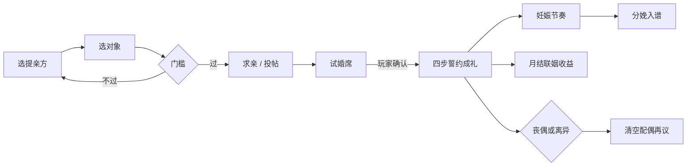

# 全员联姻设计（marriage-all-cast）

> 日期：2026-10-16  
> 状态：设计定稿；**P0 实现中 / 见 feat/marriage-all-cast-p0**  
> 用户硬需求：每个人都能娶/嫁，包括后招的佣兵；男女佣兵都算；**不能只男主/团长能结**。  
> 代码标识符保持英文；本文中文。

---

## 0. 一句话目标

联姻廷从「团长一人的政治试婚席」升级为「公司全员的婚约与家事席」：团长、战力佣兵、非战亲眷（属事处等）均可提亲、试婚、成礼、生子、丧偶/离异后再议；世界 NPC 婚约只做王朝氛围的背景账，不抢玩家操作。

---

## 1. 谁能娶谁（资格）

### 1.1 可婚主体（suitor / 提亲方）

| 类别 | 条件 | 说明 |
|---|---|---|
| 现任团长 | `is_leader`、存活、成年 | 与现行第零章春令试婚兼容 |
| 花名册佣兵 | `in_roster`、存活、成年、未退役 | 男女均可；后招的也算 |
| 非战亲眷 | 在堡、存活、成年；含配偶入族后未入战名册者、成长后的子嗣未授旗前、属事处任职者 | 靠私囊办婚，不强制进战斗编成 |
| 已授旗成年子嗣 | `age >= Calendar.ADULT_AGE`（现 15）、未退役 | 可自办婚，也可由玩家代办 |

**不列入可婚主体：** 未成年、已故、已退役且无特殊「遗族再议」旗标者、敌俘未入籍者。

### 1.2 可婚对象（target）

三类，UI 用页签分开：

1. **廷帖候选（Court posts）** — 现行 `marriage_candidates`：随落脚国刷新的外姓贵胄。性别相对**当前选中的提亲方**生成，不再相对团长。**仅后招佣兵等非主角团可「再议」刷帖。**
2. **同袍内婚（Company internal）** — 公司内另一名可婚主体；双方同意（见 §4 试婚）。
3. **剧情指名（Story-named）** — 圣经同伴（灯影、小弦等）走各自婚姻闸门；成功后写入同一套 `spouse_id`，不另开一套婚约表。

### 1.2.1 主角团 vs 后招：谁能刷廷帖（用户澄清 2026-10-16）

**硬规则：** 主角团这批人的姻缘对象是**主线固定**的（story-named），**不可**当成普通廷帖反复再议抽脸；后招佣兵等其他人的外姓候选**可以刷新，花银币即可**。

| 提亲方 | 判定 | 联姻廷候选 | 「再议」 |
|---|---|---|---|
| **主角团** | `is_leader` / `cast_key == "leader"`，或 `cast_key` 属于 `data/cast/companions_v92.json` 十二同伴 | 走**剧情指名**；团长第零章春令教学仍可持有一版廷帖快照（外交试婚），但**禁止再议刷帖** | **禁用**（提示：主角团走主线姻缘） |
| **后招佣兵 / 其他可婚主体** | 有花名册、无主角团 `cast_key`（如酒馆后招、属事处亲眷） | 外姓廷帖，性别跟提亲方 | **花银 + 月限再议**：每次 **15 银**（`COURT_REROLL_SILVER`），**每月最多 2 次**（`COURT_REROLL_MONTHLY_CAP`）；计数 `marriage_rerolls_used`，历月推进时清零 |

补充：

- 随机廷帖生成时不得带上十二同伴 / 具名主角的 `cast_key`（本来就不会；保持）。
- 十二同伴作提亲方时：廷帖列表可空，文案引导「主线姻缘，不在此刷帖」；具体指名对象随章节闸门解锁后进同一 UI（P2 把闸门接满）。
- `chapter0_flags["married"]` 仍只标记团长教学婚，与「能不能刷帖」无关。
- **防刷：** 首次进入/换提亲方的 `ensure` 不占月限；只有点「再议」才扣银并计次。月限 + 银价叠加以防无限刷到特别好的廷帖。
- **换季：** 后招本月挂着的三人廷帖，**下个月自动整批作废换新**（不扣银、不占再议次数）；主角团廷帖/主线对象不因此被刷。

### 1.3 硬门槛（`Lineage.can_propose` 扩展）

保留并泛化现有检查：

| 规则 | 默认 |
|---|---|
| 双方存活 | 必须 |
| 双方无现存配偶 | MVP 不可重婚；丧偶/离异后清空 `spouse_id` 才可再议 |
| 双方成年 | `age >= Calendar.ADULT_AGE` |
| 近亲 / 纸冕 / 血律壁垒 | 沿用 `CKBloodline.marriage_barrier` |
| 国别声望（外姓廷帖） | 仍按对象爵阶要邦交；**内婚与剧情婚可降一档或免邦交** |
| 聘礼银 | 外姓默认 40 + 婚仪；内婚减半或只付婚仪；可用提亲方**私囊**优先、不足再问旗库（见 §6） |

### 1.4 同性别婚（建议 + 默认）

| 项 | 决定 |
|---|---|
| **默认** | **异性婚**。廷帖候选与自动生成继续按提亲方的对立性别抽取（现状 `spouse_gender_for`，但改绑 suitor，不绑 leader）。 |
| **建议（可选开关）** | 设置「允许同袍同性别盟约」默认 **关**。开启后：同袍内婚允许同性别；**不走妊娠**，可记「盟约子嗣」走收养/指定继承人（P2+）；外姓廷帖仍默认异性，避免打乱血胤外交表。 |
| **理由** | 现行 `begin_pregnancy` / 基因组杂交 / 子嗣期望 UI 都假设父母双性；先保生育与外交闭环，同性别作后期扩展，不挡「全员可婚」主线。 |

### 1.5 派系与立场

- 公司内：默认同属灰旗，无额外派系检。
- 外姓：对象血胤所属国与现有联姻外交一致（`CKBloodline.marriage_effects`）。
- 敌对国廷帖：允许，但邦交门槛更高；成婚后走现有外交加减。

---

## 2. 玩家公司范围

「能结」的圈子 = 玩家能点到的人：

```
可婚池 = 现任团长
       ∪ 花名册在册佣兵（含后招）
       ∪ 族谱内成年未退役成员（含非战配偶、属事处亲眷、成年未授旗子嗣）
```

- **团长**：第零章春令试婚仍是教学主路径；`chapter0_flags["married"]` 只表示「团长已完成过一次教学婚」，**不再**充当全公司已婚总开关。
- **佣兵**：男女均可提亲；可娶外姓，也可互娶。
- **非战亲眷**：属事处任职者用私囊办婚；成婚后配偶默认不入战名册，可选手动招募或继续守堡创收（与 `purse.gd` / 属事处一致）。
- **纹章**：有 `family_id` 的显示族徽；无家族的显示**团徽（城堡旗）**。联姻不合并家族、不做个人差序（`heraldry-v2.md` §3.6）。外姓入族时：可加入提亲方家族，或 `found_family` 立新支（P1 再定默认：入提亲方家族）。

---

## 3. 世界 / NPC 婚约（王朝氛围）

| 层 | 要不要 | 做法 |
|---|---|---|
| 十国朝报里的贵族婚丧 | 要 | 朝报已有 `FilterMarriage`；扩展为随机短讯，**不生成可操作配偶** |
| AI 敌宅通婚 | 可要（P2） | `rival_houses` 态度微变；不进玩家联姻廷 |
| 同伴背着玩家自婚 | **不要**（默认） | 剧情婚必须玩家确认或圣经闸门；避免「灯影没打招呼就嫁了」 |

玩家只操作 §2 的池；世界婚约是只读新闻。

---

## 4. 流程：求亲 → 试婚 → 成礼 → 子嗣 → 离异/丧偶



### 4.1 求亲（Courtship）

- 外姓：从廷帖列表选人，「投帖」只锁定本月候选，不扣大银。
- 内婚：对同袍发起「议亲」；对方好感/羁绊不足时拒（可读 `Bonds.rank`，无羁绊则用固定「相识」门槛）。
- 剧情：走章节指令 / 同伴婚姻段，成功后跳到试婚或直接成礼。

### 4.2 试婚（Trial marriage）

与故事一致：「人先入席，喜欢不喜欢这一季不算」（`ch0-novel-arc-v92`、圣经）。

| 字段（建议） | 含义 |
|---|---|
| `blood_meta.trial_with` | 试婚对象 id |
| `blood_meta.trial_months` | 剩余试婚月（默认 1；第零章春令可 0=当月即成礼教学） |
| `blood_meta.marriage_phase` | `none` / `courting` / `trial` / `wed` / `widowed` / `divorced` |

试婚期：双方占用「准配偶」位（不可另娶）；可取消试婚（无子女、退部分聘礼）。  
第零章教学：可把试婚月压成 0，一键进誓约，保持现有 `_auto_marry` / 春令节拍。

### 4.3 成礼（Formal）

复用现行誓约四步 + 婚仪勾选（入牒礼 / 从母居 / 萤约 / 携霜契）+ 家训。  
`Lineage.marry(suitor, target, …)` **已支持任意 suitor**；改 UI 传入选中提亲方即可，不必重写核心。

### 4.4 子嗣

- 异性成礼：走 `CKFamilyState.begin_pregnancy` + 月结分娩（`fertility-v92`）。
- 同性别盟约（若开启）：不妊娠；P2 再开收养/指定。
- 子女 `family_id`：优先父方有家族则从父，否则从母（现行 `birth_child`）。

### 4.5 丧偶 / 离异

| 事件 | 处理 |
|---|---|
| 一方死亡 | `note_deaths` 已有钩子；清空对方 `spouse_id`，phase→`widowed`；私囊按 `purse` 寡妇/遗族规则 |
| 协议离异 | P1：双方在世、无妊娠中；扣声望与银；清空 `spouse_id`；子女保留双亲 id |
| 再婚 | 丧偶/离异后允许；MVP 仍一夫一妻 |

---

## 5. UI 入口（不能埋）

原则：首年六门里的「联姻廷」仍在；进门后**先选人，再选亲**。

| 入口 | 行为 |
|---|---|
| 城堡 · 家族区 · **联姻廷** | 主入口。顶栏下增加 **「提亲方」条**：头像横滑（团长默认选中；已婚者显示「已成婚」徽，点进去看配偶卡） |
| 花名册 · 个人卡 | 「议亲」按钮 → 带 `focus_id` 打开联姻廷 |
| 族谱总览 / 个人谱系 | 成年未婚：「去联姻廷」；已婚：跳配偶焦点 |
| 属事处 / 私囊页 | 非战亲眷旁「办婚」→ 同上 |
| 第零章春令 | 强制提亲方=团长；试婚教学文案不变 |

已婚视图（现行 `is_married_view`）：改为「**当前提亲方**是否已婚」，不是「团长是否已婚」。团长已婚后，仍可给其他未婚佣兵办婚——这是本设计与现状最大的行为差。

信息架构（联姻廷内）：

1. 提亲方选择条  
2. 页签：廷帖 | 同袍 | 剧情（有待办时亮）  
3. 三卡：提亲方 | 子嗣期望 | 对象  
4. 底栏：再议 / 投帖或缔约 / 义役（仅团长外姓婚保留「联姻义役」）

---

## 6. 数据模型相对现状的增量

### 6.1 已有、可复用

- `CKCharacter.spouse_id`、`parent_ids`、`children_ids`、`family_id`、`gender`、`pregnant_months`
- `Lineage.can_propose` / `marry` / `birth_child` / `heir_expectation`（逻辑已按 suitor/target，**未绑死 leader**）
- `GameState.marriage_candidates`、`CKFamilyState.refresh_marriage_candidates`
- 誓约 UI、婚仪、`house_mods` 家训、朝报婚姻过滤

### 6.2 缺口（相对「只有男主能结」）

| 位置 | 现状 | 目标 |
|---|---|---|
| `marriage.gd` | 几乎处处 `GameState.get_leader()` | 引入 `_suitor`；候选/缔约/已婚视图相对 `_suitor` |
| `CharacterFactory.make_marriage_candidate` | `spouse_gender_for(GameState.get_leader())` | `spouse_gender_for(suitor)`；刷新 API 带 suitor |
| `CKFamilyState.tick_doctrine_and_marriage_month` | 只给**团长配偶**月结士气/银 | 遍历所有 `spouse_id != ""` 的在世对，按是否在册给微收益（封顶防刷） |
| `economy_state` 联姻义役 | 要求 `leader.spouse_id` | 保留为**团长外交义役**；佣兵婚不走义役 |
| `campaign_sim` 自动婚 | 只婚 leader | 可选：为无偶成年名册角色低频自动试婚（世纪模拟用）；玩家局关闭 |
| `chapter0_flags["married"]` | 全局一布尔 | 保留教学旗；另用每人 `marriage_phase` |
| 私囊办婚 | 聘礼只扣 `GameState.silver` | P0：仍扣旗库；P1：优先 `purse`，不足问旗库并写账 |
| 同袍内婚候选 | 无 | 新列表 API：`CKFamilyState.internal_marriage_targets(suitor)` |
| 试婚字段 | 故事有、存档无统一字段 | `blood_meta.trial_*` / `marriage_phase` |

### 6.3 建议新增（轻量）

```text
# 存档兼容：缺省 = 旧档行为
blood_meta.marriage_phase: String   # none|courting|trial|wed|widowed|divorced
blood_meta.trial_with: String
blood_meta.trial_months: int
GameState.marriage_focus_id: String # UI 当前提亲方，不进关键模拟
```

不新增第二套 `spouse_id`；不合并家族。

---

## 7. 验收清单

- [x] **A1** 团长未婚时可走完整外姓誓约（回归第零章 / smoke / `auto_marry_check`）。
- [x] **A2** 团长已婚后，联姻廷仍可选择一名未婚男佣兵办婚，并成功写入双方 `spouse_id`。
- [x] **A3** 女佣兵作提亲方时，廷帖候选为男性；男佣兵反之。
- [ ] **A4** 同袍内婚：两名未婚名册角色可成礼；聘礼规则与外姓区分可见。
- [x] **A5** 花名册与族谱有「议亲 / 去联姻廷」入口；手机横屏可点（≥48dp）。
- [ ] **A6** 非团长成婚后，月结有收益或至少有族谱事件，且不破坏团长义役逻辑。
- [ ] **A7** 异性成礼可妊娠分娩；子女入谱、族徽/团徽规则正确。
- [ ] **A8** 一方死亡后，另一方 `spouse_id` 清空且可再议。
- [ ] **A9** 同性别：默认不可选；设置打开后同袍可选，且不触发妊娠（P2 可先做硬拒提示）。
- [x] **A10** 旧档：仅团长已婚 → 打开联姻廷不崩溃，可为其他人办婚。
- [x] **A11** `chapter0_flags.married` 仍只服务教学；全员已婚状态不以该旗为准。
- [x] **A12** 自动化：扩展 `married_view_check` / 新增 `all_cast_marry_check`（至少覆盖 A2、A3）。

---

## 8. 分阶段实现

### P0（必须可玩 · 修「只有团长能结」）

1. 联姻廷提亲方选择条；默认团长。  
2. `marriage.gd` / 候选刷新改绑 `_suitor`。  
3. 花名册「议亲」深链。  
4. 月结联姻收益泛化（带每月银/士气上限）。  
5. 测试 A1–A3、A5、A10–A12。  
6. **不**改誓约演出大结构；试婚字段可先只写 `marriage_phase=wed`。  
7. **主角团不可再议刷帖；后招花银再议每月最多 2 次，且下月三人自动换新**（§1.2.1）。

### P1（家事完整）

- 同袍内婚页签 + 羁绊门槛。  
- 试婚月与取消试婚。  
- 私囊优先付聘礼；属事处入口。  
- 协议离异；丧偶再婚文案。  
- 族谱「去联姻廷」按钮。

### P2（王朝味）

- 朝报随机贵族婚讯。  
- 设置：同性别盟约；收养/指定继承人。  
- 世纪模拟里非团长低频成婚。  
- 剧情同伴婚姻闸门统一进同一 UI。

### P3（打磨）

- 联姻廷信息降噪（feature-audit #34）。  
- 多对已婚的义役/外交分类账。  
- 手机专页布局再压一轮。

---

## 9. 与故事 / 文风

- 长篇与圣经：文学腔；联姻廷对白：白话短句（「人先入席，喜欢往后算」）。  
- 第零章春令仍是政治试婚，不写当夜情爱。  
- 佣兵互婚可以俗一点（「俩人自己说定了，堡里盖印」），与团长外交婚区分语气。

---

## 10. 现状代码速记（给实现的人）

| 文件 | 角色 |
|---|---|
| `project/scripts/hub/marriage.gd` | 提亲方条 + 主角团禁再议 / 后招花银再议 |
| `project/autoload/lineage.gd` | `can_propose` / `marry` 已通用 ← 少改 |
| `project/scripts/characters/family_state.gd` | 候选刷新、月结 ← 改性别源与月结遍历 |
| `project/scripts/characters/character_factory.gd` | `make_marriage_candidate` / `spouse_gender_for` |
| `project/scripts/company/purse.gd` | 私囊、属事处、遗族 |
| `project/scripts/company/economy_state.gd` | 联姻义役（保持团长外交） |
| `docs/design/fertility-v92.md` / `genealogy-v2.md` / `heraldry-v2.md` / `story-bonds-v92.md` | 旁路约束 |

---

## 11. 非目标（本设计不做）

- 重婚、多配偶。  
- 联姻合并族徽或个人差序。  
- 强制每个佣兵都结婚。  
- 把世界 NPC 婚约做成可点选恋爱模拟。

---

**签字意向（产品）：** 全员可娶可嫁；团长婚是外交主线，佣兵婚是公司家事；默认异性生育，同性别盟约为可选后期。
