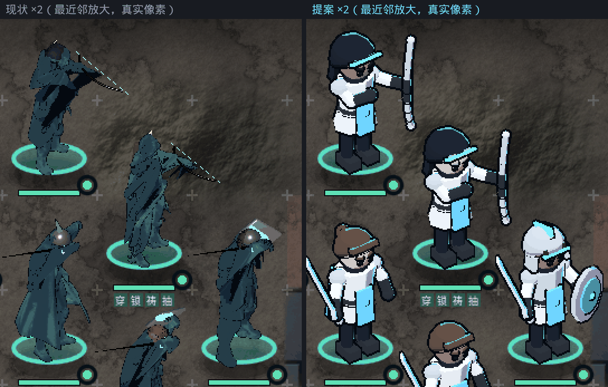
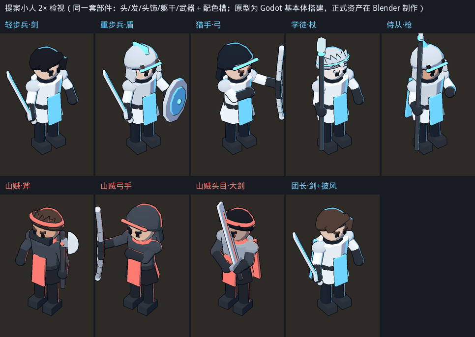
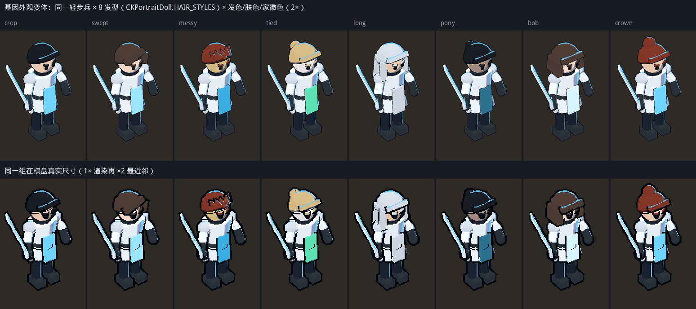

# 战棋棋子重做设计（pawn-redesign-opus）

> 状态：设计稿，只含文档和参考图，不改代码。
> 范围：战斗棋盘上的单位表现。演出（cutscene）、立绘、名册不在本稿改动范围内。
> 参考图：`docs/design/pawn-redesign-opus/`。图中"提案"一律是原型渲染，制作方式见附录 C。

## 0. 结论

1. **棋子不像人，根因在路线本身。** 现在是把为演出写实尺度做的混元模型（写实 7.5 头身、每人约 2 万面、碎片化 UV 贴图）缩到约 100px 高当棋子用。比例、姿态、贴图、描边、光照都是为演出尺度设计的，到棋盘尺度全部失效。#286、#296 都是在这条路上修补，每次修好一个问题又换来另一个：比如 `board_compact` 解决"发白"的办法是删掉全部色相，结果棋子变成了单色剪影。
2. **推荐方案 A：专为棋盘尺度设计的"棋盘小人"（board mini）。** 约 3.4 头身（不是 Q 版，成人五官、小眼睛），大头、大手、大武器；不用贴图，只用色块，加两阶冷色卡通着色和 2px 屏幕恒定描边；按部件拼装（头、发型、头饰、躯干、武器、披风）。部件由 Blender 脚本批量生成，Godot 按职业、阵营和基因组装并染色。沿用现有 18 根骨骼和武器原型动作，直接接进 #288 的实时单位层，#290 的行走、命中帧、伤害数字全部保留。
3. **原型已在真实战斗场景验证过。** 用同一相机、同一比例、同一底盘替换后，头、脸、躯干、武器一眼可分（图 1–3）。量化结果：人物像素里与地面明度差大于 0.15 的占比从 0.13–0.32 升到 0.47–0.85；人物内部明度跨度从 0.25 升到 0.78。
4. **手机端。** 每人不超过 1.5k 三角、1 个材质、无贴图，GPU 负担约为现在的 1/15。低端机走"开局烘焙一次的 2D 替身"，安卓默认就能看到人形棋子。现在安卓默认显示的是 #280 已被否决的胶囊棋子。
5. **需要拍板的一件事。** 风格锁禁止 chibi（Q 版）。本稿把棋盘小人定义为独立资产类 `board_mini`：3.2–3.6 头身、小眼、成人脸，色板和光向与风格锁相同，因此不属于 Q 版。演出和立绘保持原风格不变（§3.1）。


*图 1：桌面 1280×720，1:1 像素。左边是现状，右边是原型小人，两边使用同一个 `CKUnitLayer3D`（相机、缩放、脚点、2D 底盘和血条都相同）。*


*图 2：`CK_FORCE_MOBILE=1`，2400×1080，缩小到 50% 展示。单位层保持手机端的 0.8 渲染倍率。*



*图 3：图 1 的局部，用最近邻放大 2 倍，展示真实像素。*

---

## 1. 诊断：为什么现在的棋子不像人

### 1.1 量化

在棋盘真实尺寸下用 1× 渲染，与地面明度对比。明度按 sRGB 加权亮度计算（0–1）；地面取空白格的平均值，为 0.204。

| 指标 | 现状（混元 + `board_compact`） | 原型小人 |
|---|---|---|
| 棋子屏幕高度 | 约 1.3 格；桌面 CELL 为 71–104，即 92–135px | 1.25 格 |
| 头高 | 约 13–14px，常被兜帽或肩膀挡住 | 约 26px（CELL 71）到 31px（CELL 85） |
| 人物平均明度 / 地面明度 | 0.197 / 0.204 | 0.36 / 0.204 |
| 与地面明度差 > 0.15 的像素占比 | 0.13–0.32 | 我方 0.63–0.85，敌方 0.47–0.62 |
| 人物内部明度跨度（p90 − p10） | 0.18–0.33，平均 0.25 | 0.56–0.89，平均 0.78 |
| 描边在屏幕上的宽度 | 0.006m，约 0.3px | 2px |
| 每人三角面数 | 约 2.03 万，加一遍描边 | 原型 3.2k–3.9k（基本体，未优化）；正式目标 0.8k–1.5k |


*图 4：灰度加模糊的"眯眼测试"。现状的棋子融进地面；原型的头、身、腿分成了三段明度。*

### 1.2 逐项原因

1. **比例。** 混元模型是写实 7.5 头身，头高约占身高的 13%。棋子 100px 高时，头只有约 13px，脸只有 6–8px。再加上 38° 俯视，头顶和肩膀会挡住脸。这是尺度问题，贴图做得再好也救不回来：图 5 放大到 2 倍后，现状棋子依然读不出是人。
2. **单色剪影。** `CKUnitLayer3D._solidify_board()` 打开了 `board_compact`；`toon_body_v87.gdshader` 在这个分支里执行 `base = fill_color.rgb * form`，把全部色相替换成填充色。皮肤、头发、金属、布料变成同一种颜色，画面上只剩剪影。
3. **太暗，和地面同一个明度。** 最终颜色约等于"填充色 × 形体系数 × 光照"。形体系数是 `0.35 + 0.9 × 贴图亮度`，贴图平均亮度 0.27，所以约为 0.59。光照由环境光 0.65 加一盏暖色太阳组成，暗面 ramp 是 `shadow_tint × 0.55`，约 0.09–0.14。三者相乘后只剩填充色的 31%–47%，实测人物平均明度 0.197，地面是 0.204。
4. **贴图不适合小尺寸。** 26 个混元 GLB 的身体都是一整块网格（约 2 万面），配一张 1024² 贴图。贴图是碎片化 UV，每张图上有上百个小岛；平均亮度 0.27，平均色度只有 0.12。在棋子上，一个屏幕像素要覆盖约 10×10 个 texel，mip 会把相邻 UV 岛的颜色平均成一团灰（图 6）。#286 补洞、#296 换修复版贴图，都改变不了这一点。
5. **姿态和朝向。** 动作原型的 `READY` 姿态胸部前倾 4°，`advance` 前倾 12°，混元模型本身也偏驼背。待机时偏航 62°，接近侧面，脸背离相机。
6. **武器读不出来。** 混元模型的身体和武器是分开的，武器是后加的简单几何体：弓是圆环（Torus），枪是圆锥，再加 grip、haft 圆柱，在屏幕上只有 1–2px 粗。武器材质是 `metallic 1.0`，在没有反射环境的单位层里渲成近黑；学徒和祭司的 GLB 干脆没有武器网格。P3 的职业部件挂在固定的模型坐标上（比如敌方圆环在 `(0, 1.74, 0.12)`），换个体型就会漂成"光环"。
7. **描边和抗锯齿。** 风格锁的描边规格 0.006m 是按 720p 演出定的（约 1px），到棋盘尺度只剩约 0.3px。#296 为了避免透明合成产生鬼影，又关掉了 MSAA。结果是既没有轮廓，边缘还有锯齿。
8. **光照与风格锁冲突。** 单位层太阳光是暖色 `(1.0, 0.95, 0.88)`，而风格锁要求冷白主光、禁止暖光。
9. **阵营色和家徽色都映射错了。** 敌方棋子的填充色取自主题 `trim` 的色相（`UnitModel.fill_color_for`：`Color.from_hsv(trim.h, 0.58, 0.55)`）。22 个敌人主题里，只有 4 个的 `trim` 是珊瑚色；3 个用了风格锁规定"只能做火花"的 `#FF8A3D`，敌人会被染成橙色；其余 15 个落在我方色系：薄荷 4 个，霜青、霜青悬停、霜青按下共 7 个，另外 4 个是霜银、霜白、灰蓝这类低饱和色。公式把饱和度固定拉到 0.58，低饱和色的色相约 210°，结果也被染成钢蓝。这 15 个主题的敌人在棋盘上和我方是同一色系。我方的问题方向相反：填充色取 `UnitArt.crest_color()`，它优先返回旗号的旗底 `field_a`，而新建旗号的旗底统一是灰烬灰 `#6E7276`（玩家选的颜色存在 `charge_color` 里）。灰色算出来的色相固定约 210°，所以新存档里每个家族的我方棋子都是同一种钢蓝色，玩家选的家徽色不会出现在棋盘上。
10. **覆盖不全。** 32 个职业里只有 9 个有专属外观模型（每个职业一档外观、男女各一，共 18 个 `outfit_*_t1_*.glb`），晋升后外观不变，其余职业都落回 6 个程序化替身。22 个敌人主题共用 4 个敌人 GLB 和若干我方外观。
11. **手机默认显示胶囊。** #292 把手机端 3D 默认关掉了；关掉后，`battle_controller.gd` 的 `_draw_map` 回退到 `UnitArt.draw_token_on`，画出来的就是 #280 已被否决的胶囊棋子。手机必须关 3D，原因也在模型本身：每人 2 万面加一张 1024² 贴图再加描边 pass，16 人约 65 万三角。


### 1.3 根因

上面第 1–7、10、11 条都出自同一个决定：**拿演出模型兼任棋子**（第 8、9 条是单位层灯光和配色映射的问题，与模型无关，但新方案自带的光照和配色槽会一并修掉，见 §3.5、§3.6、§3.8）。演出模型要在近景里经得起看，所以必须写实、细节多、贴图大；棋子要在 100px 里一眼读出"人、武器、敌我"，所以必须夸张、色块大、轮廓硬。两种需求方向相反。继续在演出模型上修补，只能在"发白"和"单色"之间来回换。棋子需要一套为棋盘尺度单独设计的资产。演出模型继续留给演出用。

---

## 2. 三条路线


*图 7：同样三个单位（剑士、弓手、山贼）在棋盘真实尺寸下的样子，最近邻放大 2 倍。B 用的是由 A 烘焙出的 48px 像素精灵（B2 的示意），C 是写实比例、厚底座、柔和涂装。*

### A. 专用 3D 棋盘小人（推荐）

做法：实时 3D 的低面数小人，按部件拼装；平涂色块，两阶卡通着色，加屏幕恒定描边。保留现有的实时单位层、行走、命中帧和伤害数字。

- 优点：可读性最高，且动作完整；基因染色是天然支持的（配色槽直接取表型色，8 款发型就是 8 个部件）；包体小；手机负担小；与 #288–#296 的投入兼容，只换模型来源。
- 缺点：风格锁要加 `board_mini` 例外（比例、描边宽度、平涂）；短手短腿需要调整动作原型的姿态。

### B. 2D 精灵表（HD-2D 式）

做法：每个职业一套逐帧精灵，2D 直接画在棋盘上，不再使用 3D 单位层。分两种：B1 手绘像素；B2 由 A 的 3D 套件离线烘焙。

- 优点：最终画面完全可控，B1 手绘品质上限最高；运行时最便宜，是纯 2D。
- 缺点：B1 工作量极大，约 32 职业 × 2 性别 × 38 帧 × 2 朝向，约 5k 帧手绘，没有美术团队做不完，AI 生成又难以保证逐帧一致；基因染色要做调色板索引加分层，8 款发型 × 全部帧会数量爆炸；包体增加约 10–20MB，而非基因库部分的预算（`export_base_budget_bytes`）当前只剩约 0.9MB；#288 的 3D 层和 #290 的动作要推倒重来。B2 本质上依赖 A 的套件，所以它适合作为 A 的低端档（§3.9），不适合单独作为一条路线。

### C. 桌游手办

做法：写实比例的静态雕像放在厚底座上，涂装感材质；移动用滑行、跳跃、倾斜这类程序化动作代替骨骼动画。

- 优点：桌游棋子的隐喻很直观；底座同时提供了阵营色和接地感；运行时是最便宜的 3D（静态网格，无蒙皮）。
- 缺点：没有解决比例问题。写实比例下头依然小（图 7 下排），一旦夸张比例，就和 A 趋同；厚底座要占掉格子面积，和现有的 2D 底盘、血条、地形高亮抢位置；"涂装手办"是实体玩具的隐喻，与"当代奇幻、精修插画"不一致；#290 的行走和命中动作作废，战斗失去生命感。

### 对比

| 维度 | A 专用 3D 小人 | B 2D 精灵表 | C 桌游手办 |
|---|---|---|---|
| 一眼像人 | 强 | B1 强 / B2 强 | 中 |
| 动作与生命感 | 保留 #290 全部表现 | 取决于帧数 | 弱（只有程序化位移） |
| 工作量 | 中：脚本化套件加数据表 | B1 极高 / B2 中高（依赖 A） | 中 |
| 风险 | 中：需风格锁例外、动作调姿 | 高：逐帧一致性、染色分层 | 中高：比例问题未解决 |
| 手机性能 | 好；低端机用烘焙替身 | 最好，但显存随帧数增长 | 好 |
| 与风格锁一致 | 色板、光向、描边色一致；比例和线宽需例外 | B1 像素风冲突；B2 同 A | 玩具隐喻冲突 |
| 基因染色 | 直接取表型色 | 需调色板索引加分层 | 同 A |
| 包体增量 | 约 1–1.5MB | 约 10–20MB | 约 1–2MB |
| 与现有系统 | 只替换单位层的模型来源 | 3D 层作废，改回 2D 管线 | 复用单位层，动作作废 |

### 为什么不继续修补现有模型

把 `board_compact` 关掉、换更好的贴图、加大 `FIG_CELLS`，都只能改善第 2–4 条，第 1、5、6、7 条（比例、姿态、武器、描边）原样保留。#283（预渲染演出模型，结果发白）和 #296（实心单色）已经把这条路的两个极端都试过了。重新用混元生成也不行：风格锁禁止 Q 版提示词，而它的输出是一整块 2 万面的三角面汤，没法按部件分别染色。

---

## 3. 推荐方案 A：资产规格

### 3.1 风格锁修订：新增资产类 `board_mini`

在 `style-lock-v89.json` 和 `style-lock-v87.md` 中新增 `board_mini` 一类，只适用于棋盘单位：

| 项 | 演出 / 立绘（不变） | `board_mini`（新增） |
|---|---|---|
| 比例 | 写实 | 3.2–3.6 头身。禁止 2–2.5 头身、大眼、腮红、动漫高光（即 chibi） |
| 五官 | 写实 | 成人脸；眼睛是两个深色小块，眉毛是斜线，没有嘴或只有 1px 嘴线 |
| 着色 | 喷绘感、柔和过渡 | 平涂，两阶加 1 道顶面提亮；阴影用冷色乘 `(0.60, 0.66, 0.80)` |
| 描边 | 0.006m，约 1px@720p | 屏幕恒定 2px（以逻辑分辨率计），颜色 `#0A0E14`；内部不加线 |
| 光向 | `(-0.55, 0.65, 0.52)` | 相同 |
| 边缘光 | 霜青 / 珊瑚，从右后方 | 相同，但改为硬边阈值 |
| 色板 | 风格锁色板加基因色 | 相同，见 §3.5 |
| 相机 | 演出 28–34° FOV | 正交，俯仰 38°（与单位层一致） |

理由：100px 高的人物，喷绘渐变会糊成一片，1px 线压不住纹理复杂的地面；只有加大头身比例和线宽，"人"这个信号才能留下来。修订只放宽这三项，色板、光向和禁用项（金色、暖光、哥特元素等）全部照旧。

### 3.2 比例与造型


H 指发顶到脚底的高度。模型空间里 H = 1，导出时按 1.85m 缩放，这样单位层现有的缩放公式不用改。

| 部位 | 规格 |
|---|---|
| 头 | 高 0.29H，宽 0.28H，约 3.4 头身。下巴上抬 6°，抵消 38° 俯视 |
| 眼、眉 | 眼 0.022×0.026H，两眼间距 0.08H；眉长 0.044H，斜 10° |
| 颈 | 0.06H，被领口遮住一半 |
| 躯干 | 肩线 0.67H；肩宽（含肩甲）0.40H；腰带 0.47H；胸厚 0.20H |
| 手臂 | 上臂半径 0.040H，前臂 0.037H；手 Ø0.09H（夸张 1.5 倍，握持关系要读得出） |
| 腿 | 胯 0.36H；腿半径 0.046H；站距 0.14H；靴子 0.09×0.07×0.15H（加重接地感） |
| 武器 | 剑 0.55H，大剑 0.65H，长枪 1.45H，弓 0.75H，杖 1.1H 加杖头 0.13H，盾 Ø0.36H，斧柄 0.6H 加斧刃 0.24H，旗杆 1.5H 加旗面 0.35×0.28H。武器整体按写实尺寸放大 1.3–1.5 倍 |
| 姿态 | 直立不驼背；武器放在展示位（剑斜持在身体外侧，不藏在身后）；敌方镜像成左手持械，保证武器永远在相机一侧 |

造型原则：

- **剪影优先。** 把小人涂成纯黑，在 1× 下仍要能分出 9 条造型线（§3.3）。
- **三段明度。** 头（肤色和发色）、躯干（浅色外套或护甲）、腿（深色裤靴）三段明度要分得开。深色腿负责接地，浅色上身负责从地面上跳出来。
- **大块面。** 最小可见特征不小于 0.02H，在 CELL 71 时约 2px。比这更小的细节一律不做。
- 原型只是 Godot 基本体拼出来的验证品（图 9），正式部件要在 Blender 里做出倒角、锥形四肢、发型体块和手型，品质必须高于原型。



### 3.3 形状语言：职业、阶位、阵营

- **职业线靠"头饰 + 武器 + 躯干"三者组合区分**，不靠颜色。`jobs.json` 有 8 条晋升线（8 个 t1 职业）；学徒秘术到 t2 分成秘术士和祭司两支，两者战场职能不同，造型也分开，所以共 9 条造型线。基础组合：骑手（羽盔、骑枪、短披风），轻步（露发、单手剑），重步（全盔、盾），猎手（兜帽、弓、箭袋），秘术（发带、长杖），祭司（长兜帽、灯杖、长袍），乡勇（斗笠、短矛），执旗（旗杆、旗面用家徽色），侍僧（短袍、手铃或书）。完整映射见附录 A。
- **阶位越高越华丽。** t1 是布衣或轻甲；t2 加肩甲、头盔或短披风；t3 加一个标志件（长披风、冠饰、霜纹发光线 ×2、武器升级）。在棋盘上就能看出晋升。
- **阵营色槽锁死。** 我方的主色、饰线、边缘光用家徽色和霜青，点缀用薄荷；敌方一律用珊瑚和炭灰。敌人主题只能影响布料、护甲、皮革三个槽，外加一个"主题标志件"（如斗笠、毛领、面具、提灯），不能改阵营槽。这样就修掉了 §1.2 第 9 条的敌方部分；我方家徽色撞上珊瑚的情况由 §3.8 规则 4 处理。
- **敌方轮廓差异。** 敌方用头巾、面罩、兜帽这类我方不用的头部轮廓，加上镜像持械。色觉模式下即使颜色合并，也能靠形状分辨敌我（风格圣经"敌我"一节："色觉模式改色板，形状不变"）。
- **首领。** 整体放大 1.10–1.15 倍，加独有头饰，珊瑚发光线 ×2，高度不超过 1.4 格。

### 3.4 面数、骨骼、网格

| 项 | 预算 |
|---|---|
| 每人三角面 | 0.8k–1.5k，硬上限 2k。参考分配：身体加头 500–700，发型 80–200，头饰 60–150，武器 40–150，披风 20–60 |
| 网格 | 组装后合并成 1 个 ArrayMesh，即 1 个 draw call，加 1 遍描边 pass |
| 骨骼 | 沿用 `build_standins_v86.py` 的 18 根骨骼和骨骼名；关节位置按新比例重摆 |
| 蒙皮 | 刚性蒙皮，每个部件 100% 绑在一根骨骼上 |
| 倒角 | 箱体边缘 1 段倒角，用来接住顶面提亮；不做细分 |
| 法线 | 着色用硬边；另把平滑法线烘进 `UV2` 或自定义通道，专供描边外扩用，避免硬边处描边开裂 |
| 贴图 | 0 张 |

### 3.5 材质与配色槽

只用一个着色器 `board_mini.gdshader`（unshaded，自带光照计算）。顶点色编码配色槽和描边参数：`COLOR.r` 是槽号（÷16），`COLOR.g` 是发光标记，`COLOR.b` 是描边宽度系数（眼、眉、饰线设为 0）。每个单位一份 `ShaderMaterial`，通过 `uniform vec4 palette[16]` 传颜色。最多 16 个单位就是 16 份材质，不依赖 instance uniform，所以在 Vulkan Mobile 和 OpenGL 回退下行为一致。

| 槽 | 我方 | 敌方 | 来源 |
|---|---|---|---|
| skin 皮肤 | 表型 `skin_color` | 同左 | `CKGenome.phenotype` |
| hair 头发 | 表型 `hair_color` | 同左 | 同上 |
| eye 眼眉 | `#141820` | 同左 | 固定 |
| coat 外套 | 霜白 `#E6ECF3` | 炭灰，亮度 ≥ 0.30（例如 `#4A5361`） | 职业表 / 主题 |
| armor 护甲 | 霜银 `#C9D3DE` | 枪灰 `#9AA4B2` | 同上 |
| under 内衬、裤 | 墨蓝 `#1C2330` | `#20252D` | 固定 |
| leather 皮革、靴 | `#2A3038` | 同左 | 固定 |
| primary 罩袍、披风、旗面 | 家徽主色（建旗时从 `heraldry_v2.json` 的 24 种颜色中选）；落在暖色相时改用霜银，见 §3.8 规则 4 | 珊瑚 `#FF7A70` | `GameState.banner_spec`（取法见 §3.8）/ 阵营 |
| trim 发光饰线 | 霜青 `#6ED4FF` | 珊瑚 | 阵营（色觉模式取 `Frost.palette()`） |
| accent 小点缀 | 薄荷 `#5EE0B5` | 珊瑚 | 阵营 |
| blade 刃 | `#DCE5EE`（浅色，不用 metallic） | 同左 | 固定 |
| wood 柄 | `#3A3F4A` | 同左 | 固定 |
| gem 法器发光 | `#9BE4FF` | 珊瑚 | 阵营 |

明度分层：深色槽（under、leather、eye）亮度 ≤ 0.12；中间槽（皮肤、护甲）0.35–0.70；浅色槽（我方外套、刃）≥ 0.75。地面约 0.20，所以深色腿靠描边分开，浅色上身直接跳出来。敌方外套偏暗，要靠珊瑚罩袍、边缘光、肤色和浅色武器把"分离度"（§6.1）拉到 0.5 以上。原型里的敌方弓手只有 0.47，所以把敌方外套亮度下限定为 0.30，并加宽珊瑚罩袍。

### 3.6 描边、光照、相机、格内尺寸

- **描边**：反向外壳（cull front），在裁剪空间按 `VIEWPORT_SIZE` 外扩，保证屏幕上恒定 2px（以 1280×720 逻辑分辨率为准）。手机上单位层有 0.8 渲染倍率，描边按倍率补偿到 2.5px。颜色 `#0A0E14`。
- **光照**：着色器内部固定主光方向 `(-0.55, 0.65, 0.52)`（世界空间），不吃场景灯，所以单位层的暖色太阳不再影响棋子。亮面取原色，暗面乘 `(0.60, 0.66, 0.80)`，过渡宽 0.1；顶面加 10% 提亮；边缘光在 fresnel > 0.62 且朝向右后方时硬切，强度 0.85，颜色我方霜青、敌方珊瑚；发光饰线乘 1.35。
- **状态**：`dim`（已行动）去饱和 60%、压暗 25%，对应现有的 `ck_dim`；`flash`（受击）白闪 80ms；`select`（选中）由 2D 高亮负责，3D 端只播一个小跳动作。
- **相机**：正交、俯仰 38°、`PX` 100，都不变。待机偏航从 62° 改为 ±35°：我方朝右，敌方朝左，两边都略朝向相机。
- **格内尺寸**：屏幕高 1.25 格（`FIG_CELLS` 不变，小人的 `ck_base_scale` 取 0.96）。脚点不变，仍在格内 `CELL × 0.62` 处。身体宽 ≤ 0.6 格，含武器 ≤ 0.85 格；长枪、旗杆可以伸进上一格不超过 0.3 格。保留现有的 2D 阵营底盘（薄荷 / 珊瑚圆环）、接地阴影和血条。
- **抗锯齿**：维持 MSAA 关闭（#296 的结论不变）。平涂加粗描边在无 MSAA 下呈现干净的硬边，图 1–3 就是无 MSAA 的效果。

### 3.7 动作集

沿用 `anim_archetypes_v92.py` 的 8 个动作和命中帧时刻。关键帧只有旋转，与比例无关，所以可以直接套到同名骨骼上。另外新增棋盘专用的覆盖姿态，以及 4 个新原型。

| 动作 | 时长 | 要点 |
|---|---|---|
| idle 待机（循环） | 1.6s | 直立，武器在展示位，呼吸起伏 ±1% 高度，头轻摆 2°；胸部前倾覆盖为 0° |
| advance 行走（循环） | 0.52s/步 | 腿摆 ±25°，臂摆 ±15°，前倾 ≤ 6°；移动速度沿用 `WALK_CELLS_S` |
| attack 攻击 | 0.9s | 命中帧 0.458s，与 2D 特效同步（`impact_delay`） |
| skill 战技 | 1.2s | 命中帧 0.792s；杖头和武器微光 |
| crit 暴击 | 1.0s | 命中帧 0.5s，叠加 hit-stop |
| hit 受击 | 0.35s | 后仰 10°，加 `flash` |
| dodge 闪避 | 0.4s | 侧跳 0.15 格 |
| death 阵亡 | 0.9s | 后倒，之后沿用现有的 1.4s 淡出 |
| select 选中（新增） | 0.25s | 小跳并举起武器 |

- 新增原型：`axe`（山贼单手斧）、`banner`（执旗线）、`dagger`（散兵、寻路人）、`book`（咏者、唱诗）。
- 动作风格采用"关键姿态加停顿"（pose-to-pose）：每个动作 2–3 个关键姿态，命中帧停 1 帧。小尺寸下，干脆的姿态比细腻的过渡更好读。
- 短手臂的双手武器（枪、大剑、弓）要在原型 JSON 里加 `board` 姿态覆盖，保证双手确实握在武器上。

### 3.8 基因染色与配色保护

- **发型**：`CKPortraitDoll._style(c)`，与立绘、演出头发模块共用同一组 8 款（crop、swept、tied、messy / long、pony、bob、crown），所以同一个人在立绘、演出和棋盘上发型一致（图 10）。
- **颜色**：皮肤和头发取 `CKGenome.phenotype`。家徽主色取旗号里玩家选的颜色：旗底 `field_a` 是灰烬灰 `#6E7276`（新建旗号）时取 `charge_color`，否则（旧存档迁移来的旗号）取 `field_a`；外姓角色用所属家族的纹章。不要直接用 `UnitArt.crest_color()`，原因见 §1.2 第 9 条。
- **年龄**：`age_stage` 为老年时头发降饱和，身高 ×0.97。眼色和胎记在棋盘尺度看不见，不做；荣誉（领针、冠饰）体现为 t3 饰线。
- **保护规则**（组装时自动执行）：
  1. 发色与外套明度差 < 0.12（例如霜银发配白外套，见图 10 的 long 列）时，领口改用深色，头发描边系数提到 1.5。
  2. 家徽主色与外套明度差 < 0.15 时，罩袍加一圈深色边。
  3. 敌方除皮肤、头发外的任何槽，都不许落在"我方色域"：色相 150–220°（覆盖薄荷 160°、霜青 196–198°、钢蓝 210–216°）且色度 max−min > 0.15。落进去就回退到炭灰。用色度而不用饱和度，是为了放过墨蓝 `#1C2330` 这类很暗的布料（饱和度 0.42，色度只有 0.08）。现有 22 个主题的 66 个布料、护甲、皮革槽都不会被拦下，这条规则只防以后新增的主题。
  4. 我方的 primary、trim、accent 槽不许落在"敌方色域"：色相 0–30° 或 340–360°（覆盖珊瑚、赤霞、ember）且色度 > 0.15。建旗色板里的"珊瑚"`#FF7A70` 和"赤霞"`#FF8A80` 都会命中。命中时罩袍和披风改用霜银，家徽主色只用在胸口徽记、旗面纹章这类小面积上（每块不超过约 30 像素）。



### 3.9 手机分档

| 档 | 条件 | 表现 |
|---|---|---|
| 实时 3D 小人 | 桌面；中高端安卓（P3 性能门禁通过后默认开） | 本节全部规格。空闲时单位层以 12–15Hz 刷新（与 [#289](https://github.com/wuyongjia666-droid/CenturyKnights/pull/289) 提出的约 12Hz 棋盘脉冲重绘对齐；#289 尚未合并），行走和攻击时满帧 |
| 烘焙替身 | `DeviceProfile.is_low_end()`；单位数 > `MAX_UNITS`；用户关闭 3D | 开局时用一个离屏 SubViewport，把每个单位的小人渲染成 2D 精灵（待机 1 帧，朝右，朝左时镜像），按外观哈希缓存到内存和 `user://`；2D 直接绘制。替换掉所有胶囊棋子，包括棋盘回退、触控确认的虚影和名册 |

16 个单位时：三角面 ≤ 2.4 万，加描边 ≤ 4.8 万（现状约 65 万）；单位层 draw call ≤ 40（现状每人约 6–10 个：身体、描边、武器、头发模块、P3 部件）；贴图显存为 0（现状 16 张 1024²）。替身档的显存约为 16 × 160² × 4B，约 1.6MB。小人便宜之后，`MAX_UNITS` 可以从 16 提到 24（手机）和 32（桌面）。

---

## 4. 生产管线

### 4.1 Blender 套件生成器

新脚本 `tools/models/board_minis_v1.py`（Blender 4.2，无界面运行），沿用 `build_standins_v86.py` 的写法：

- **身体**：`m` 和 `f` 两种，肩宽和胯宽略有不同；外加一个 `heavy` 加宽体型给重甲用。
- **部件库**：头 2 款；发型 8 款，每款带一个"戴盔时只露刘海"的变体；头饰约 10 款（盔、羽盔、兜帽、发带、斗笠、头巾、面罩、目镜、书生帽、首领冠饰）；躯干 6 款（布外套、板甲、长袍、皮背心、山贼背心、军官外套）；披风 3 款；武器约 14 款（剑、大剑、锤、骑枪、短矛、弓、长弓、杖、灯杖、书、手铃、短刀、斧、盾 2 款、旗）。
- **每个部件写入**：顶点色（槽号、发光标记、描边系数）、平滑法线通道、刚性骨骼权重、挂点。
- **人工精修通道**：美术可以在 `tools/models/board_parts/` 放同名 `.blend` 部件覆盖脚本生成的版本，脚本优先使用人工件。
- **导出**：`assets/models/board/board_kit_v1.glb`，加上清单 `board_kit_v1.json`，记录部件、骨骼、槽位和三角面数。
- **动作**：扩展 `anim_archetypes_v92.py`，加入 `board` 姿态覆盖和 4 个新原型，产出 `assets/models/board/anim_board_v1.res`，复用现有的 Godot 动作库构建流程。
- **QA 渲染**：同一个脚本可以输出正视、侧视、3/4 转台图，给美术快速过目。

### 4.2 数据表

新建 `data/board_minis.json`。它是唯一的映射来源，`UnitModel.JOB_ANIM` 只留给演出用。

```json
{
  "jobs": {
    "light_inf": {"body": "std", "torso": "coat", "head": "none", "weapon": "sword", "arch": "sword", "cape": null, "tier": 1},
    "warrior":   {"body": "std", "torso": "coat_pauldron", "head": "band", "weapon": "greatsword", "arch": "heavy", "cape": null, "tier": 2}
  },
  "enemy_templates": {
    "bandit": {"torso": "bandit_vest", "head": "wrap", "mask": true, "weapon": "axe", "arch": "axe"}
  },
  "enemy_themes": {
    "snow": {"signature": "fur_collar", "kit": {"melee": "militia", "ranged": "hunter", "elite": "light_inf"}}
  },
  "cast": {
    "leader": {"cape": "long", "weapon": "sword"}
  }
}
```

### 4.3 Godot 组装器与着色器

- `scripts/art/board_mini.gd`（`class_name CKBoardMini`）：
  - `spec_for(u)`：从数据表、表型、家徽、阵营、主题、阶位算出部件和配色。
  - `build(spec)`：先实例化骨架，再挂部件，然后合并成单个 ArrayMesh（带蒙皮），挂上 `AnimationPlayer`（动作名与现有的一致）。
  - 按外观哈希做 LRU 缓存（64 个），重进战斗不重复构建。
  - 执行 §3.8 的配色保护规则。
- `shaders/board_mini.gdshader`：着色器本体和描边 pass，参考实现见附录 B。

### 4.4 接入现有单位层

- `unit_layer_3d.gd` 的 `sync()` 里，把 `UnitModel.instantiate` + `CKUnitSilhouette.apply` + `_solidify_board` 换成 `CKBoardMini.build`。`st.anim` 取小人的 `AnimationPlayer`，所以 `_play`、`act`、`impact_delay`、路径行走、hit-stop、伤害数字都不用改。
- `unit_art.gd` 的 `draw_token_on` 和 `token()`：有烘焙替身时画替身，不再画胶囊。
- `battle_controller.gd` 不改。它现在 2999 行，有 3000 行门禁，新逻辑全部放进新文件。
- 演出、立绘、名册转台继续使用混元模型。名册是否改为显示棋盘小人，列为开放问题。

### 4.5 QA：样张、指标、门禁

- `tests/suites/battle/board_mini_check.gd`（无界面可跑）：检查 32 个职业和全部敌人模板都有映射；每个组合的三角面 ≤ 2k、网格 1 个、材质 1 个、贴图 0 张；敌方配色槽不落在 §3.8 规则 3 的"我方色域"；用建旗色板的全部 24 种颜色逐一组装，我方 primary、trim、accent 槽不落在规则 4 的"敌方色域"。
- `tests/suites/battle/board_mini_shots.gd`（Xvfb + `--rendering-driver opengl3`，在本 VM 上已验证可行）：输出 32 职业 × 2 性别 × 我方/敌方的 1× 和 4× 样张；在真实战斗场景里截桌面和手机的 A/B 图；生成 `metrics.json`。
- `tools/ci/board_mini_gate.py`：按 §6.1 的门槛判定。`scripts/board_mini_gate.sh` 仿照 `mobile_gate.sh` 编写。

---

## 5. 分期实施

| 期 | 内容 | 改动面 | 验证 | 主要风险 |
|---|---|---|---|---|
| P0 规格 | 风格锁加 `board_mini`；`data/board_minis.json` 初版；`board_mini_gate.py` 先给现状建立基线 | 文档、数据、工具 | 基线数值与 §1.1 一致 | 风格例外是否被接受 |
| P1 套件和静态接入 | Blender 生成器；8 个 t1 职业的部件，加山贼套；`CKBoardMini`；着色器；单位层替换；烘焙替身取代胶囊；`export_base_budget_bytes` 上调约 2MB | 新文件为主；改 `unit_layer_3d.gd` 和 `unit_art.gd` 少量代码 | 样张、门禁、桌面和手机 A/B 截图；`unit_layer_check`、`board_pawn_check` 更新 | 部件品质不如原型；包体 |
| P2 动作 | 重摆骨架；原型 `board` 覆盖；`axe`、`banner`、`dagger`、`book`；`select`、`flash`、`dim`；命中帧与 2D 特效对齐 | 工具、动作库、着色器参数 | `pawn_shots --seq` 逐帧检查；命中帧误差 ≤ 1 帧 | 短手臂握持穿插 |
| P3 手机 | 空闲 12–15Hz 刷新；中高端安卓默认开实时 3D，低端默认替身；`MAX_UNITS` 上调；手机门禁 | `unit_layer_3d.gd`、`device_profile.gd`、设置项 | §6.3 实机帧率；`CK_FORCE_MOBILE` 截图门禁 | 透明 SubViewport 的合成开销 |
| P4 覆盖 | 32 职业的 t2/t3 装饰；22 个敌人主题的标志件；首领；主角团专属件；退出 P3 职业部件和 `board_compact` 的棋盘路径 | 数据和部件为主 | 全职业样张，剪影区分 IoU | 工作量膨胀（靠数据驱动控制） |

P1 就要包含烘焙替身。这样安卓用户在第一期就能告别胶囊棋子，不必等到 P3。

---

## 6. 验收标准

### 6.1 自动指标

测量条件：桌面 1280×720，最差格子 CELL 71（12×8 地图），1× 渲染。

| 指标 | 门槛 | 现状基线 | 原型 |
|---|---|---|---|
| 头高（发顶到下巴） | ≥ 20px | 约 13px | 约 26px |
| 分离度：与地面明度差 > 0.15 的像素占比（每个单位） | ≥ 0.50 | 0.13–0.32 | 0.47–0.85 |
| 人物内部明度跨度 p90 − p10 | ≥ 0.50 | 0.18–0.33 | 0.56–0.89 |
| 武器可见像素（武器槽 ID 通道） | ≥ 60px | P0 建立基线 | P1 测量 |
| 职业剪影区分：9 条造型线 1× 黑色剪影两两 IoU | ≤ 0.80 | — | P1 测量（P4 覆盖全部） |
| 阵营色：敌方像素（皮肤、头发除外）落在 §3.8 规则 3"我方色域"的占比 | ≤ 1% | 22 个主题中有 15 个的敌人整体被染成该色系 | 0 |
| 阵营色：我方 primary、trim、accent 槽像素落在规则 4"敌方色域"的占比，24 种家徽色逐一测 | ≤ 1% | 现状我方恒为钢蓝，未触发；改用玩家家徽色后才会出现 | P1 测量 |
| 色觉模式（3 种）下敌我可辨 | 阵营槽随 `Frost.palette()` 切换，外形差异独立成立 | — | P1 测量 |

### 6.2 人工盲测

- 5 名测试者，每人看 10 张 1× 棋盘截图（桌面截图加安卓实机截图），每张 3 秒。对每个单位回答三个问题：是不是人、拿的什么武器、是敌是我。三项正确率都要 ≥ 90%。用同一套题对现状做基线。
- 最终验收：用户看图 1–3 级别的 A/B 对比，确认"每个棋子都清楚是人：有头、有身体、有武器"。

### 6.3 性能

| 平台 | 条件 | 门槛 |
|---|---|---|
| 中端安卓（骁龙 7 系或天玑 8000 级） | 实时 3D，16 单位 | 空闲 ≥ 58fps；行走和攻击时 ≥ 55fps，1% low ≥ 45fps |
| 低端安卓（≤ 4GB，例如 Helio G85） | 烘焙替身 | ≥ 58fps；内存增量 ≤ 20MB |
| 桌面 | 实时 3D，16 单位 | 单位层 GPU ≤ 1.0ms@1080p |
| CI 代理指标 | `board_mini_check` | 每人三角面 ≤ 2k，每人 draw call ≤ 2，贴图 0 张 |

CI 跑在 llvmpipe 上，测不出真实帧率。发版前沿用 `mobile-landscape.md` 的做法，在 AVD 和实机上冒烟。

### 6.4 包体与风格

- 导出包增量 ≤ 2MB，`ratchet.json` 的调整与 P1 同一个 PR 完成。
- 在小人样张上做色板检查：非基因色的像素与风格锁色板（含阴影乘数和顶面提亮）的 ΔE2000 ≤ 8；不允许出现金色、暖光和 ember 色相。

---

## 7. 风险与对策

| 风险 | 对策 |
|---|---|
| 风格锁例外不被接受 | 例外只放宽比例、线宽、平涂三项；P0 先拿图 1、3、9 给用户确认再动工 |
| 同一角色在棋盘和演出上长相不同 | 发型、发色、肤色、家徽色、武器类型、头饰在两边保持一致。FE、三角战略等作品的地图小人与战斗演出也采用这种分层表现 |
| 短手短腿套原型动作会穿插 | 原型 JSON 加 `board` 姿态覆盖；P2 逐帧检查 |
| 透明 SubViewport 合成在手机上的填充率 | 空闲时 12–15Hz 刷新；低端机走替身档 |
| 非基因库预算余量只有约 0.9MB（门禁按总量判定，总量目前还有约 11MB 结余，但大部分是基因库图版配额，不应挪用） | 套件约 1–1.5MB；P1 把 `export_base_budget_bytes` 上调约 2MB |
| 32 职业加 22 个主题的工作量膨胀 | 全部数据驱动；新增一个职业 = 一行数据，最多加 1 个部件 |
| 渲染器差异（Vulkan Mobile / OpenGL 回退） | 不依赖 instance uniform；描边着色器已在 OpenGL 下验证（参考图就是用 opengl3 渲染的） |

## 8. 不做的事

- 不改演出、立绘，也不重新生成混元模型。
- v1 不给骑兵加坐骑，用羽盔、骑枪、披风区分；坐骑列入开放问题。
- 不做逐帧手绘。

## 9. 开放问题

1. 是否接受 `board_mini` 的三项风格例外（3.2–3.6 头身、2px 描边、平涂）？
2. 骑兵线在棋盘上要不要骑马？骑马的工作量约等于再做一套坐骑骨架和动作。
3. 名册里的 3D 转台是否改为显示棋盘小人，与棋盘保持一致？
4. "关闭 3D"选项改为"烘焙替身"之后，还需不需要保留纯 2D 胶囊？建议删除。

---

## 附录 A：职业到部件的映射（初版）

| 造型线 | 职业（阶） | 躯干 | 头饰 | 武器（动作原型） | 标志件 |
|---|---|---|---|---|---|
| 骑手 | 见习骑手 squire（1） | 轻甲外套 | 羽盔（低） | 剑（sword） | 短披风 |
| | 轻骑 light_cavalry（2） | 轻甲 | 羽盔 | 骑枪（spear） | 短披风 |
| | 游骑 outrider（3） | 轻甲加围巾 | 羽盔加护目 | 骑枪 | 长披风 |
| | 桥税骑 bridge_tax（3） | 轻甲 | 宽檐盔 | 骑枪挂小税幡 | 长披风、腰牌 |
| 轻步 | 轻步 light_inf（1） | 布外套 | 露发 | 剑（sword） | — |
| | 勇士 warrior（2） | 外套加单肩甲 | 头带 | 大剑（heavy） | — |
| | 老兵 veteran（3） | 外套加双肩甲 | 头带 | 大剑 | 腰披 |
| | 锻眉 forge_brow（3） | 皮围裙加护臂 | 目镜 | 战锤（heavy） | — |
| 重步 | 重步 heavy_inf（1） | 板甲 | 全盔 | 剑加圆盾（shield） | — |
| | 哨卫 sentinel（2） | 板甲 | 全盔加冠饰 | 剑加鸢盾 | — |
| | 壁垒 bulwark（3） | 厚板甲（heavy 体型） | 全盔加冠饰 | 塔盾加短剑 | 披风 |
| 猎手 | 猎手 hunter（1） | 皮背心 | 兜帽 | 短弓加箭袋（bow） | — |
| | 弓手 archer（2） | 皮甲 | 软帽 | 长弓 | — |
| | 神射 marksman（3） | 皮甲 | 目镜 | 长弓（霜纹） | 长围巾 |
| 秘术 | 学徒秘术 apprentice（1） | 短袍 | 发带 | 短杖（staff） | — |
| | 秘术士 mage（2） | 长袍 | 发带加目镜 | 长杖 | 披肩 |
| | 录外生 lu_wai（3） | 书院长袍 | 书生帽 | 长杖加书 | 书箱 |
| | 破咒师 warlock（3） | 长袍加护甲片 | 兜帽 | 双头杖 | 长披风 |
| 祭司 | 祭司 priest（2，由学徒秘术晋升） | 长袍 | 长兜帽 | 灯杖（staff） | — |
| | 医官 medic（3） | 长袍加腰包 | 软帽 | 医杖 | 药箱 |
| | 验盏 yan_zhan（3） | 长袍 | 长兜帽 | 盏杖（杖头挂盏） | — |
| 乡勇 | 乡勇 militia（1） | 粗布外套 | 斗笠 | 短矛（spear） | — |
| | 散兵 skirmisher（2） | 轻外套 | 头巾 | 双短刀（dagger） | — |
| | 寻路人 pathfinder（3） | 轻外套 | 兜帽 | 短刀加绳钩 | 斗篷 |
| 执旗 | 执旗 banner（1） | 外套 | 露发 | 旗杆（banner） | 旗面用家徽色 |
| | 旗手 standard（2） | 外套加肩甲 | 头带 | 大旗加短剑 | 旗面用家徽色 |
| | 队长 captain（3） | 军官外套 | 露发 | 剑（sword） | 长披风用家徽色 |
| | 盐引 salt_yin（3） | 外套 | 斗笠 | 旗杆挂盐引牌 | 腰牌 |
| 侍僧 | 侍僧 acolyte（1） | 短袍 | 兜帽 | 手铃加短杖（staff） | — |
| | 咏者 cantor（2） | 长袍 | 兜帽 | 书（book） | 肩带 |
| | 唱诗 chorister（3） | 长袍加披肩 | 发带 | 书加手铃 | 长披肩 |
| | 霜候 frost_wait（3） | 长袍 | 霜纹兜帽 | 霜晶杖 | 长披风 |

敌方模板：`bandit_weak` 是布衣、头巾、短棍；`bandit` 是山贼背心、头巾、面罩、斧；`bandit_archer` 是兜帽加弓（外套亮度 ≥ 0.30，珊瑚罩袍加宽）；`bandit_chief` 是头巾、珊瑚披风、大剑，整体 ×1.08。敌对家族的援军使用对应职业套件，但阵营槽锁成珊瑚。

主题标志件示例：fisher 斗笠加鱼叉，paper 纸面具，lamp 提灯，snow 毛领，bamboo 竹笠，bell 腰铃，shadow 黑面巾，salt 盐袋，porcelain 瓷面具，drum 背鼓。

## 附录 B：原型着色器（参考实现）

原型使用的两个着色器。正式版要改为读取顶点色槽号和平滑法线通道。

```glsl
// 本体：unshaded，固定冷色主光，两阶加顶面提亮，硬边阈值边缘光
shader_type spatial;
render_mode unshaded, cull_back, depth_draw_opaque;
uniform vec4 base : source_color = vec4(1.0);
uniform vec3 shadow_mul = vec3(0.60, 0.66, 0.80);
uniform vec3 key_dir = vec3(-0.55, 0.65, 0.52);
uniform vec4 rim_color : source_color = vec4(0.431, 0.831, 1.0, 1.0);
uniform float rim_amt = 0.85;
uniform float emissive = 0.0;
uniform float top_boost = 0.10;
void fragment() {
	vec3 L = normalize((VIEW_MATRIX * vec4(normalize(key_dir), 0.0)).xyz);
	vec3 U = normalize((VIEW_MATRIX * vec4(0.0, 1.0, 0.0, 0.0)).xyz);
	float band = smoothstep(-0.05, 0.05, dot(NORMAL, L));
	vec3 col = mix(base.rgb * shadow_mul, base.rgb, band);
	col += base.rgb * top_boost * clamp(dot(NORMAL, U), 0.0, 1.0);
	float fres = 1.0 - clamp(dot(NORMAL, VIEW), 0.0, 1.0);
	vec3 R = normalize((VIEW_MATRIX * vec4(0.7, 0.35, -0.6, 0.0)).xyz);
	float rim = smoothstep(0.62, 0.70, fres) * step(0.2, dot(NORMAL, R));
	col = mix(col, rim_color.rgb, rim * rim_amt);
	ALBEDO = mix(col, base.rgb * 1.35, emissive);
}
```

```glsl
// 描边 pass：反向外壳，在裁剪空间按像素外扩，屏幕上恒定 px 宽
shader_type spatial;
render_mode unshaded, cull_front, depth_draw_opaque;
uniform vec4 line_color : source_color = vec4(0.039, 0.055, 0.078, 1.0);
uniform float px = 2.0;
void vertex() {
	vec4 clip = PROJECTION_MATRIX * (MODELVIEW_MATRIX * vec4(VERTEX, 1.0));
	vec3 nv = (MODELVIEW_MATRIX * vec4(NORMAL, 0.0)).xyz;  // 正式版改用平滑法线通道
	vec2 off = (PROJECTION_MATRIX * vec4(nv, 0.0)).xy;
	off = length(off) > 1e-5 ? normalize(off) : vec2(0.0);
	clip.xy += off * px * 2.0 / VIEWPORT_SIZE * clip.w;
	POSITION = clip;
}
void fragment() { ALBEDO = line_color.rgb; }
```

## 附录 C：参考图的制作方式

- 原型是一次性 GDScript，没有提交：放在 `project/_mock_pawn/`，用 Godot 基本体（盒、球、胶囊、圆柱）按 §3.2 的比例拼成小人，使用附录 B 的两个着色器。
- 棋盘 A/B（图 1–3）：先加载 `battle.tscn`（`ch0_pass`，关闭剧情对话）；为了展示更多职业，额外加入猎手、学徒、重步、祭司和两名山贼。截一张"现状"，然后在运行时把 `CKUnitLayer3D._nodes[*].node` 换成原型小人，再截一张"提案"。两张图的相机、缩放公式、脚点、2D 底盘和血条完全相同。
- 渲染环境：桌面用 Xvfb + `--rendering-driver opengl3`，1280×720；手机用 `CK_FORCE_MOBILE=1`，2400×1080（Xvfb 屏幕 2600×1700），单位层保持手机端 0.8 倍率。
- 指标：用 PIL 对 1× 渲染的单位（取 alpha 遮罩内的像素）计算 sRGB 加权亮度；地面取空白格，平均值 0.204。
- 图 7 中，B 是把 A 的 4× 渲染缩小 8 倍、量化到 14 色、加 1px 描边后再放大 2 倍得到的示意图，代表"由 3D 套件烘焙的 48px 像素精灵"，不是手绘品质。C 是同一套原型改成写实头身比例（头 ×0.74）、加厚底座和柔和涂装着色。
