# 战棋棋子重做设计（pawn-redesign-opus）

> 状态：设计稿第 2 版已拍板（2026-10-14），只含文档和参考图，不改游戏代码。
> 已拍板：① 主光随朝向左右镜像；② 敌方头部/发色照立绘，布料按阵营上色（不跟立绘外套）。
> 第 1 版方案"board_mini"（3.4 头身加平涂卡通）已被否决：它和写实当代奇幻风格的立绘差得太远，破坏全游戏的风格统一。本版整体替换第 1 版。
> 目标：棋子与该角色的立绘一致，一眼认得出是谁；头、身体、武器清晰可辨；满足手机性能预算。
> 范围：战斗棋盘上的单位表现。立绘、演出、名册不在本稿改动范围内。
> 参考图：`docs/design/pawn-redesign-opus/`。图中的"提案"都是原型渲染：用 Godot 基本体加现有的 8 款发型模块拼成，放进真实战斗场景截图。制作方式见附录 D。

## 0. 结论

1. **棋子就是立绘里那个人的全身小像。** 写实成人比例，5.45 头身。为了在棋盘尺度上读得出，头相对真人放大约 1.35 倍，剑类武器放大约 1.15 倍，下巴上抬 8° 抵消 38° 俯视。发色、肤色、外套色、内衬色和围巾色，直接从界面上实际显示的那张立绘里取样；发型和上身外形（领口、肩甲、围裙、背带、围巾）照立绘标注。着色沿用立绘的光照和质感：冷白主光、柔和的明暗过渡、冷灰蓝暗部、霜青边缘光（敌方用珊瑚）、霜感金属上的小高光，不做平涂。描边只有外轮廓一圈 1px 的 `#0A0E14` 光晕，作用仅是把人物和地面分开。
2. **以显示的立绘为准，不以基因组为准。** 界面上的立绘是基因库图版，和角色的基因组表型并不一致。本场 13 人里，基因组发色和立绘发色的 ΔE2000 平均 19.6、最大 62.2（基因组是浅金发，立绘画的是黑发）；发型有 10 人对不上。照基因组做棋子，就会和玩家眼前的立绘对不上。只有没有图版、立绘由程序化纸娃娃生成时，才退回基因组（§2.2、§3.3）。
3. **原型已在真实战斗场景验证（图 1–3，见下表）。** 头、身体、武器在 1× 下分得开，每个人的发色、肤色和外套配色都与立绘对得上。用配色签名把 8 个我方棋子分别和 8 张立绘自动配对（§4.1），5 个排第 1、7 个进前 3；现状是 1 个和 3 个，等于随机水平。
4. **保留第 1 版查出的两个配色 bug 的修复。** 敌方：填充色现在取主题 `trim` 的色相，22 个敌人主题里有 15 个会把敌人染进我方色系；改为阵营槽锁死珊瑚，敌方布料不得进入我方色域（§3.5 规则 3）。我方：填充色现在取 `UnitArt.crest_color()`，它对新存档永远返回灰烬灰旗底，于是每个家族都是钢蓝；改为读取玩家建旗时选的 `charge_color`（§3.5）。
5. **手机预算。** 〔2026-10-17 用户拍板方案 A，已放宽到 Path C 精致款现状：每件 ≤ 15k 三角、≤ 1 张 ≤ 512 的 JPG/WebP 贴图、棋子资源总量 ≤ 45MB，见 §7.3/§7.4 与 `pawn-gate-proposal-20261017.md`。以下为原稿〕正式资产每人 4–6k 三角（上限 7k），1 个蒙皮网格、1 个材质、0 张贴图；光晕在单位层合成时一次做完，不再有逐人描边 pass。16 人共约 6.4–9.6 万三角，现状约 65 万。低端机用开局时烘焙一次的 2D 替身，安卓默认就能看到人形棋子，不再是胶囊（§3.8）。
6. **已拍板两件事（2026-10-14）。** 一是主光随朝向镜像：敌方朝左时主光就是风格锁的 `(-0.55, 0.65, 0.52)`，我方朝右时取它的左右镜像，保证脸和胸前始终受光（图 11，§3.4）。二是敌人只照立绘取头部，布料按阵营重新着色（图 10，§3.6）。比例和着色都跟随立绘，不需要风格锁例外，只需在风格锁里登记一个 `board_figure` 资产类。

| 指标（桌面 1280×720，13 个单位） | 现状 | 原型 |
|---|---|---|
| 头高（发顶到下巴），均值 | 17.7px | 24.5px |
| 分离度：与地面明度差 > 0.15 的像素占比，均值 | 0.28 | 0.56 |
| 轮廓可见率，最差的单位 | 0.39 | 0.69 |
| 头与躯干的色差 ΔE2000，均值 | 3.0 | 14.6 |
| 发色 / 肤色 / 外套色与立绘的 ΔE2000，均值 | 25.5 / 无法测 / 18.0 | 4.7 / 2.3 / 5.3 |
| 家徽色 ΔE2000（我方），均值 | 60.8 | 5.9 |
| 认人：我方棋子在 8 张立绘中自动配对，排第 1 / 进前 3 | 1/8 / 3/8 | 5/8 / 7/8 |

指标定义见 §4.1，手机结果见 §4.3。现状测不到肤色，是因为混元模型是单网格，没有皮肤分区。

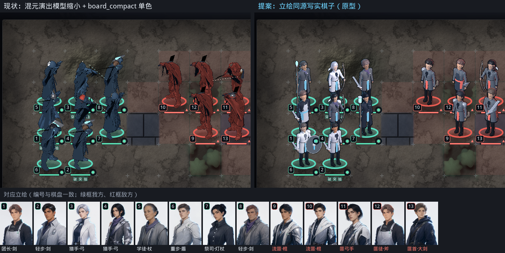

*图 1：桌面 1280×720，1:1 像素，`ch0_pass` 战斗（CELL 85）。左边是现状，右边是原型；两边用同一个 `CKUnitLayer3D`，相机、缩放、脚点、2D 底盘和血条都相同。下方是每个单位在界面上实际显示的立绘，编号与棋盘一致，绿框是我方，红框是敌方。*

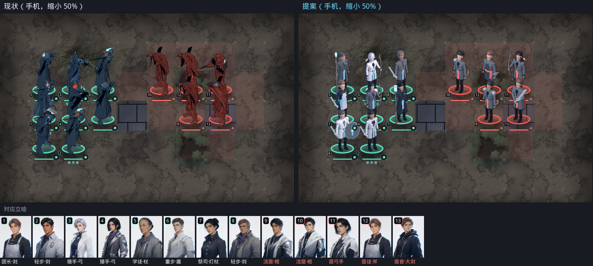

*图 2：`CK_FORCE_MOBILE=1`，2400×1080（CELL 103），缩小到 50% 展示。单位层保持手机端的 0.8 渲染倍率。*

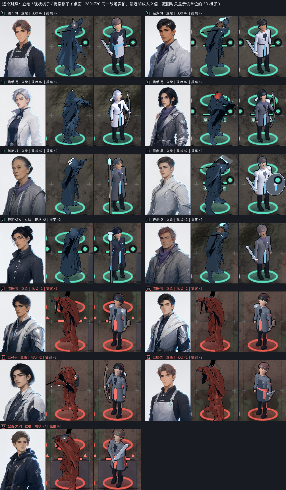

*图 3：逐个对照。每格依次是立绘、现状棋子、原型棋子，取自图 1 的同一帧，最近邻放大 2 倍。截图时只显示该单位的 3D 棋子，避免被邻格挡住。*

---

## 1. 第 2 版改了什么

第 1 版的前提是"棋盘尺度只能靠夸张造型读出来"。原型说明这个前提不成立：写实比例只要做到三点就读得出。一是头和武器适度放大；二是保留立绘里本来就有的明度层次（深色内衬和裤靴、浅色外套、肤色、发色）；三是外轮廓加一圈 1px 深色光晕。

| 项 | 第 1 版 board_mini（已否决） | 第 2 版 立绘同源写实棋子 |
|---|---|---|
| 比例 | 3.4 头身，大头、大手、大武器 | 5.45 头身，写实成人；相对真人，头放大约 1.35 倍，剑类约 1.15 倍 |
| 脸 | 两个深色小块当眼睛，1px 嘴线 | 写实头部体块（颅、下颌、下巴、鼻），靠主光画出脸的形 |
| 着色 | 两阶平涂，硬边边缘光 | 立绘式柔和明暗：包裹光、冷色暗部、柔和边缘光、金属小高光 |
| 描边 | 屏幕恒定 2px 反向外壳 | 单位层合成时加 1px `#0A0E14` 光晕，只在外轮廓 |
| 配色来源 | 基因组表型加职业色块 | 显示的立绘图版取样；基因组只作兜底 |
| 发型 | 基因组 `_style` | 立绘标注（图像判别加人工复核） |
| 风格锁 | 需要三项例外（比例、线宽、平涂） | 不需要例外；登记 `board_figure` 资产类；主光随朝向镜像（已拍板） |
| 每人三角面 | 0.8k–1.5k | 4k–6k（原上限 7k；2026-10-17 方案 A 放宽为 ≤ 15k） |

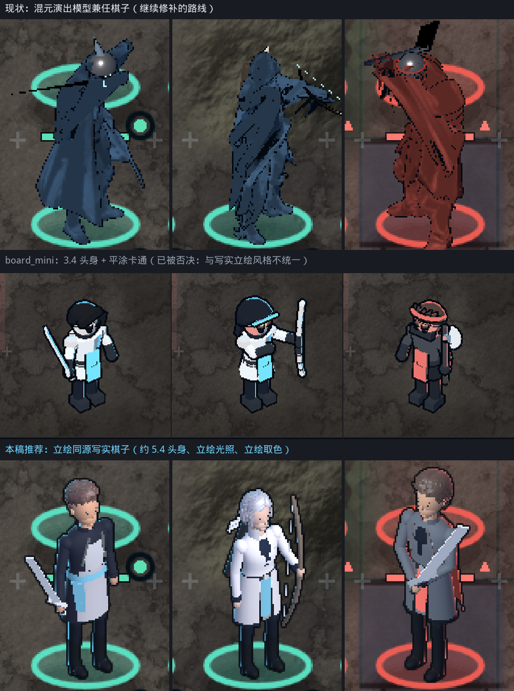

*图 7：同样三个单位（团长、3 号猎手、13 号匪首）在棋盘真实尺寸下的样子，最近邻放大 2 倍。上排是现状，中排是第 1 版 board_mini，下排是本稿方案。*

---

## 2. 现状诊断

### 2.1 棋盘上读不出人

现在的棋子是把为演出写实尺度做的混元模型（7.5 头身、每人约 2 万面、1024² 碎片化 UV 贴图）缩到约 1.3 格高，再由 `board_compact` 把全部色相换成填充色。第 1 版逐项查过原因，本版在同一场景复测，结论不变：

1. **比例与遮挡。** 头高 17.7px（CELL 85；最小的 CELL 71 时约 14.8px），38° 俯视下头顶和肩膀挡住脸。
2. **单色剪影。** `CKUnitLayer3D._solidify_board()` 打开 `board_compact`，`toon_body_v87.gdshader` 执行 `base = fill_color.rgb * form`，皮肤、头发、金属、布料变成同一种颜色。头和躯干的色差平均只有 ΔE 3.0，几乎分不开。
3. **太暗。** 人物平均明度 0.194，地面 0.204。形体系数约 0.59，暗面 ramp 约 0.09–0.14，乘下来只剩填充色的 31%–47%。
4. **贴图不适合小尺寸。** 每张贴图上有上百个 UV 岛，一个屏幕像素覆盖约 10×10 个 texel，mip 把相邻岛的颜色平均成一团灰（图 6）。
5. **姿态和朝向。** `READY` 姿态胸部前倾 4°，`advance` 前倾 12°，模型本身偏驼背；待机偏航 62°，接近侧面，脸背离相机。
6. **武器。** 后加的简单几何体只有 1–2px 粗；`metallic 1.0` 在没有反射环境的单位层里渲成近黑；学徒和祭司的 GLB 没有武器网格（本场 5 号、7 号的武器像素为 0）。
7. **没有轮廓。** 风格锁的 3D 描边 0.006m 在棋盘上只剩约 0.3px，MSAA 又关着（#296）。轮廓可见率平均 0.51，最差 0.39。
8. **暖光。** 单位层太阳光是暖色 `(1.0, 0.95, 0.88)`，违反风格锁"冷白主光、禁止暖光"。
9. **覆盖不全。** 32 个职业里只有 9 个有专属外观模型；22 个敌人主题共用 4 个敌人 GLB。
10. **手机默认显示胶囊。** #292 关掉手机端 3D 后，`_draw_map` 回退到 `UnitArt.draw_token_on`，画出来的是 #280 已否决的胶囊棋子。

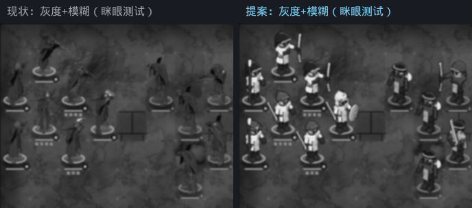

*图 4：灰度加模糊的"眯眼测试"。现状的棋子融进地面；原型的头、上身、腿分成三段明度。*

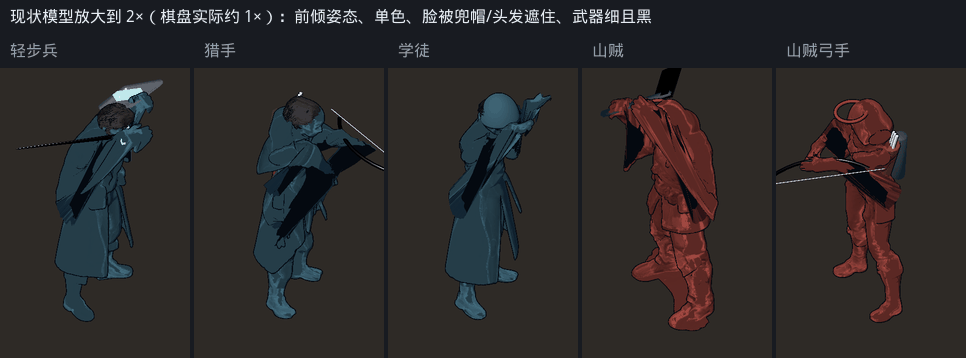

*图 5：现状模型放大 2 倍：前倾、单色，脸被兜帽或头发遮住，武器细且黑。*

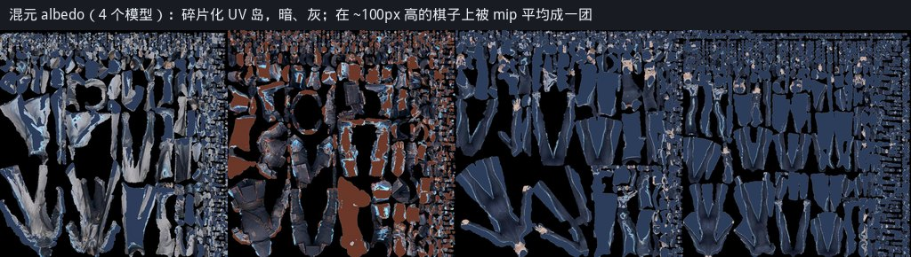

*图 6：4 个混元模型的贴图：碎片化 UV 岛，又暗又灰，平均亮度 0.27、平均色度 0.12。*

### 2.2 立绘、基因组、棋子三者对不上

立绘的来源：`UnitArt.portrait` 调用 `CKPortraitBank.try_texture`。它先用 `best_match` 按身份标签（每个桶 14 个，如 `hair:ash_brown`、`face.jaw:defined`）在农场清单里找重合度最高的桶，重合度 ≥ 0.80 算命中。只有命中、并且这个桶在包里已经有图版时，才显示这张图版；其余情况（未命中，或命中的桶还没出图）都在同年龄段、同性别的图版里按 `identity_seed` 取一张。包里共有 1,595 张图版（5 个年龄段 × 319 张，每张 3 档分辨率），但清单的 1,840 个桶里只有 25 个有图版（`run_ci.sh lint` 输出的 `BANK COVERAGE` 行），所以开发环境里也几乎总是走兜底。导出包里不带 `tools/` 下的农场清单（`portrait_bank.gd` 的注释写明 device 上没有 farm manifest），立绘一律走兜底。

兜底只保证年龄段和性别一致，发色和发型不跟基因组走。本场 13 人的实测（立绘发色是图版中间调的取样）：

| # | 单位 | 基因组发色 | 立绘发色 | ΔE2000 | 基因组发型 | 立绘发型 |
|---|---|---|---|---|---|---|
| 1 | 团长 leader_1 | `#5C4A40` | `#5D4A49` | 5.2 | tied | swept |
| 2 | 轻步 ally_2 | `#5C4A40` | `#242327` | 17.3 | crop | crop |
| 3 | 猎手 ally_3 | `#C9B184` | `#9B9DAC` | 25.5 | pony | bob |
| 4 | 猎手 hire_13 | `#8E3A34` | `#1C1F27` | 31.1 | long | bob |
| 5 | 学徒 hire_14 | `#D8E2EC` | `#434145` | 55.4 | swept | tied |
| 6 | 重步 hire_15 | `#1B1D24` | `#464042` | 12.7 | tied | crop |
| 7 | 祭司 hire_16 | `#C9B184` | `#151822` | 62.2 | crown | crown |
| 8 | 轻步 hire_17 | `#5C4A40` | `#5F5052` | 7.2 | crop | messy |
| 9 | 流匪 enemy_10 | `#28262A` | `#242830` | 3.6 | messy | messy |
| 10 | 流匪 enemy_11 | `#1B1D24` | `#26262A` | 3.5 | crop | swept |
| 11 | 匪弓手 enemy_12 | `#1B1D24` | `#1A1D23` | 0.3 | swept | long |
| 12 | 匪徒 enemy_18 | `#1B1D24` | `#5D4A49` | 19.3 | messy | swept |
| 13 | 匪首 enemy_19 | `#28262A` | `#4C423F` | 11.1 | crop | messy |

- 发色 ΔE2000 平均 19.6（0.3–62.2）；肤色平均 6.0（1.2–20.0，最大的是 8 号：基因组浅肤色，立绘是小麦色）。
- 发型 13 人中 10 人不一致。
- 9 人的标签重合度 ≥ 0.80，算命中，但命中的桶都还没有图版；另外 4 人（0.71、0.77、0.77、0.77）未命中。所以本场 13 人显示的全是兜底图版。
- 12 号敌人和团长显示的是同一张图版（像素完全相同）。这是立绘侧的撞脸问题，棋子照立绘做就会继承它（§8 第 4 条）。
- 现状棋子和立绘之间几乎没有对应关系：露出头发的 5 人发色 ΔE 平均 25.5，外套 18.0，家徽色 60.8。

结论：要让玩家一眼认出是谁，棋子必须照实际显示的那张立绘做。而且要按实际加载的图版查表，不能在棋子侧重新匹配一次，因为开发环境和导出包挑出的图版可能不同。

### 2.3 两个配色 bug

1. **敌人落进我方色系。** `UnitModel.fill_color_for` 对敌人返回 `Color.from_hsv(trim.h, 0.58, 0.55)`，只取主题 `trim` 的色相，饱和度和明度固定。22 个敌人主题里，只有 4 个的 `trim` 是珊瑚；3 个用了风格锁规定只能用于特效的火花橙 `#FF8A3D`，敌人被染成橙色；其余 15 个落在我方色系：薄荷 4 个，霜青、霜青悬停、霜青按下共 7 个，另外 4 个是霜银、霜白、灰蓝这类低饱和色，它们的色相约 210°，饱和度被拉到 0.58 后变成钢蓝。图 10 右下是这张映射表。
2. **`crest_color()` 返回灰色。** 我方填充色取 `UnitArt.crest_color()`，它优先返回旗号的旗底 `field_a`。建旗界面（`naming.gd` 的 `_current_spec`）给每个家族的旗底都写入灰烬灰 `#6E7276`（"灰底是灰烬邦给的"），玩家选的颜色写在 `charge_color`、`emblem_color` 和 `ordinary_tincture` 里。灰色算出的色相固定约 210°，所以新存档里每个家族的棋子都是同一种钢蓝，玩家选的家徽色从不出现在棋盘上（图 10 右上）。

---

## 3. 方案

### 3.1 原则

- **身份区照立绘。** 立绘画到胸口（风格锁 `portrait_part`：头顶在画面 10%，下巴在 52%，双肩撑满画幅）。这一区包括发型、发色、肤色、领口、外套上半、肩甲、围巾、围裙和背带，全部照立绘取色和标注。
- **职能区按职业。** 胸口以下的下摆长度、腿部护具、武器和背后挂件，按职业线和阶位决定（附录 A）。外套颜色从身份区延续下来。
- **不加立绘里没有的头部遮挡。** 立绘没戴头盔或兜帽，棋子也不戴。职业头饰只在立绘本身就有时出现，否则改成不遮脸的挂件（背在身后的斗笠、推到额上的目镜）。一顶全盔就足以抵消"一眼认出是谁"。
- **家徽色只用在立绘裁切线以下和背面**：腰带、腰封、披风、旗面，不改身份区的任何颜色。
- **敌人**：头部照立绘；布料、护甲、皮革按阵营主题重新着色，阵营槽锁珊瑚（§3.6）。
- **可读性优先借用立绘自带的明度层次**：深色内衬和裤靴压住地面，浅色外套、肤色、发色从地面上跳出来；不够时才由 §3.5 的规则补救。

### 3.2 比例与造型

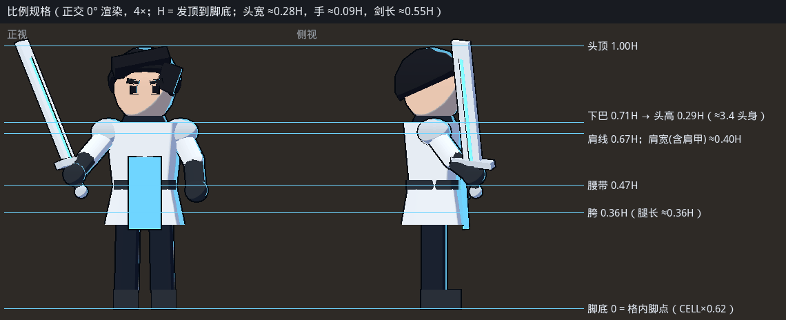

*图 8：原型团长的正面、侧面（平视）和棋盘相机视角（俯仰 38°、偏航 35°）。横线按头高分格。*

模型空间沿用单位层的 `MODEL_H = 1.85m`，单位层现有的缩放公式不用改。

| 部位 | 规格 |
|---|---|
| 身高 | 1.837m，5.45 头身 |
| 头 | 下巴到发顶 0.337m。真人 7–7.5 头身时头高约 0.25m，相当于放大约 1.35 倍。下巴绕颈部枢轴上抬 8°，抵消 38° 俯视 |
| 肩、胯 | 肩关节半宽 0.205m（女 0.185m）；胯半宽 0.098m（女 0.105m） |
| 腿 | 截面半径：大腿根 0.076m，膝 0.052m，踝 0.040m |
| 手臂 | 截面半径：上臂 0.052m，肘 0.044m，腕 0.037m |
| 武器 | 剑刃 0.86m（约为真实单手剑的 1.15 倍），大剑 1.10m，弓 1.32m，长枪约 2.1m，杖约 1.9m |
| 体型差异 | 女性身高 ×0.965；首领 ×1.06；55 岁以上头部下沉 3cm、前移 2.4cm，呈轻微前倾 |
| 姿态 | 直立不驼背，待机胸部前倾 0°；待机偏航 ±35°，我方朝右、敌方朝左，都略朝向相机 |
| 持械 | 武器始终在相机一侧；敌方改为左手持械，用朝向符号镜像实现，不用负缩放 |
| 屏幕尺度 | 头高 24.5px（CELL 85）；最小格 CELL 71 时约 20.5px；手机 29.7px（CELL 103） |

造型要点：

- 写实体块：锥形四肢、收腰、肩颈过渡、下颌和颧骨的体块，让主光能画出脸和身体的形。
- 最小可见特征 ≥ 2px（CELL 71 下约为身高的 0.02）。纽扣、缝线、刺绣这类更小的细节不建模。
- 原型是 Godot 基本体加现有发型模块拼成的验证品，手是球，也没有衣褶。正式件在 Blender 里做，品质必须高于原型。

### 3.3 从立绘取色

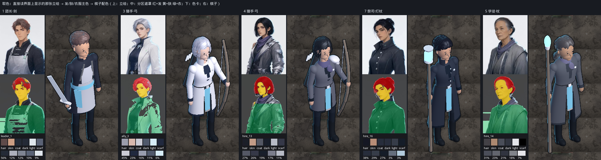

*图 9：5 个单位的取色过程。每组左上是立绘；左下是分区遮罩（红为头发、黄为皮肤、绿为服装），下面是取出的色块和服装聚类的占比；右边是棋子。*

流程如下，参数见附录 C。

1. **拿到显示的那张图版。** 取 `CKPortraitBank.try_texture` 实际加载的图版 stem（命中和兜底两条路径都要把 stem 带出来），不在棋子侧重新匹配。
2. **分区。** 背景、皮肤（脸）、头发、服装（下巴以下）。
3. **取色。** 皮肤和头发取中间调的中位数，去掉高光和最深的阴影；服装做 5 类 k-means，按占比和明度分出外套、内衬、浅色件、深色件；另外检测紫色围巾或腰封，以及霜银金属件。
4. **还原底色。** 立绘取样是已经受过光的中间调，要按 HSV 明度乘系数换回材质底色：头发 ×1.18、皮肤 ×1.06、布料 ×1.15、紫色件 ×1.25。系数按"渲染后棋子上的中位色落回立绘中位色"标定，§4 的结果是发色 ΔE 4.7、肤色 2.3、外套 5.3。
5. **标注。** 发型（8 款之一）、领口（立领、高领、开领）、围裙、背带、围巾、肩甲（左、右、双）、下摆长度。图版提示词只描述发色和发质，不写发型，所以发型靠图像判别加人工复核；服装可以先拿提示词里的 styling 子句（例如"layered technical jacket with a slim grey-violet scarf"）作先验，再用图像核对。原型阶段这些标注是人工看图填写的。
6. **离线预计算。** 1,595 张图版一次跑完，写进 `data/plate_palettes.json`（约 100KB），另配一张人工覆盖表。运行时只查表，不分析图片。角色换年龄段时图版会换，所以棋子的外观哈希里要带上图版 stem。
7. **兜底。** 没有图版的角色，显示的立绘由程序化纸娃娃 `CKPortraitDoll` 按基因组生成，这时直接用 `CKGenome.phenotype` 和 `CKPortraitDoll._style`。

配色槽（每个单位一组，由 `uniform vec4 palette[20]` 传入）：

| 槽 | 我方 | 敌方 |
|---|---|---|
| hair 头发 | 立绘发色 ×1.18 | 同左 |
| skin 皮肤 | 立绘肤色 ×1.06 | 同左 |
| eye 眼、眉 | `#2A2F38` | 同左 |
| coat 外套 | 立绘服装主色 ×1.15 | 主题布料，明度下限 0.40（原型 `#606A77`） |
| coat_dark 内衬、领口 | 立绘指定的服装类 ×1.15 | `#1C2330`，明度下限 0.12 |
| apron 围裙、背心 | 立绘有围裙时取对应类 ×1.15 | 主题皮革，明度下限 0.26（原型 `#374456`） |
| sash 围巾、腰封 | 立绘紫色件 ×1.25 | 不用 |
| metal 金属 | 立绘霜银件；没有时用 `#C9D3DE` | 枪灰 `#9AA4B2` |
| blade 刃 | `#DCE5EE`，浅色，不走金属反射 | 同左 |
| house 家徽片 | 玩家家徽色，规则见 §3.5 | 珊瑚 `#FF7A70` |
| crest 胸前徽记 | 玩家家徽色 | 珊瑚 `#FF7A70` |
| cape 披风 | 家徽色 | 暗珊瑚 `#C8564E` |
| trousers 裤 | `#222936` | `#20252D` |
| boots 靴 | `#20252D` | 同左 |
| leather 皮革 | `#2E3138` | 同左 |
| wood 木柄 | `#7A6F66` | 同左 |
| accent 点缀、发光线 | 薄荷 `#5EE0B5` | 珊瑚 `#FF7A70` |

### 3.4 光照与着色

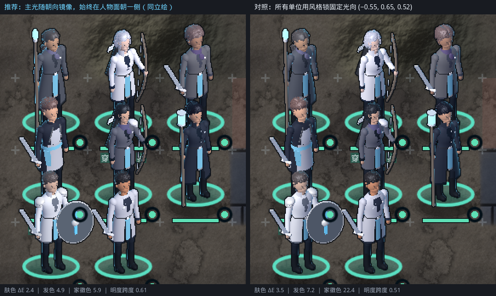

*图 11：我方 8 人的主光对比，最近邻放大 2 倍。左：主光随朝向镜像（推荐），始终在人物面朝的一侧。右：所有人用风格锁的固定光向 `(-0.55, 0.65, 0.52)`，朝右的我方脸和胸前落在暗面。底部是我方 8 人的均值。*

风格锁里，立绘的质感由 `finish` 规定："柔和喷绘式明暗、干净边缘、哑光技术面料、霜感拉丝金属配小而锐的高光、1px 霜青发光线"。`toon_3d`（两阶 ramp、0.006m 反向外壳）只用于演出模型。棋子跟随立绘的 `finish`，所以要在 `style-lock-v89.json` 登记一个资产类：

```json
"board_figure": {
  "scope": "battle board units only",
  "proportion": "adult, 5.2-5.6 heads; head <= 1.4x and weapons <= 1.2x life size for board readability; no chibi",
  "finish": "same as portrait finish: soft painterly light, cool shadow, frost rim, small sharp metal speculars; no toon ramp, no flat fill",
  "lineart": "silhouette only: 1px #0A0E14 screen-space halo at alpha 0.95; no interior lines",
  "palette": "sampled from the displayed portrait plate; faction slots locked (ally frost/mint, enemy coral)",
  "key": "cool white, elevation 40deg, on the side the figure faces: enemy facing left = vector_godot, ally facing right = vector_godot mirrored in x"
}
```

着色规格：

| 项 | 风格锁（立绘） | 棋子 |
|---|---|---|
| 主光 | 冷白，左前上方，Godot 向量 `(-0.55, 0.65, 0.52)` | 冷白，放在人物面朝的一侧：敌方朝左时就是 `(-0.55, 0.65, 0.52)`，我方朝右时为 `(0.55, 0.65, 0.52)`（已拍板） |
| 明暗过渡 | 柔和喷绘 | 包裹光 `(N·L + 0.5) / 1.5` 再做 smoothstep，过渡带宽；亮面 ×1.05，蓝通道再 ×1.02 偏冷 |
| 暗部 | 冷色环境补光，无暖反射 | 底色乘 `(0.42, 0.45, 0.56)`：冷灰蓝，不是黑 |
| 顶面补光 | — | 朝上的面 +8%，模拟天光 |
| 高光 | 霜感金属，小而锐 | Blinn-Phong，指数 14（布料）到 36（金属），强度 `0.04 + 0.42·金属 + 0.22·光泽`，颜色 `(0.92, 0.96, 1.0)` |
| 边缘光 | 霜青 `#6ED4FF`，从右后方；3D 规格为 power 3.0、强度 0.55；敌方 `#FF7A70` | 来自主光对侧的后方；fresnel 指数 2.6，强度 0.55；深色外套（明度 < 0.36）和敌方用 0.85，上限 0.85 |
| 环境遮蔽 | — | 按高度从脚部 0.80 渐变到 1.25m 以上的 1.0，压住裤靴，突出上身 |
| 描边 | 外轮廓细线 `#0A0E14`（立绘约 1.5px@1024），内部线更浅 | 只有外轮廓：单位层合成时加 1px 光晕 `#0A0E14`，α 0.95，对角方向 ×0.6；内部不加线 |
| 发光线 | 1px 霜青发光线 | 家徽片和饰线发光：底色 ×1.3 |

- **边缘光指数用 2.6 而不是 3.0。** 棋子只有约 100px 高，用 3.0 时边缘光不到 1px。颜色和方向不变。
- **不再受单位层灯光影响。** 着色器自带光照计算（unshaded 模式），单位层的环境光和暖色太阳不再作用于棋子。

**为什么推荐主光随朝向镜像。** 立绘是正面像，主光从左前上方照亮整张脸。棋盘上我方朝右、敌方朝左；如果所有人都用固定光向，朝右的我方就是脸和胸前背光（图 11 右）。我方 8 人的数据（§4.5）：镜像时家徽色 ΔE 5.9，头与躯干色差最差 5.75；固定光向时分别是 22.4 和 1.66，后者低于门槛 5，脸和衣服糊在一起。固定光向的外套色差略好（4.60 对 5.32），8 选 1 认人也多对 1 个（6/8 对 5/8），但家徽色和头身分离差得多。综合下来推荐镜像。镜像只改变我方光向的 x 分量，敌方完全符合风格锁；它还让低端机的烘焙替身可以直接水平翻转使用（§3.8）。

### 3.5 家徽色与阵营配色

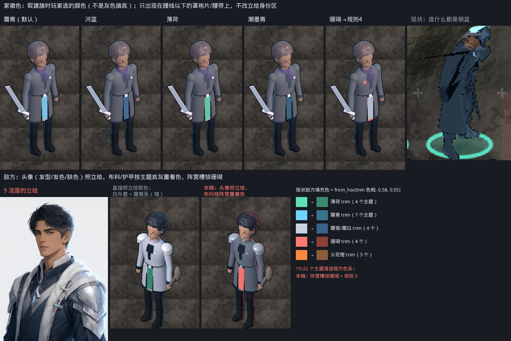

*图 10：上排是同一个我方单位换 5 种家徽色（霜青是建旗默认色），最右是现状：选什么颜色都是钢蓝。下排是敌人：左为 9 号流匪的立绘；中为直接照立绘取色，白外套加霜青系，会被看成我方；右为本稿做法，头部照立绘，布料按阵营重新着色。最右是现状敌方填充色的映射表。*

**取色。** 旗底 `field_a` 是灰烬灰 `#6E7276`（建旗界面一律写入这个值）时取 `charge_color`；否则（旧存档迁移来的旗号，旗底就是玩家色）取 `field_a`。外姓角色用所属家族的旗号。不要直接用 `UnitArt.crest_color()`。

**位置。** 腰带、腰带下的垂片、腰封，有披风或旗面时也用家徽色，全部在立绘裁切线以下或背面，不改身份区。家徽片按染色布处理，饱和度 ×0.80、明度 ×0.92，避免像一块发光的色板。原型里每个我方单位的家徽像素有 91–222 个，在 1× 下是一块清楚的色块。

**保护规则**（`CKBoardFigure.spec_for` 组装时执行；测试覆盖 22 个敌人主题和建旗色板全部 24 色）：

1. **头身分离保底。** 头部（发色、肤色）与躯干上段的 ΔE2000 < 5 时，领口改用立绘里最深的服装类。原型 13 人里最低的是 5 号学徒，5.75，没有触发。
2. **家徽片描边。** 家徽色与外套的明度差 < 0.15 时，家徽片加一圈 `#1C2330` 深色边。
3. **敌方不进我方色域。** 敌方除皮肤、头发外的任何槽，只要色相在 150°–220°（覆盖薄荷 160°、霜青 196°–198°、钢蓝 210°–216°）且色度 max−min > 0.15，就回退到炭灰。用色度而不用饱和度，是为了放过 `#1C2330` 这类很暗的布料（饱和度 0.42，色度只有 0.08）。
4. **我方家徽不进敌方色域。** 我方的 house、cape、accent 槽色相在 0°–30° 或 340°–360°（覆盖珊瑚、赤霞、火花橙）且色度 > 0.15 时，家徽片和披风改用霜银 `#C9D3DE`，玩家色只留在胸前徽记和下摆饰线这种小面积上（图 10 上排第 5 个）。建旗色板里的"珊瑚" `#FF7A70` 和"赤霞" `#FF8A80` 都会命中。
5. **敌方明度下限。** 外套 ≥ 0.40，皮革和围裙 ≥ 0.26，内衬 ≥ 0.12；敌方边缘光强度 0.85。没有这条，炭灰布料会沉进 0.20 的地面（§4.4）。

### 3.6 敌人

- **头部照立绘。** 敌人同样有基因库立绘，选中敌人时战斗信息面板显示的就是这张（`BattleInfoPanel` 用 `UnitArt.portrait`）。所以发型、发色、肤色照立绘做，面板里的脸和棋子对得上。
- **布料不照立绘。** 图版里的敌人常穿霜白外套、配霜银肩甲（9 号就是），照搬会被看成我方（图 10 下中）。所以外套、护甲、皮革按敌人主题取色并压进炭灰范围，house、crest、accent 槽锁珊瑚，边缘光用珊瑚。
- **上身外形仍照立绘标注。** 9 号立绘有双肩甲，棋子也有；12 号立绘有围裙和背带，棋子也有。这样敌人之间也分得出谁是谁：只看头部的 13 选 1 里，5 个敌人有 4 个排第 1，另一个排第 2。
- **主题标志件**（斗笠、毛领、面具、提灯等，见附录 A 末尾）挂在不遮脸的位置。首领整体 ×1.06，加珊瑚披风。

### 3.7 正式资产规格

| 项 | 规格 |
|---|---|
| 每人三角面 | **方案 A（2026-10-17）：每件航运档 ≤ 15k 三角**（Path C 现状 11,976–14,477）。原稿：4k–6k，硬上限 7k。原稿参考分配：身体（含手、靴）1.6–2.2k，头 0.5–0.8k，发型 0.6–1.2k，服装外层（下摆、围裙、领口、肩甲、披风）0.6–1.0k，武器 0.2–0.6k，挂件 0.1–0.4k |
| 发型 | 8 款共享发型模块（`assets/models/modules/hair_*.glb`，与立绘纸娃娃、演出共用）各做一个棋盘 LOD，从 1.0–1.3 万面减到 ≤ 1.2k，保住 38° 俯视下的外形 |
| 网格 | 组装后合并成 1 个蒙皮 ArrayMesh，即 1 个 draw call；不再有逐人描边 pass |
| 骨骼 | 沿用 `build_standins_v86.py` 的 18 根骨骼和骨骼名，关节按 §3.2 的比例重摆 |
| 蒙皮 | 肩、肘、胯、膝的顶点最多 2 骨权重，其余刚性。写实比例下，刚性蒙皮的关节断口会被柔和光照放大 |
| 法线 | 平滑法线；只有甲片边和刃口用硬边 |
| 顶点色 | R = 配色槽号，G = 烘焙的 AO，B = 标记位（发光、双面、金属） |
| 材质 | 每个单位 1 个 `ShaderMaterial`，配色由 `uniform vec4 palette[20]` 传入；不用 instance uniform，所以 Vulkan Mobile 和 OpenGL 回退下行为一致 |
| 贴图 | **方案 A（2026-10-17）：每件 ≤ 1 张 albedo，边长 ≤ 512，JPG 或 WebP，嵌在 GLB 里**。原稿：0 张 |
| 脸 | 不用贴图。眉弓、鼻、颧骨、下颌建出体块，让光照画出脸；眼睛是顶点色的小块深色 |
| 光晕 | 把 `CKUnitLayer3D` 现有的预乘 `CanvasItemMaterial` 换成 canvas_item 着色器：仍按预乘 alpha 合成，同时对单位层纹理做 8 邻域膨胀，多出的一圈填 `#0A0E14` |

原型每人 16.6k–20.6k 三角，其中发型模块就占 1.0–1.3 万（bob 10,279，crop 11,002，crown 12,501，long 12,121，messy 10,683，pony 11,509，swept 11,780，tied 12,714），所以原型的面数不能当性能参考。

### 3.8 手机分档

| 档 | 条件 | 表现 |
|---|---|---|
| 实时 3D | 桌面；中高端安卓（**P3 已落地**：默认开） | 本节全部规格。空闲时单位层 **14Hz**（12–15 带）刷新，与 [#289](https://github.com/wuyongjia666-droid/CenturyKnights/pull/289) 约 12Hz 战斗脉冲对齐；行走、攻击和特效存活期间满帧。实现：`CKUnitLayer3D._refresh_update_mode` |
| 烘焙替身 | `DeviceProfile.is_low_end()` 默认；单位数 > `max_units()`（手机 24 / 桌面 32）；用户关闭 `board_units_3d` | 开局时用离屏 SubViewport 把每个棋子渲染成 2D 精灵（待机 1 帧，朝右），朝左水平翻转；主光随朝向镜像。按外观哈希缓存到内存和 `user://`。替换胶囊棋子（棋盘回退、触控虚影、名册）。用户开关可覆盖低端默认 |

16 个单位时的估算：

- 三角面 6.4–9.6 万（上限 11.2 万）；现状约 65 万（每人约 2 万面，再加一遍描边 pass）。
- 单位层 draw call 约 17（每人 1 个，加 1 次合成）；现状每人 6–10 个。
- 贴图显存为 0；现状 16 张 1024²。
- 光晕是对单位层纹理的 9 次取样。**P3**：手机把光晕挪进独立 blit SubViewport，与单位层 12–15Hz 刷新同频（`prefer_halo_in_viewport()`）；桌面仍走显示 TextureRect 材质。实机若 blit 路径仍 >0.3ms，再测并记入 §7.3（CI/llvmpipe 测不出 GPU ms）。
- 替身档显存约 16 × 160×200 × 4B，约 2MB。
- **`max_units()` P3 已上调**：手机 24、桌面 32（绝对值天花板 `MAX_UNITS := 32`）。超限强制替身/2D token。

### 3.9 动作

- 沿用 `anim_archetypes_v92.py` 的 8 个原型动作和命中帧时刻。5.45 头身比第 1 版的 3.4 头身更接近现有骨架，关键帧旋转基本可以直接套用。
- 棋盘覆盖姿态：下巴 +8°，`READY` 胸部前倾 0°，待机偏航 ±35°。
- 穿插检查：头放大 1.35 倍后，拉弓、过顶劈砍、举杖这类举臂动作可能碰到头，P2 逐帧检查。
- 新增原型：`axe`（单手斧）、`banner`（执旗线）、`dagger`（散兵、寻路人）、`book`（咏者、唱诗）。
- 状态表现：`dim`（已行动）去饱和 60%、压暗 25%，对应现有的 `ck_dim`；`flash`（受击）白闪 80ms；选中由 2D 高亮负责，3D 端只轻抬武器。
- #290 的逐格行走、命中帧、hit-stop、伤害数字全部保留。

---

## 4. 原型与可读性指标

### 4.1 场景与方法

- **场景**：`battle.tscn` 的 `ch0_pass` 战斗，关闭剧情对话。为了覆盖更多职业，额外加入猎手、学徒、重步、祭司、轻步各一名和两名山贼，共 8 名我方、5 名敌方。
- **对照方式**：先截"现状"，再在运行时把 `CKUnitLayer3D._nodes[*].node` 换成原型棋子，截"提案"。两张图的相机、缩放公式、脚点、2D 底盘和血条完全相同。
- **分辨率**：桌面 1280×720（CELL 85）；手机 `CK_FORCE_MOBILE=1`、2400×1080（CELL 103），单位层 0.8 渲染倍率。
- **辅助渲染**：同一帧再渲染三张图：隐藏全部棋子的地面图；每个单位一种颜色的单位 ID 图；按部位（头发、皮肤、身体、武器、金属、家徽）上色的部位 ID 图。另外记录每个单位发顶、下巴、脚底的屏幕坐标。
- **明度**：sRGB 加权亮度 0.2126R + 0.7152G + 0.0722B，取值 0–1。地面空白格平均 0.204。
- **色差**：CIEDE2000（ΔE2000）。大致上，2 以下肉眼难分，10 以上一眼看出是不同的颜色。

| 指标 | 定义 |
|---|---|
| 头高 | 发顶到下巴的屏幕高度（逻辑像素） |
| 分离度 | 单位像素中，与同位置地面（取自地面图）明度差 > 0.15 的占比 |
| 轮廓可见率 | 沿人物外缘逐点取三个像素：人物内侧、向外 1px（光晕的位置）、向外 3px（地面）。相邻两点明度差 > 0.10 就算这一点轮廓可见，统计可见点的占比 |
| 明度跨度 | 人物像素明度的 p90 − p10，衡量内部层次 |
| 头–躯干色差 | 头部（发顶到下巴）与躯干上段（下巴往下、占下巴到脚底距离的前 40%）的 Lab 中位数之间的 ΔE2000 |
| 武器像素、武器分离度 | 部位 ID 图里武器的像素数，以及其中与地面明度差 > 0.15 的占比 |
| 发色、肤色 ΔE | 棋子头发（皮肤）像素的 Lab 中位数与立绘取样之间的 ΔE2000；头发少于 12 个像素、皮肤少于 8 个像素时不计 |
| 外套 ΔE | 躯干上段的服装像素做 3 类 k-means；立绘服装占比最大的两类，各自到最近一类的 ΔE2000，按占比加权 |
| 家徽色 ΔE | 家徽像素的中位色与测试家徽色霜青 `#6ED4FF`（建旗默认色）之间的 ΔE2000；没有家徽像素时用躯干上段的中位色 |
| 阵营色域违规 | 我方像素（皮肤、头发除外）落进 §3.5 规则 4 敌方色域的占比，以及敌方像素落进规则 3 我方色域的占比 |
| 认人 8 选 1 | 每个我方棋子与 8 张我方立绘逐一比较"签名距离"（头部两色到立绘发色、肤色的距离，加躯干三色到立绘外套两色的距离），看自己的立绘排第几。随机猜中第 1 的概率是 1/8 |
| 认人 13 选 1 | 只用头部签名，在全部 13 张立绘里排名；像素完全相同的图版算同一张 |

### 4.2 桌面结果（1280×720，CELL 85）

| 指标 | 现状：均值（范围） | 原型：均值（范围） |
|---|---|---|
| 头高 | 17.7px（16.8–18.3） | 24.5px（23.8–26.1） |
| 分离度 | 0.275（0.146–0.437） | 0.557（0.301–0.860） |
| 　其中我方 / 敌方 | 0.290 / 0.250 | 0.598 / 0.490（敌方最差 0.434） |
| 轮廓可见率 | 0.514（0.394–0.665） | 0.774（0.694–0.862） |
| 　其中我方 / 敌方 | 0.501 / 0.535 | 0.805 / 0.723 |
| 明度跨度 | 0.221（0.129–0.284） | 0.544（0.311–0.778） |
| 人物平均明度（地面 0.204） | 0.194 | 0.414 |
| 头–躯干色差 | 3.05（0.09–6.98） | 14.6（5.75–39.7） |
| 武器像素 | 127（0–315） | 262（74–1708） |
| 武器分离度 | 0.55 | 0.71 |
| 发色 ΔE | 25.5（7.9–56.9），13 人中只有 5 人露出足够的头发 | 4.7（2.6–6.9） |
| 肤色 ΔE | 无法测 | 2.3（1.7–3.2） |
| 外套 ΔE（我方） | 18.0（4.7–37.0） | 5.3（3.1–8.9） |
| 家徽色 ΔE（我方） | 60.8（59.0–63.9），家徽像素为 0 | 5.9（5.0–10.5），家徽像素 91–222 |
| 阵营色域违规 | 约 0（我方像素最高 0.1%） | 0 |
| 认人 8 选 1：第 1 / 前 3 | 1/8 / 3/8 | 5/8 / 7/8 |
| 认人 13 选 1（只看头）：第 1 / 前 3 | 2/13 / 4/13 | 8/13 / 12/13 |

### 4.3 手机结果（2400×1080，CELL 103）

| 指标 | 现状：均值（范围） | 原型：均值（范围） |
|---|---|---|
| 头高 | 21.5px（20.4–22.2） | 29.7px（28.8–31.6） |
| 分离度 | 0.271（0.102–0.451） | 0.539（0.224–0.904） |
| 　其中我方 / 敌方 | 0.293 / 0.237 | 0.574 / 0.483（敌方最差 0.381） |
| 轮廓可见率 | 0.220（0.185–0.277） | 0.505（0.370–0.724） |
| 　其中我方 / 敌方 | 0.218 / 0.222 | 0.557 / 0.422 |
| 明度跨度 | 0.188（0.136–0.235） | 0.493（0.275–0.753） |
| 头–躯干色差 | 4.0（0.03–8.5） | 15.2（6.7–43.5） |
| 发色 ΔE | 24.7（8.1–51.7） | 5.3（3.6–7.4） |
| 肤色 ΔE | 无法测 | 3.6（2.9–4.3） |
| 外套 ΔE（我方） | 21.3（5.0–39.8） | 5.6（3.0–8.3） |
| 家徽色 ΔE（我方） | 62.5（60.0–66.6） | 6.0（5.2–10.6） |
| 我方像素落入敌方色域 | 0.07%（最高 0.5%） | 0.4%（最高 0.9%） |
| 认人 8 选 1：第 1 / 前 3 | 1/8 / 3/8 | 5/8 / 8/8 |
| 认人 13 选 1（只看头）：第 1 / 前 3 | 0/13 / 5/13 | 6/13 / 12/13 |

- **手机的轮廓可见率偏低，很大一部分来自测量方式。** 单位层按 0.8 倍渲染再双线性放大，边缘过渡被拉宽到约 2px，按 1px、3px 取样时明度台阶更难超过 0.10。试过把光晕加宽到 1.5 个纹素，敌方轮廓只从 0.41 升到 0.43，所以维持 1 个纹素，轮廓门禁以桌面为准。图 2 里手机端的敌人目视是清楚的。
- **手机端 0.4% 的色域违规也来自放大。** 部位 ID 图按最近邻放大，画面按双线性放大，两者在皮肤边缘错开一两个像素，肤色像素被算进了"身体"。桌面同一套配色是 0。

### 4.4 敌方调参

敌人的炭灰布料一开始沉进地面。逐步调整的结果（桌面，5 个敌人）：

| 配置 | 敌方分离度：均值（最差） | 敌方轮廓：均值（最差） | 我方轮廓 |
|---|---|---|---|
| 起点：光晕 `#1C2330` α0.85，外套明度下限 0.34 | 0.36（0.28） | 0.65（0.54） | 0.79 |
| 光晕改为 `#10141C` α0.95 | 0.36（0.28） | 0.68（0.61） | 0.80 |
| 再加明度下限（外套 0.40、围裙 0.26），敌方边缘光 0.85 | 0.49（0.43） | 0.72（0.68） | 0.80 |
| 最终：光晕改为风格锁线色 `#0A0E14` α0.95 | 0.49（0.43） | 0.72（0.69） | 0.81 |

光晕只改善轮廓，分离度要靠布料明度下限。最终配置里敌方每个单位分离度 ≥ 0.43、轮廓 ≥ 0.69。

### 4.5 主光 A/B（我方 8 人，桌面）

| 指标 | 主光随朝向镜像（推荐） | 风格锁固定光向 |
|---|---|---|
| 肤色 ΔE | 2.36 | 3.53 |
| 发色 ΔE | 4.93 | 7.19 |
| 家徽色 ΔE | 5.89 | 22.37 |
| 外套 ΔE | 5.32 | 4.60 |
| 明度跨度 | 0.608 | 0.506 |
| 头–躯干色差（最差的单位） | 5.75 | 1.66 |
| 认人 8 选 1：第 1 / 前 3 | 5/8 / 7/8 | 6/8 / 8/8 |

如果拍板选固定光向，需要把暗部补光提高到让家徽色和头身分离重新过门槛，再重测一遍认人。

### 4.6 逐单位结果（桌面，现状 → 原型）

| # | 单位 | 分离度 | 轮廓 | 发色 ΔE | 肤色 ΔE | 外套 ΔE | 8 选 1 名次 | 13 选 1 名次 | 武器像素 |
|---|---|---|---|---|---|---|---|---|---|
| 1 | 团长·剑 leader_1 | 0.26 → 0.58 | 0.39 → 0.86 | — → 6.9 | 2.2 | 8.0 → 4.1 | 4 → 1 | 11 → 1 | 41 → 108 |
| 2 | 轻步·剑 ally_2 | 0.38 → 0.73 | 0.51 → 0.83 | 17.8 → 3.6 | 1.7 | 27.2 → 8.9 | 6 → 4 | 3 → 3 | 242 → 106 |
| 3 | 猎手·弓 ally_3 | 0.15 → 0.86 | 0.54 → 0.84 | — → 5.4 | 2.7 | 31.6 → 5.4 | 8 → 1 | 13 → 1 | 70 → 74 |
| 4 | 猎手·弓 hire_13 | 0.34 → 0.59 | 0.45 → 0.81 | 35.5 → 2.6 | 3.2 | 9.7 → 3.5 | 2 → 1 | 7 → 2 | 28 → 74 |
| 5 | 学徒·杖 hire_14 | 0.23 → 0.30 | 0.46 → 0.73 | 56.9 → 4.7 | 1.9 | 9.9 → 4.9 | 3 → 2 | 7 → 2 | 0 → 260 |
| 6 | 重步·盾 hire_15 | 0.44 → 0.60 | 0.66 → 0.86 | 9.5 → 6.0 | 2.5 | 37.0 → 6.3 | 7 → 3 | 4 → 1 | 315 → 1708 |
| 7 | 祭司·灯杖 hire_16 | 0.38 → 0.44 | 0.52 → 0.71 | — → 3.4 | 3.0 | 4.7 → 3.1 | 1 → 1 | 1 → 6 | 0 → 319 |
| 8 | 轻步·剑 hire_17 | 0.16 → 0.68 | 0.46 → 0.81 | 7.9 → 6.8 | 1.7 | 15.7 → 6.3 | 4 → 1 | 1 → 1 | 187 → 106 |
| 9 | 流匪·棍 enemy_10 | 0.28 → 0.60 | 0.52 → 0.76 | — → 4.0 | 1.8 | 按阵营重着色 | — | 3 → 1 | 146 → 78 |
| 10 | 流匪·棍 enemy_11 | 0.23 → 0.47 | 0.48 → 0.69 | — → 3.2 | 2.3 | 按阵营重着色 | — | 8 → 1 | 146 → 78 |
| 11 | 匪弓手 enemy_12 | 0.29 → 0.44 | 0.56 → 0.72 | — → 3.1 | 2.6 | 按阵营重着色 | — | 5 → 2 | 148 → 92 |
| 12 | 匪徒·斧 enemy_18 | 0.18 → 0.43 | 0.56 → 0.71 | — → 5.5 | 2.2 | 按阵营重着色 | — | 10 → 1 | 141 → 83 |
| 13 | 匪首·大剑 enemy_19 | 0.28 → 0.51 | 0.56 → 0.74 | — → 5.8 | 2.7 | 按阵营重着色 | — | 8 → 1 | 185 → 315 |

"—"表示现状露出的头发不足 12 个像素；肤色只列原型，因为现状测不到。2、8 号的武器像素变少了：现状的武器几何体斜伸出很长，但只有 1–2px 粗；原型的剑短一些、宽一些，武器分离度从 0.50、0.69 升到 0.93、0.98。

### 4.7 已知不足

1. **敌人共用一套服装。** 原型只做了一套山贼服，5 个敌人的下身完全一样。正式版按模板和主题区分（附录 A）。
2. **5 号学徒的分离度最低（0.30）。** 立绘是深灰长袍配灰发，整体是中低明度，靠轮廓 0.73 过线。可以让立绘里的浅色内衬多露一些，不改颜色。
3. **还有 3 个我方单位在 8 选 1 里没排第 1。** 2 号排第 4、6 号排第 3：本场有 3 人穿浅色外套（2、3、6 号），配色签名接近。5 号排第 2。7 号只看头时排第 6：13 人里有 6 人是黑发，头部签名接近；加上外套就排第 1。
4. **手机端轮廓可见率偏低（0.505）。** 原因见 §4.3。
5. **脸部特征只有 2–3px。** 1× 下读不出五官，认人靠发型轮廓、发色、肤色和外套配色。
6. **原型是基本体。** 手是球、没有衣褶，发型模块面数过高。正式件要在 Blender 里做。

---

## 5. 生产管线

> **2026-10-16 量产锁定**：默认走本节模块化（通用身 + 职业壳 + 立绘/共享脸）。  
> 团长混元全身 Path C（`docs/design/captain-base-model-plan.md`）是**关键角色 LOOK 特例**，不是每人管线。  
> 杂兵与多数首领**共用脸**；独特脸只留给主角团与关键 BOSS。  
> **禁止** soft COLLAPSE 混元开壳；**禁止**要求用户为每个单位上云端混元。  
> **禁止接头焊身**（混元头/compose 头切片焊到通用身）；脸 = 套件 `head_*` **整件替换**。配方卡：`docs/design/board-figure-mass-recipe.md`。


- **`tools/art/plate_palette.py`**：离线取色和标注（参数见附录 C），输出 `data/plate_palettes.json`，以图版 stem 为键；每 100 张图版出一页核对样张；人工覆盖表放在 `data/plate_palette_overrides.json`。
- **`tools/models/board_figures_v1.py`**（Blender 4.2，无界面运行）：沿用 `build_standins_v86.py` 的写法。
  - 身体：`m`、`f` 两种，外加一个加宽的 `heavy` 体型给重甲用。
  - 头部体块：男、女各 1 款，年龄用形变参数。
  - 发型：8 款共享发型模块的棋盘 LOD。
  - 服装外层件、约 14 款武器、职业标志件和主题标志件。
  - 每个部件写入顶点色（槽号、AO、标记位）、蒙皮权重和挂点。
  - 人工精修通道：美术在 `tools/models/board_parts/` 放同名 `.blend` 部件，就会覆盖脚本生成的版本。
  - 导出 `assets/models/board/board_figures_v1.glb`，加清单 `board_figures_v1.json`，记录部件、骨骼、槽位和三角面数。
- **`data/board_figures.json`**：职业线到部件的映射（附录 A）、敌人模板和主题标志件、主角团专属件。它是唯一的映射来源，`UnitModel.JOB_ANIM` 只留给演出用。
- **`scripts/art/board_figure.gd`**（`class_name CKBoardFigure`）：
  - `spec_for(u)`：从立绘调色表、数据表、家徽、阵营、主题和阶位，算出部件和配色槽，并执行 §3.5 的保护规则。
  - `build(spec)`：实例化骨架、挂部件、合并成单个蒙皮网格，挂上 `AnimationPlayer`（动作名与现有的一致）。
  - 按外观哈希（含图版 stem）做 LRU 缓存，容量 64。
- **`shaders/board_figure.gdshader`** 和单位层的光晕合成着色器，参考实现见附录 B。
- **`portrait_bank.gd`** 小改：`try_texture` 把实际加载的图版 stem 一并返回，供 `spec_for` 查表。
- **接入单位层**：在 `unit_layer_3d.gd` 的 `sync()` 里，把 `UnitModel.instantiate`、`CKUnitSilhouette.apply`、`_solidify_board` 换成 `CKBoardFigure.build`。`st.anim` 取新棋子的 `AnimationPlayer`，所以 `_play`、`act`、`impact_delay`、路径行走、hit-stop、伤害数字都不用改。`unit_art.gd` 的 `draw_token_on` 和 `token()` 在有替身时画替身。`battle_controller.gd` 不改：它现在 2999 行，有 3000 行门禁，新逻辑全部放进新文件。
- **QA**：
  - `tests/suites/battle/board_figure_check.gd`（无界面）：检查职业和敌人模板的映射完整；每人三角 ≤ 15k（方案 A，原稿 7k）、网格 1 个、材质 1 个、贴图 ≤ 1 张（方案 A，原稿 0 张）；22 个敌人主题 × 4 个模板逐一组装，敌方槽不进我方色域；建旗色板 24 色逐一组装，我方家徽和点缀不进敌方色域；1,595 张图版都有调色表。
  - `tests/suites/battle/board_figure_shots.gd`（Xvfb + `--rendering-driver opengl3`）：真实战斗场景的桌面和手机 A/B 图、逐单位卡片、地面图、两张 ID 图和 `metrics.json`。
  - `tools/ci/board_figure_gate.py`：按 §7.1 的门槛判定。

---

## 6. 分期实施

| 期 | 内容 | 改动面 | 验证 | 主要风险 |
|---|---|---|---|---|
| P0 规格与数据 | 风格锁登记 `board_figure`；`plate_palette.py` 跑完 1,595 张图版，人工复核发型；`try_texture` 带出图版 stem；`board_figure_gate.py` 先给现状建立基线 | 文档、工具、数据；`portrait_bank.gd` 小改 | 基线与 §4.2 一致；调色表抽检 | 图版标注的工作量 |
| P1 套件和静态接入 | Blender 生成器；身体、头部、8 款发型 LOD、8 个 t1 职业的服装和武器、山贼套；`CKBoardFigure`；着色器和光晕；单位层替换；烘焙替身取代胶囊；`export_base_budget_bytes` 上调约 3MB | 新文件为主；`unit_layer_3d.gd`、`unit_art.gd` 少量 | 门禁；桌面和手机 A/B 截图；`unit_layer_check`、`board_pawn_check` 更新 | 正式件品质；包体 |
| P2 动作 | 骨架按新比例重摆；`board` 姿态覆盖；`axe`、`banner`、`dagger`、`book`；`dim`、`flash`、选中 | 工具、动作库、着色器参数 | `pawn_shots --seq` 逐帧检查；命中帧误差 ≤ 1 帧 | 头部放大后的举臂穿插 |
| P3 手机 | **已合**：空闲 14Hz 刷新；中高端安卓默认实时 3D，低端默认替身（设置可覆盖）；光晕随刷新 blit；`max_units` 24/32；`mobile_unit_layer_check` | `unit_layer_3d.gd`、`device_profile.gd`、设置 `board_units_3d` | CI：`unit_layer_check` + `mobile_unit_layer_check`；§7.3 实机帧率仍要用户机/AVD | 透明合成填充率（实机） |
| P4 覆盖 | 32 个职业的 t2/t3 标志件；22 个敌人主题的标志件；首领；主角团专属件；退出 P3 职业部件和 `board_compact` 的棋盘路径 | 数据和部件为主 | 全职业样张；剪影两两 IoU | 工作量膨胀（靠数据驱动控制） |

P1 就要包含烘焙替身，这样安卓用户在第一期就告别胶囊棋子，不必等到 P3。P1 先做 3 个单位（团长、猎手、山贼）给用户过目，通过后再铺开。

---

## 7. 验收标准

### 7.1 自动指标

测量条件：桌面 1280×720，在 CELL 85（`ch0_pass`）和 CELL 71（12×8 地图）两档各测一次，1× 渲染，逐个单位判定。手机端的分离度和轮廓受 0.8 倍渲染的双线性放大影响，只记录、不卡门禁；手机端单独要求头高 ≥ 24px，配色门槛与桌面相同。

| 指标 | 门槛（每个单位） | 现状 | 原型 |
|---|---|---|---|
| 头高 | ≥ 19px（CELL 71） | 约 14.0–15.3px | 约 19.9–21.8px（女性单位整体 ×0.965，最矮） |
| 轮廓可见率 | ≥ 0.65 | 0.39–0.67 | 0.69–0.86 |
| 分离度 | ≥ 0.40；深色服装的单位在轮廓 ≥ 0.70 时放行 | 0.15–0.44 | 0.30–0.86（5 号 0.30，靠轮廓 0.73 放行） |
| 明度跨度 | ≥ 0.30 | 0.13–0.28 | 0.31–0.78 |
| 头–躯干色差 | ≥ 5 | 0.09–6.98 | 5.75–39.7 |
| 武器像素 | ≥ 60 | 0–315 | 74–1708 |
| 发色 ΔE | ≤ 8 | 7.9–56.9（只有 5 人可测） | 2.6–6.9 |
| 肤色 ΔE | ≤ 5 | 无法测 | 1.7–3.2 |
| 外套 ΔE（我方） | ≤ 10 | 4.7–37.0 | 3.1–8.9 |
| 家徽色 ΔE（我方） | ≤ 12 | 59.0–63.9 | 5.0–10.5 |
| 阵营色域违规 | ≤ 1% | 本场约 0（本场山贼主题的 `trim` 恰好是珊瑚） | 0 |
| 认人 8 选 1，进前 3 | ≥ 7/8 | 3/8 | 7/8 |
| 认人 13 选 1（只看头），进前 3 | ≥ 11/13 | 4/13 | 12/13 |

本场测不出配色 bug 1，所以阵营色域还要在 `board_figure_check` 里做静态检查：22 个敌人主题 × 4 个模板、建旗色板 24 色，逐一组装后检查配色槽。

### 7.2 人工盲测

- **看棋子找立绘**：5 名测试者，每人看 10 张 1× 棋盘截图（桌面截图加安卓实机截图），旁边放一排打乱顺序的立绘，把棋子和立绘连线。正确率 ≥ 80%。用同一套题测现状，作为基线。
- **是不是人、拿什么武器、是敌是我**：每张看 3 秒，三项正确率都 ≥ 90%。
- **最终验收**：用户看图 1–3 级别的 A/B 对比，确认"每个棋子都像立绘里的那个人，有头、有身体、有武器"。

### 7.3 性能

| 平台 | 条件 | 门槛 |
|---|---|---|
| 中端安卓（骁龙 7 系或天玑 8000 级） | 实时 3D，16 单位 | 空闲 ≥ 58fps；行走和攻击时 ≥ 55fps，1% low ≥ 45fps |
| 低端安卓（≤ 4GB，例如 Helio G85） | 烘焙替身 | ≥ 58fps；内存增量 ≤ 20MB；开局烘焙 ≤ 300ms |
| 桌面 | 实时 3D，16 单位 | 单位层 GPU ≤ 1.0ms@1080p |
| CI 代理指标 | `board_figure_check`、`tools/ci/pathc_ship_gate.py`、`unit_layer_check`、`mobile_unit_layer_check` | **方案 A（2026-10-17）**：每件航运档（`pathc_ship`、`pathc_weapons`）≤ 15k 三角、≤ 1.0MB、1 个材质、≤ 1 张贴图（边长 ≤ 512，JPG/WebP）；每人 draw call ≤ 2（身体 + 武器），CI 测不出，发版前实机核对。原稿：每人三角 ≤ 7k，每人 draw call 1 个，贴图 0 张。**P3 CI**：档位/上限/空闲刷新/光晕 blit 源契约（`CK_FORCE_MOBILE`）；**不**卡实机 fps |
| P3 实机（待用户机） | 中端实时 3D 16 人；低端替身 | 空闲 ≥58fps；行走/攻击 ≥55fps（1% low ≥45）；低端 ≥58fps、烘焙 ≤300ms、内存增量 ≤20MB。**本 PR 未在真机测量** |

CI 跑在 llvmpipe 上，测不出真实帧率。发版前沿用 `mobile-landscape.md` 的做法，在 AVD 和实机上冒烟。

### 7.4 包体与风格

- **方案 A（2026-10-17）：棋子资源总量（`pathc_ship` + `pathc_weapons`，只算 git 跟踪文件）≤ 45MB**，由 `pathc_ship_gate` 卡住；现状约 8.6MB，铺满 32 职估算 38–42MB。铺满时 APK 约再涨 30MB，届时在同一 PR 调 `ratchet.json` 的 `export_base_budget_bytes`。
- 原稿（已由方案 A 取代）：导出包增量 ≤ 3MB。估算为 2–2.5MB：共享部件约 5 万三角、3 万顶点的 GLB，加约 100KB 的立绘调色表。`ratchet.json` 的 `export_base_budget_bytes` 调整与 P1 在同一个 PR 完成。
- 色板检查：固定槽（裤、靴、皮革、金属、刃）与风格锁色板的 ΔE2000 ≤ 8；全部像素不出现金色、暖光和火花橙。

---

## 8. 已拍板事项与开放问题

0a. **§7 门槛（已拍板，2026-10-17）。** 用户选方案 A：放宽到 Path C 精致款现状，不回到 7k / 0 贴图。数值见 §3.7、§7.3、§7.4，决策记录见 `pawn-gate-proposal-20261017.md`，门禁见 `tools/ci/pathc_ship_gate.py`。
0. **量产路径（已拍板，2026-10-16）。** Opus 模块化通用身 + 职业壳；共享脸给杂兵/多数首领；独特脸给主角团与关键 BOSS（头部件整件替换，**不焊**）；混元云端只留给关键角色/底模。团长 Path C 全身是 LOOK 参考。详见 `captain-base-model-plan.md` §3 与 `board-figure-mass-recipe.md`。

1. **主光随朝向镜像（已拍板，2026-10-14）。** 采用推荐方案：主光随朝向左右镜像。数据见图 11 和 §4.5。不再使用风格锁固定光向。
2. **敌人布料按阵营重着色（已拍板，2026-10-14）。** 敌方只照立绘取头部/发色；布料按阵营重新上色，不跟立绘外套。避免穿霜白外套的敌人看起来像我方（图 10 下中）。
3. **演出模型要不要也改为照图版取发型和发色？** 演出头发现在按基因组的 `_style` 和表型色。棋子改为照立绘后，同一个人在棋盘和演出里的发型、发色可能不同。
4. **立绘撞脸。** 12 号敌人和团长用的是同一张图版，棋子会继承这个撞脸。这是图版挑选的问题，建议在立绘侧处理（例如同一场战斗内去重），不在本稿范围。
5. **骑兵上棋盘要不要骑马？** 骑马约等于再做一套坐骑骨架和动作。v1 先用骑枪、披风、马靴区分。
6. **名册里的 3D 转台是否改为显示棋盘棋子**，与棋盘保持一致？
7. **可选实验：把立绘的胸口区域投影成贴花贴到棋子胸前。** 会更像，但要 1 张小贴图，俯视下还会变形；不进 P1。
8. **关闭 3D 之后还保留纯 2D 胶囊吗？** 建议删除，统一用烘焙替身。

---

## 9. 风险与对策

| 风险 | 对策 |
|---|---|
| 正式件品质不如预期（写实比例对建模的要求更高） | Blender 生成器配人工精修通道；P1 先做 3 个单位过审，再铺开 |
| 立绘取色或标注出错（帽子遮发、发色接近背景、深色衣服接近阴影） | 离线一次跑完，按页出核对样张，配人工覆盖表；门禁对每张图版都卡发色、肤色 ΔE |
| 立绘系统自身不一致（开发环境与导出包挑出的图版不同、撞脸） | 棋子只认实际加载的图版 stem；撞脸交给立绘侧处理 |
| 棋盘与演出外观不一致（演出按基因组） | 列为开放问题 3；在拍板前，发色、发型的差异是已知代价 |
| 每人面数是第 1 版的约 4 倍 | 仍只有现状的约 1/4（每人 4–6k 对约 2 万），且去掉了描边 pass；低端机走替身 |
| 头部放大后动作穿插 | `board` 姿态覆盖；P2 逐帧检查 |
| 光晕和透明合成在手机上的填充率 | P3 实测；必要时把光晕挪进 SubViewport，随 12–15Hz 刷新 |
| 包体：非基因库部分的预算余量很小 | P1 把 `export_base_budget_bytes` 上调约 3MB |
| 32 个职业加 22 个主题的工作量 | 全部数据驱动：新增一个职业等于一行数据，最多加 1 个部件 |
| 渲染器差异（Vulkan Mobile 与 OpenGL 回退） | 不依赖 instance uniform；原型的着色器和光晕已在 OpenGL 下验证（参考图就是用 opengl3 渲染的） |

## 10. 不做的事

- 不改立绘和演出，不重新生成混元模型。
- 不做 Q 版、平涂和粗描边。
- v1 不给骑兵加坐骑。
- 不做逐帧手绘精灵。

---

## 附录 A：职业到部件的映射（初版）

上身外形和颜色照立绘，本表只规定职能区（下摆与腿部、武器、标志件）。头饰只在立绘本身有时出现；标志件一律不遮脸。

| 造型线 | 职业（阶） | 下摆与腿部 | 武器（动作原型） | 标志件 |
|---|---|---|---|---|
| 骑手 | 见习骑手 squire（1） | 短下摆、马靴 | 剑（sword） | 短披风 |
| | 轻骑 light_cavalry（2） | 短下摆、护腿 | 骑枪（spear） | 短披风 |
| | 游骑 outrider（3） | 短下摆、护腿 | 骑枪 | 长披风、围巾 |
| | 桥税骑 bridge_tax（3） | 短下摆、护腿 | 骑枪挂小税幡 | 长披风、腰牌 |
| 轻步 | 轻步 light_inf（1） | 中长下摆 | 剑（sword） | — |
| | 勇士 warrior（2） | 中长下摆、单护膝 | 大剑（heavy） | — |
| | 老兵 veteran（3） | 中长下摆、双护膝 | 大剑 | 腰披 |
| | 锻眉 forge_brow（3） | 皮围裙、护臂 | 战锤（heavy） | 目镜（推到额上） |
| 重步 | 重步 heavy_inf（1） | 甲裙、护腿 | 剑加圆盾（shield） | — |
| | 哨卫 sentinel（2） | 甲裙、护腿 | 剑加鸢盾 | — |
| | 壁垒 bulwark（3） | 厚甲裙（heavy 体型） | 塔盾加短剑 | 披风 |
| 猎手 | 猎手 hunter（1） | 短下摆、绑腿 | 短弓加箭袋（bow） | — |
| | 弓手 archer（2） | 短下摆、绑腿 | 长弓 | — |
| | 神射 marksman（3） | 短下摆、绑腿 | 长弓（霜纹） | 长围巾 |
| 秘术 | 学徒秘术 apprentice（1） | 长袍下摆 | 短杖（staff） | — |
| | 秘术士 mage（2） | 长袍下摆 | 长杖 | 披肩 |
| | 录外生 lu_wai（3） | 书院长袍下摆 | 长杖加书 | 书箱 |
| | 破咒师 warlock（3） | 长袍下摆加甲片 | 双头杖 | 长披风 |
| 祭司 | 祭司 priest（2，由学徒秘术晋升） | 长袍下摆 | 灯杖（staff） | — |
| | 医官 medic（3） | 长袍下摆、腰包 | 医杖 | 药箱 |
| | 验盏 yan_zhan（3） | 长袍下摆 | 盏杖（杖头挂盏） | — |
| 乡勇 | 乡勇 militia（1） | 粗布短下摆、绑腿 | 短矛（spear） | 斗笠（背在身后） |
| | 散兵 skirmisher（2） | 短下摆 | 双短刀（dagger） | — |
| | 寻路人 pathfinder（3） | 短下摆 | 短刀加绳钩 | 斗篷 |
| 执旗 | 执旗 banner（1） | 中长下摆 | 旗杆（banner） | 旗面用家徽色 |
| | 旗手 standard（2） | 中长下摆、护膝 | 大旗加短剑 | 旗面用家徽色 |
| | 队长 captain（3） | 军官下摆 | 剑（sword） | 长披风用家徽色 |
| | 盐引 salt_yin（3） | 中长下摆 | 旗杆挂盐引牌 | 腰牌 |
| 侍僧 | 侍僧 acolyte（1） | 短袍下摆 | 手铃加短杖（staff） | — |
| | 咏者 cantor（2） | 长袍下摆 | 书（book） | 肩带 |
| | 唱诗 chorister（3） | 长袍下摆、披肩 | 书加手铃 | 长披肩 |
| | 霜候 frost_wait（3） | 长袍下摆 | 霜晶杖 | 长披风 |

敌方模板：`bandit_weak` 是布衣、短棍；`bandit` 是山贼背心、斧；`bandit_archer` 是弓加箭袋；`bandit_chief` 是珊瑚披风、大剑，整体 ×1.06。敌对家族的援军使用对应职业的部件，但阵营槽锁成珊瑚。

主题标志件示例：fisher 斗笠加鱼叉，paper 纸面具，lamp 提灯，snow 毛领，bamboo 竹笠，bell 腰铃，shadow 黑面巾，salt 盐袋，porcelain 瓷面具，drum 背鼓。面具和面巾挂在腰间或推到额上，不遮脸。

## 附录 B：原型着色器（参考实现）

本体着色器。`face` 是朝向符号（我方朝右为 +1，敌方朝左为 −1），主光和边缘光随它镜像。正式版改为从顶点色读槽号去 `palette[]` 取底色，AO 从顶点色 G 通道读。

```glsl
shader_type spatial;
render_mode unshaded, cull_back, depth_draw_opaque;
uniform vec4 base : source_color = vec4(0.5, 0.5, 0.5, 1.0);
uniform float metal = 0.0;
uniform float sheen = 0.0;
uniform float glow = 0.0;
uniform vec4 rim_col : source_color = vec4(0.431, 0.831, 1.0, 1.0);
uniform float rim_amt = 0.55;
uniform float face = 1.0;
uniform vec3 shadow_mul = vec3(0.42, 0.45, 0.56);
uniform float key_gain = 1.05;
uniform float top_fill = 0.08;
void fragment() {
	vec3 N = normalize(NORMAL);
	// 主光在世界空间：前上方，位于人物面朝的一侧；face = -1 时即风格锁向量
	vec3 L = normalize((VIEW_MATRIX * vec4(0.55 * face, 0.65, 0.52, 0.0)).xyz);
	float wrap = clamp((dot(N, L) + 0.50) / 1.50, 0.0, 1.0);
	float d = smoothstep(0.0, 1.0, wrap);
	vec3 col = base.rgb * mix(shadow_mul, vec3(key_gain, key_gain, key_gain * 1.02), d);
	if (!FRONT_FACING) { col *= 0.55; }
	vec3 U = normalize((VIEW_MATRIX * vec4(0.0, 1.0, 0.0, 0.0)).xyz);
	col += base.rgb * top_fill * clamp(dot(N, U), 0.0, 1.0);
	vec3 Hh = normalize(L + VIEW);
	float sp = pow(clamp(dot(N, Hh), 0.0, 1.0), mix(14.0, 36.0, metal));
	col += vec3(0.92, 0.96, 1.0) * sp * (0.04 + 0.42 * metal + 0.22 * sheen);
	vec3 R = normalize((VIEW_MATRIX * vec4(-0.75 * face, 0.25, -0.60, 0.0)).xyz);
	float fres = pow(1.0 - clamp(dot(N, VIEW), 0.0, 1.0), 2.6);
	float rim = fres * smoothstep(-0.05, 0.55, dot(N, R));
	col = mix(col, rim_col.rgb, clamp(rim * rim_amt, 0.0, 0.85));
	col = mix(col, base.rgb * 1.3, glow);
	ALBEDO = col;
}
```

原型的环境遮蔽是组装时按每个部件的高度乘进底色的（`mix(0.80, 1.0, smoothstep(0.0, 1.25, y))`，腿部暗、胸口满亮），正式版改为逐顶点烘进顶点色 G 通道。

光晕着色器，挂在 `CKUnitLayer3D` 上，取代现有的预乘 `CanvasItemMaterial`：

```glsl
shader_type canvas_item;
render_mode blend_premul_alpha;
uniform float px = 1.0;
uniform vec4 halo : source_color = vec4(0.039, 0.055, 0.078, 1.0);  // #0A0E14
uniform float halo_a = 0.95;
void fragment() {
	vec4 c = texture(TEXTURE, UV);
	vec2 o = TEXTURE_PIXEL_SIZE * px;
	float m = 0.0;
	m = max(m, texture(TEXTURE, UV + vec2(o.x, 0.0)).a);
	m = max(m, texture(TEXTURE, UV - vec2(o.x, 0.0)).a);
	m = max(m, texture(TEXTURE, UV + vec2(0.0, o.y)).a);
	m = max(m, texture(TEXTURE, UV - vec2(0.0, o.y)).a);
	m = max(m, 0.6 * texture(TEXTURE, UV + o).a);
	m = max(m, 0.6 * texture(TEXTURE, UV - o).a);
	m = max(m, 0.6 * texture(TEXTURE, UV + vec2(o.x, -o.y)).a);
	m = max(m, 0.6 * texture(TEXTURE, UV + vec2(-o.x, o.y)).a);
	float h = clamp(m - c.a, 0.0, 1.0) * halo_a;
	COLOR = vec4(c.rgb + halo.rgb * h * (1.0 - c.a), c.a + h * (1.0 - c.a));
}
```

## 附录 C：立绘取色参数

原型脚本的参数，正式版 `plate_palette.py` 沿用，再按核对样张微调。颜色运算在 CIELAB（D65）中进行。

| 步骤 | 参数 |
|---|---|
| 背景 | 每行取左右各 10px 列的 Lab 中位数（图版背景是竖向柔和渐变）；与背景距离 > 7 的像素为前景，再做 5×5 均值平滑，阈值 0.5 |
| 皮肤候选 | 前景中 Lab 色相 25°–80°、彩度 10–45、L 35–92，且在画面上方 62% 以内；13×13 均值平滑，阈值 0.55 |
| 脸 | 皮肤候选中位于上方 55%、离中线 ±22% 画宽以内的部分；脸框取 y 的 2%–98% 分位、x 的 3%–97% 分位 |
| 肤色 | 脸高 25%–75% 的中段，去掉 L 最低 25% 和最高 15%，取中位数 |
| 头发 | 脸框上方 55% 高度、左右各外扩 45% 脸宽的头部框内，非皮肤的前景，并排除与肤色 L 差 < 8 且彩度 > 10 的像素；取 L 的 20%–75% 分位内的中位数 |
| 服装 | 下巴（脸框底再往下 6% 脸高）以下、非皮肤的前景，随机取 6,000 个像素做 5 类 k-means（k-means++ 初始化） |
| 角色分配 | 占比 > 4% 的类参与：外套 = 占比最大的类；内衬 = 最暗的类；浅色件 = 最亮的类；围巾 = 彩度 > 9、色相 200°–330°、占比 < 35% 中彩度最高的类 |
| 紫色件 | 服装像素中 Lab 色相 288°–340°、彩度 > 13、L > 22 的占比 > 2% 时，取其 L 的 40% 分位以上的中位数 |
| 霜银金属 | 服装像素中 L > 82、彩度 < 7 的占比 > 1% 时，取中位数 |
| 底色还原 | HSV 明度乘系数：头发 1.18、皮肤 1.06、布料 1.15、紫色件 1.25 |
| 敌方明度下限 | 按 0.05 步长提高 HSV 明度，直到 sRGB 加权亮度达到下限（外套 0.40、皮革和围裙 0.26、内衬 0.12） |

## 附录 D：参考图的制作方式

- 原型是一次性脚本，出图后已删除，没有提交。它用 Godot 基本体（车削体做躯干和外套、锥形四肢、椭球拼的头和下颌）加现有的 8 款发型模块拼成棋子，使用附录 B 的两个着色器；取色参数见附录 C。
- 棋盘 A/B（图 1、2、4、11）：加载 `battle.tscn`（`ch0_pass`，关闭剧情对话），按 §4.1 加入额外单位。先截"现状"，再在运行时替换 `CKUnitLayer3D._nodes[*].node` 截"提案"。同一帧再渲染地面图、单位 ID 图和部位 ID 图，用于计算指标。
- 逐个对照（图 3）：冻结战斗逻辑，每次只显示一个单位的 3D 棋子截图，避免邻格遮挡。
- 立绘：保存 `UnitArt.portrait` 实际返回的纹理，也就是界面显示的那张；取色在这张图上做。
- 渲染环境：Xvfb 加 `--rendering-driver opengl3`。桌面 1280×720；手机用 `CK_FORCE_MOBILE=1`、2400×1080，Xvfb 屏幕开到 2600×1700，否则窗口会被限制在屏幕尺寸内。
- 指标：Python（PIL 加 numpy）对 1× 渲染计算，定义见 §4.1。
- 图 7 中排是第 1 版 board_mini 的原型渲染，保留作对照。

### #310 P1 偏离记录（0 贴图规则）
- 棋盘棋子现直接使用演出 UnitModel 的烘焙 albedo 清洗版 `units/*__albedo_board.png`（`tools/art/board_albedo_clean.py`：去掉 UV 间黑边并外扩、把“未填充”键色标为 alpha=0 素布）。这偏离 §0-texture 规则：每个棋子 1 张已存在的模型贴图，不新增立绘投影贴花。
- 理由：用户三次否决“脸不像/糊+锯齿/配色不对”。纯色槽无法保留五官与衣褶；硬阈值分槽在 mip 上产生锯齿色块。现改为 `grade_mode`：贴图只提供明暗细节，颜色仍全部来自立绘采样调色槽（头部按几何正面=脸、顶/后=发；衣物按亮度在 coat_dark→coat 之间软过渡）。
- 抗锯齿：桌面 3D 层 2× 双线性超采样（不用 MSAA，避免透明层半透明鬼影）；审图卡 2× 渲染 + MSAA4 + Lanczos 缩小。
- 山贼：按 `art/portraits/bandit.webp` 采用棕色兜帽/外套（色相≈20°，在友军色域外），红色边光保持阵营识别。
- P1b：立绘脸贴花。每个单位用自己的立绘（队长=领袖立绘，猎人=`v8_bust_*_hunter`，山贼=`bandit.webp`）按肤色行直方图裁出脸（颧骨行定位），羽化椭圆后在 bind-pose 空间（CUSTOM0）平面投射到头部正面，跟随骨骼。运行时生成，不新增贴图文件。
- 队长外套：程序化西装翻领 + 黑色内搭 V 区 + 钥匙项链（BoneAttachment3D 挂 chest）。
- 棋盘：我方 exposure 1.22 / 阴影底 0.64，敌方 1.12；衣物明暗取 mip3 粗采样，去掉细碎黑点。
- P1c：脸贴花改为绕头轴的圆柱投影 + 角度遮罩（不依赖重拓扑头部的噪声法线），贴花区域光照压平；棋盘尺度用粗 mip 的高对比简化脸（眉/眼/发形）。头骨 ×1.10。山贼不贴立绘脸，头部保留模型自带手绘贴图（兜帽阴影）。猎人加白毛领、银额环、冰甲肩甲；队长翻领加厚度与边线、左袖臂章+银星；领袖衣色中性灰。
- P1d：猎人脸内清除模型深色发片（脸椭圆内转肤色）、肤色取立绘最亮 30% 肤色像素；长发（冠部+22 缕+侧缕+碎刘海，挂 head 骨）；冰甲改为三片棱角冰片；棋盘按外套亮度降曝光。队长翻领翻折（翻折线抬高）、8 角星章+深色底托、领口带转黑色高领。
- P1e：猎人棋盘专用模型 `cast_dengying__board.glb`（Blender 脚本 `tools/art/board_head_front_clean_blender.py` 把脸前发片顶点投到头部椭球，重建干净脸面；演出模型不动）；发片改为 board_hair.gdshader 软 alpha 成簇发片+簇状刘海；冰甲移到毛领外。队长领口黑带收窄且仅正面，翻领边线细且浅。
- P1f：队长棋盘模型 `cast_leader__board.glb`（`tools/art/board_collar_clean_blender.py` 把下颌/立领外翻顶点收回颈部圆柱），去掉着色器领口黑带；翻领深边诊断为厚度侧壁（coat_dark×AO 0.85 在 35° 视角大面积可见），改为外套色。猎人发片 20 簇长短差大、轻波浪、顶部伏贴碎发；棋盘简化脸眼眉减半、改暖深色；冰甲霜白边缘+冷蓝阴影。
