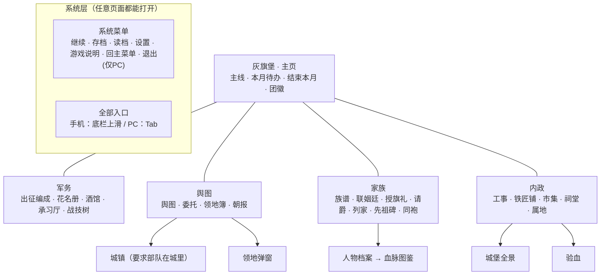
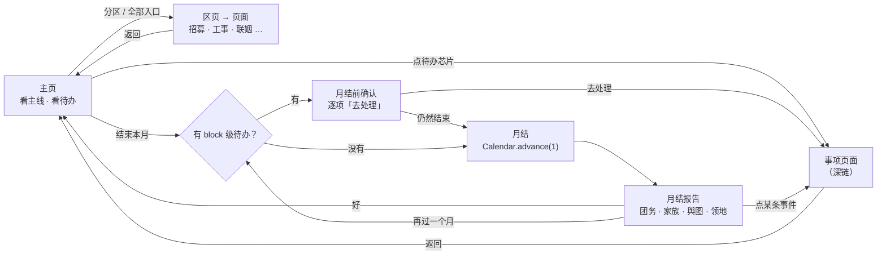
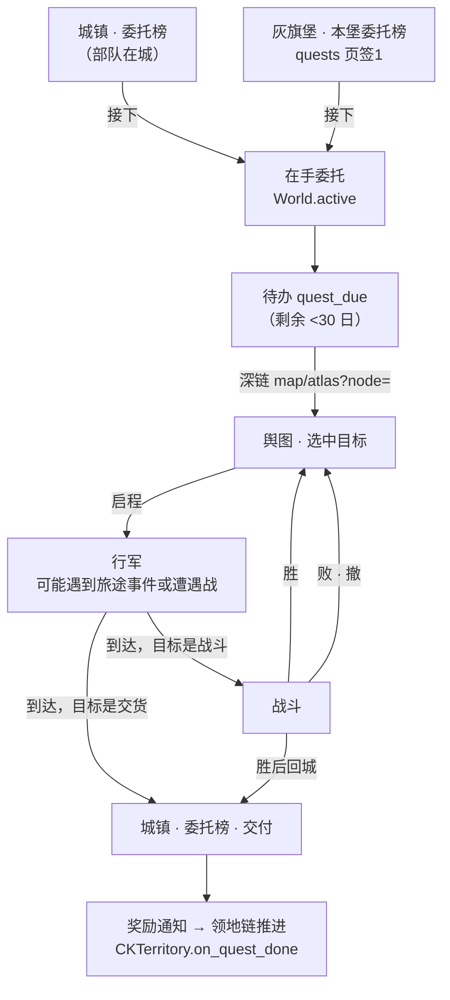
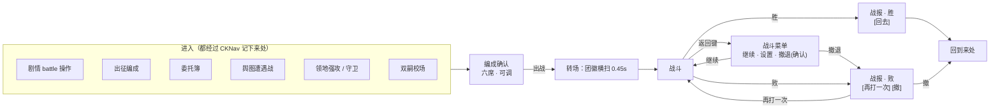
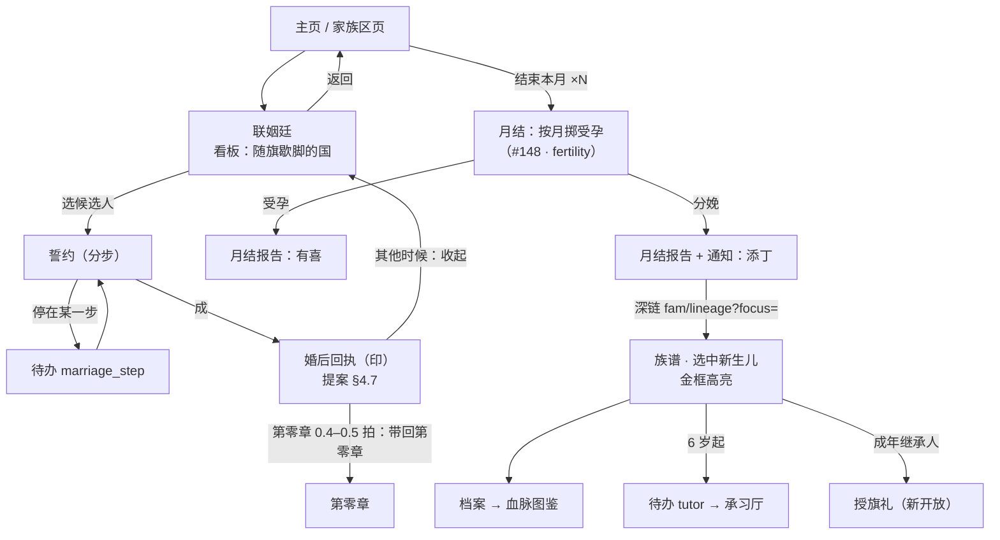
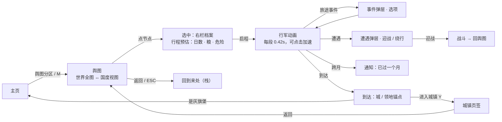
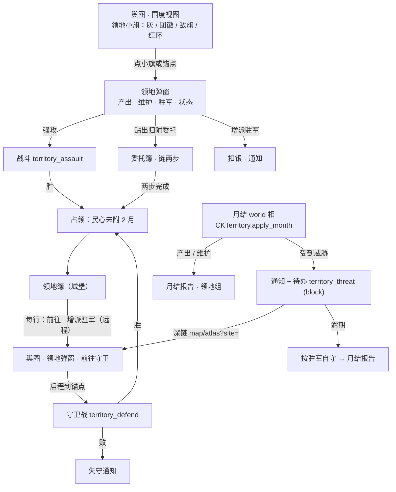
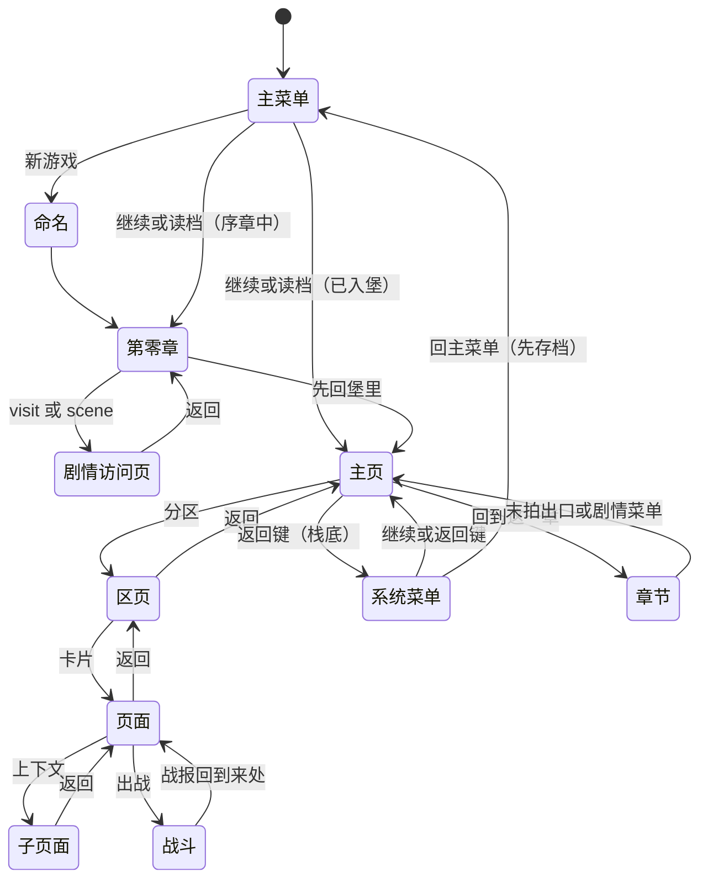
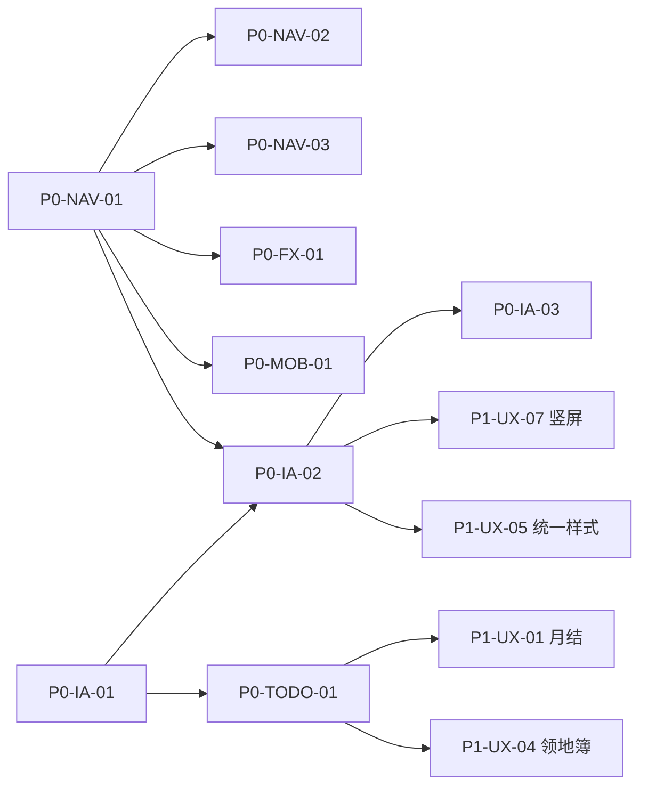

# 百年骑士 UX 导航与交互设计 v1

> 状态：已拍板（2026-10-12，见 §9 决议），按 §7 P0→P1→P2 分小 PR 实施。
> 代码基线：`origin/main` `f92a427c`。已含 #142 序章重做、#144/#146 领地、#147 团徽归属、#149 主线路由。
> 对照：`docs/audit/playtest-audit-v92.md`（分支 `cursor/playtest-audit-v92-158d`，PR #145）的 P0-1、P0-2、P0-7、P0-8、P1-1，以及进行中的 #148（入口）、#156（第二据点并入领地）、#157（出战每月一次）。
> 关联文档：`v92-upgrade-proposal.md` §4.6、§4.7、§4.9；`story-bible-v92.md` §12；`mobile-polish-banner-diy-v93.md` §2；`territory.md`；`heraldry-v2.md`。

## 0. 一页结论

1. **主界面藏功能，根因有四个。**
   - 一是入口只有一条 142px 宽的左侧导航轨。条目高 20px、字号 11（`castle_hub.gd` 357–364 行），锁住的条目直接隐藏（101 行）。
   - 二是解锁表有两份，而且互相矛盾：`tutorials.json` 和 `campaign_v92.json` 的 `unlocks`。代码只读前一份。
   - 三是有 5 个场景在游戏里根本进不去：先祖碑、同袍对话，以及列家、嗣位冲突、双嗣校场这个只互相链接的环。属地的解锁旗标 `e2_holdings` 全工程没有任何地方置位，所以属地也永远打不开。城堡全景和请爵虽然进得去，但入口藏在工事页里或团长牌上。
   - 四是领地（#144/#146）只能在舆图弹窗里操作，城堡里看不到"我有几处领地、哪处正被争夺"。
2. **跳转别扭，根因有三个。**
   - 一是每个页面都用 `change_scene_to_file` 把目标写死。脚本里共有 97 处这样的调用，返回目标分散在 `dossier_back`、`story_return`、`battle_return` 三个 meta 里，各管各的。
   - 二是 ESC 和 Android 返回键在所有页面上都被全局暂停菜单抢走（`mobile_chrome.gd` 85–94 行、`game_state.gd` 110–119 行）。页面自己写的"ESC 返回城堡"一次都不会触发。
   - 三是转场是硬切：`UIFX.page_exit()` 刚开始淡出，下一行就换场景（`atlas_view.gd` 1286–1288 行），所以看不到离场动画。城堡还同时叠了 `fade_in` 和 `page_enter` 两种入场。
3. **本设计的骨架：**
   - 一个主页「灰旗堡」，加五个一级分区：主堡、军务、舆图、家族、内政。
   - 每个分区有一张区页，二级入口全部摆出来；锁住的入口显示为灰色，并写明原因。
   - 一个全局导航器 `CKNav` 统一管理返回栈、返回键和深链。
   - 一个只数真事项的待办中心；一个全局转场层；一个快捷层（最近、全部入口、PC 热键）。
4. **P0 共 9 项**（§7）：
   - 导航器与返回键；
   - 统一解锁表，锁住的入口显示原因；
   - 新主页和区页；
   - 待办口径；
   - 战败返回；
   - 孤儿页面接线；
   - 转场层；
   - 触控尺寸；
   - Android 返回键不退出游戏。

## 1. 锁定规则与设计原则

### 1.1 锁定规则（不可违背）

| 规则 | 在本设计里的体现 |
|---|---|
| 精致、现代、高级的当代奇幻 UI，不走粗犷乡土风 | 继续用现有 Frost 霜青玻璃体系（`UIKit`、`UIFX`）。不引入木纹、羊皮纸、做旧边框。旧样式页面（§2.4）全部迁到 Frost chrome |
| 全游戏一种风格 | 所有页面统一用一套 chrome：顶栏、返回、页脚、区页卡片、锁定卡、底部弹层，不再并存两套按钮和背景 |
| 我们是一支佣兵团，只有一座固定主堡，团旗永久不变 | 主页就是灰旗堡，不做"选择据点"。舆图上的领地不是第二个家，在城堡里只是一页「领地簿」。顶栏常驻的是团徽（`GameState.banner_spec`，#147 起永久），族徽只出现在族谱和人物上 |

### 1.2 设计原则

- **P1 一屏知道下一步。** 主页第一眼回答三件事：主线下一章是什么、本月还剩什么没做、怎么结束这个月。
- **P2 看得见才找得到。** 已经承诺过的功能不隐藏。没开放的显示为灰色，写明"何时开放"，并能点开看说明。
- **P3 永远有路回去。** 任何页面都有可见的返回按钮。ESC、Android 返回键、手柄 B 键都是"回上一层"，任何时候都不会把玩家困在某一页。
- **P4 一点一义。** 点一下就做一件事，不靠右键，不靠悬停。长按只看说明，不执行操作。
- **P5 一个叫法。** 同一个功能在按钮、芯片、提示、帮助里叫同一个名字（§8 术语表）。
- **P6 动效服务方向感。** 前进时从右侧推入，返回时向右滑出，切换分区时交叉淡化，弹层从下方升起。转场时长不超过 0.3 秒。尊重设置里的「减少动效」。

## 2. 现状盘点

### 2.1 全局机制（所有页面共用）

| 机制 | 现在怎么做 | 位置 | 问题 |
|---|---|---|---|
| 场景切换 | 各页面直接调用 `get_tree().change_scene_to_file(<写死路径>)` | `scripts/` 和 `autoload/` 里共 97 处 | 返回目标写死；没有返回栈；同一页面从不同地方进入，返回都去同一处 |
| 返回目标 | 三个互不相干的 meta：`dossier_back`（档案）、`story_return`（剧情 visit，#149）、`battle_return`（战斗） | `unit_dossier.gd` 48 行、`story_catalog.gd` 22 行、`battle_report.gd` 156 行 | 三套逻辑，互不知道对方 |
| ESC 和返回键 | `MobileChrome._input()` 在所有平台上拦截 `ui_cancel`，切换暂停菜单；`GameState._unhandled_input()` 也切换一次；`NOTIFICATION_WM_GO_BACK_REQUEST` 也切换暂停菜单 | `mobile_chrome.gd` 85–94 行、`game_state.gd` 110–119 行 | 各页面 `_unhandled_input` 里的 `ui_cancel → _back()` 永远不会触发（审查 P2-7）。页脚的「ESC 返回城堡」不准确 |
| Android 返回键 | `project.godot` 没有设置 `application/config/quit_on_go_back`，Godot 4 默认为 `true` | `project.godot` | **按代码推断**，在 Android 上按返回键可能直接退出游戏，同时还会弹一次暂停菜单。需要真机核实 |
| 暂停菜单 | 继续、存档、读档、设置、回到灰旗堡（#149 新加）、标题 | `pause_menu.gd` 8–15 行 | 战斗中点「回到灰旗堡」会直接离开战斗，没有确认，也不算撤退 |
| 转场 | `UIFX.page_enter`：0.22 秒淡入加一条细线闪；`page_exit` 启动淡出后立刻换场景 | `ui_fx.gd` 229–247、334–337 行 | 离场动画看不到；场景同步加载，大页面（舆图 1455 行、城 1104 行）会卡一帧到几帧；城堡同时用了 `fade_in(0.32)` 和 `page_enter` |
| 触控尺寸 | `DeviceProfile.hit_px()` 的下限是 48dp；`MobileLayout.ensure_hit_targets` 自动放大按钮 | `device_profile.gd` 6、54–58 行 | 导航轨条目被列为例外，只有 20px 高。在 1080p、400dpi 的横屏手机上，1 个逻辑像素约等于 0.6dp，所以 20px 只有约 12dp |
| 竖屏 | `content_scale_size = 1280×720`，`ASPECT_EXPAND`；竖屏时把 1280 宽的设计稿缩到屏幕宽度 | `mobile_chrome.gd` 11–13 行、`mobile_layout.gd` 8–32 行 | **按公式推算**，1080×2400 的竖屏手机上，1 个逻辑像素约 0.84 物理像素，约 0.3dp。11 号字只有约 3–4sp，读不了。需要真机截图核实 |
| 新解锁提示 | 没有 | — | 入口悄悄出现在导航轨里（审查 P0-7） |
| 帮助 | 「游戏说明」`CKHelpCodex.open()`，城堡顶栏有按钮；灯引 `CKCoach` 首次进门时高亮 | `castle_hub.gd` 30–33 行 | 没有「带我去」深链（提案 §4.6 要求有） |

### 2.2 场景清单与可达性

可达性分四种：

- **直达**：城堡导航轨或城堡卡片上有入口。
- **仅转入**：只能从别的页面跳进去。
- **仅剧情**：只在剧情里出现。
- **孤儿**：游戏里没有任何入口。

返回一栏写的是代码里返回按钮实际去的地方。所有页面按 ESC 实际都会打开暂停菜单，见 §2.1，下表不再重复。

#### 外壳与剧情

| 场景 | 功能 | 现在怎么进 | 返回去哪 | 可达性 | 样式 |
|---|---|---|---|---|---|
| `ui/main_menu.tscn` | 新游戏、继续、读档、设置、制作人员、退出 | 启动 | — | 直达 | Frost |
| `story/naming.tscn` | 起姓、团徽 DIY（唯一一次） | 主菜单「新游戏」 | 主菜单 | 直达 | 自绘 |
| `ui/save_slots.tscn` | 存档位 | 主菜单「读档」 | 主菜单。读档后按 `hub_open` 去城堡或第零章（`save_slots.gd` 36–41 行） | 直达 | 自绘 |
| `ui/settings.tscn` | 设置，含 UI 缩放 0.9–1.4 | 主菜单；城堡导航轨「朝堂 → 设置」；暂停菜单 | 已开局回城堡，否则回主菜单（`settings.gd` 9–13 行） | 直达 | Frost |
| `ui/credits.tscn` | 制作人员 | 主菜单 | 主菜单 | 直达 | Frost |
| `ui/pause_menu`（CanvasLayer） | 暂停 | 任意页面按 ESC 或返回键 | 关闭 | 直达 | Frost |
| `story/chapter0.tscn` | 第零章，锁定 `ch0.json` | 命名之后；读档；城堡「继续主线」（ch0 未完成时）；酒馆、联姻、族谱、沙漏的返回（第零章特定拍） | 末拍「先回堡里」去城堡 | 仅剧情 | 对白 Frost |
| `story/chapter_player.tscn` | 卷章 e1–e5 | 城堡「继续主线」→ `StoryCatalog.request_chapter()` | 末拍没有动作时，自动补「回到灰旗堡」（#149，`chapter_player.gd` 337 行） | 直达 | 对白 Frost |
| `story/support_viewer.tscn` | 同袍支援对话 | **没有调用方**。只有 `bonds.gd` 23 行定义了常量 | 城堡 | **孤儿** | — |
| `debug/portrait_kinship.tscn` | 调试 | 没有入口 | 主菜单 | 调试，不进正式导航 | — |

#### 城堡（`hub/castle_hub.tscn`）

- **顶栏**：游戏说明、存档、「主菜单」。第三个按钮一点就回标题，主页上放这个太危险。
- **左侧导航轨**：五组。军务、内政、家族、朝堂、舆图。
- **中部**：三张卡，#01 主线、#02 酒馆、#03 联姻。下面是「继续主线」按钮，再下面是「本月待办」芯片。
- **右侧**：团长立绘牌，下面有「检视骑士完整档案」进花名册，「请爵」进 `title_promote`。
- **页脚提示是假的**：「B 返回中枢」「Y 快速休整」「LB/RB 切换分区」都没有对应的输入处理（`castle_hub.gd` 236、302 行）。

#### 由城堡导航轨进入的页面

下表的「解锁」列取自 `tutorials.json`（main 版）。

| 入口 id | 场景 | 现名 | 组 | 解锁 | 还能从哪进 | 返回去哪 | 样式 | 问题 |
|---|---|---|---|---|---|---|---|---|
| deploy | `deploy.tscn` | 战役 / 出战编成 | 军务 | 首年 | 花名册「委派出战」；舆图「出战编成」 | 城堡（从舆图进也回城堡） | Frost | 战败回第零章（见 §2.3）；出战可以无限重复（审查 P1-3，#157 在修） |
| train | `train.tscn` | 旗塾 | 军务 | 首年 | — | 城堡 | **旧** | 和 `campaign_v92` 的 e3_03 冲突 |
| skills | `skill_tree.tscn` | 战技树 | 军务 | e1_01 | — | 城堡 | **旧** | |
| tavern | `tavern.tscn` | 烽火酒馆 | 内政 | 首年 | 城堡卡 #02 | 城堡；第零章 0.2 拍回第零章 | Frost | 招募放在内政组，不符合直觉 |
| forge | `forge.tscn` | 炉火工坊 | 内政 | e1_05 | 花名册「锻造装备」 | 城堡 | Frost | 页面里 W 键或按钮进工事 |
| market | `market.tscn` | 陆桥商路 | 内政 | e1_04 | — | 城堡 | Frost | |
| estates | `estates.tscn` | 属地 | 内政 | `e2_holdings` | — | 城堡 | Frost | **`e2_holdings` 没有任何地方置位，永远锁着** |
| quests | `quests.tscn` | 委任榜 | 内政 | chapter0_done | 剧情 visit | 城堡或剧情 | **旧** | 和舆图城镇的「委托榜」是两套委托 |
| works | `works.tscn` | 工事 | 内政 | `e2_holdings` | 工坊、祠堂、属地 | 城堡 | Frost | 导航里永远锁着，只能从工坊或祠堂绕进去 |
| roster | `roster.tscn` | 花名册 | 家族 | 首年 | 城堡右牌 | 城堡 | Frost | 放在家族组，但它是军务 |
| shrine | `shrine.tscn` | 祠堂 | 家族 | e1_06 | — | 城堡 | Frost | |
| marriage | `marriage.tscn` | 联姻廷 | 家族 | e1_07 | 城堡卡 #03；授旗礼 | 城堡；第零章 0.4–0.5 拍回第零章 | Frost | 首年没进导航（审查 P0-7） |
| lineage | `lineage_view.tscn` | 族谱 | 家族 | child_born | 花名册「族谱」；授旗礼；剧情 | 城堡；第零章 0.5–0.55 拍回第零章 | Frost | 审查 P0-7 |
| rite | `lineage_rite.tscn` | 授旗礼 | 家族 | 有继承人 | 族谱 Y 键；联姻；双嗣校场 | 城堡 | **旧** | |
| hourglass | `hourglass.tscn` | 岁月沙漏 | 朝堂 | 首年 | 剧情 visit | 城堡或剧情 | **旧** | 推进月份是核心循环，却埋在「朝堂」组里；正式版里还留着「教程：跳至丰收月」按钮 |
| settings | `settings.tscn` | 设置 | 朝堂 | 首年 | — | 城堡 | Frost | 占用首年六门里的一扇 |
| atlas | `atlas_view.tscn` | 舆图 | 舆图 | chapter0_done | 剧情 visit | 城堡或剧情 | Frost | 组名和条目同名 |

#### 只能从别的页面转入的页面

| 场景 | 功能 | 现在怎么进 | 返回去哪 | 可达性 | 样式 | 问题 |
|---|---|---|---|---|---|---|
| `title_promote.tscn` | 请爵 | 城堡右牌「请爵」 | 城堡 | 仅转入 | Frost | 不在导航里，解锁表里也没有 `titles` |
| `unit_dossier.tscn` | 血脉详档 | 花名册；族谱 | `dossier_back` | 仅转入 | Frost | 档案里再进档案（242 行）会覆盖 `dossier_back` |
| `bloodline_codex.tscn` | 血脉图鉴 | 档案 Y 键；族谱 | **固定回族谱** | 仅转入 | Frost | 从花名册 → 档案 → 图鉴，返回时落到族谱 |
| `blood_test.tscn` | 验血 | 祠堂 V 键 | 祠堂 | 仅转入 | Frost | |
| `castle_view.tscn` | 城堡全景（九座建筑剪影） | 工事「全景」 | 工事 | 仅转入 | Frost | 这是"我的主堡"的最佳门面，却藏在第三层 |
| `court_news.tscn` | 十邦朝报 | 舆图「朝报」；族谱 | **固定回舆图** | 仅转入 | Frost | 从族谱进来，返回落到舆图 |
| `city.tscn` | 城镇：概览、铁匠铺、市集、委托榜、酒馆、军械库、灯籍 | 舆图「进入城镇」 | 舆图 | 仅转入 | Frost | 进城要看部队位置，这是合理的 |
| 舆图「领地」弹窗 | 领地：强攻、归附委托、驻军、守卫 | 舆图选中锚点后点「领地 N」，或点领地小旗 | 关闭弹窗 | 仅转入 | Frost | 城堡里看不到领地；受到威胁只写进日志 |
| `rival_houses.tscn` | 列家：敌宅态度 | 只有 `inheritance.tscn` 进得来 | 城堡 | **孤儿环** | **旧** | 和嗣位冲突互相链接，外面进不来 |
| `inheritance.tscn` | 嗣位冲突 | 只有 `rival_houses.tscn` 进得来 | 城堡 | **孤儿环** | **旧** | |
| `heir_rivalry.tscn` | 双嗣校场 | 只有 `rival_houses.tscn` 进得来 | 城堡、授旗礼 | **孤儿环** | **旧** | |
| `ancestors.tscn` | 先祖碑 | **没有调用方**。脚本注释写着"Castle entry is left for the UX stream" | 城堡 | **孤儿** | **旧** | |
| `battle.tscn` | 战斗 | 剧情 battle 操作；出战编成；委任榜；舆图遭遇；领地强攻和守卫；双嗣校场 | 战报 → `battle_return` | 直达 | Frost | 见 §2.3 |

### 2.3 跳转缺陷清单（本次读码所得，审查里没有的标 ★）

| # | 缺陷 | 证据 | 玩家感受 |
|---|---|---|---|
| J1 | ESC 和返回键在所有页面上都打开暂停菜单，从不返回上一层 | `mobile_chrome.gd` 85–94 行；`game_state.gd` 110–112 行 | "按返回键没反应，弹了个菜单" |
| J2 ★ | Android 返回键可能直接退出应用 | `project.godot` 没有设置 `quit_on_go_back`（Godot 4 默认为 true）；`game_state.gd` 118 行同时切换暂停菜单 | 闪退感（需真机核实） |
| J3 ★ | **战败一律回第零章**：没有遭遇战标记的战斗，输了以后「撤」去 `chapter0.tscn` | `battle_report.gd` 156 行：`else "res://scenes/story/chapter0.tscn"` | 委任榜、出战编成、领地、卷章的仗打输了，会被扔回序章 |
| J4 ★ | 战斗中暂停菜单的「回到灰旗堡」直接离开战斗，没有确认，也没有撤退结算 | `pause_menu.gd` 70 行 | 误触后整场战斗白打，或者可以借此逃避战败惩罚 |
| J5 ★ | 朝报固定回舆图，图鉴固定回族谱 | `court_news.gd` 46–47 行；`bloodline_codex.gd` 64–65 行 | "我从族谱进来，怎么到了舆图" |
| J6 ★ | 从舆图进出战编成，返回时落到城堡 | `deploy.gd` 121–122 行 | 离开了舆图上下文 |
| J7 ★ | 属地永远锁着；工事在导航里永远锁着 | `tutorials.json` 13 行的 `e2_holdings` 全工程没有置位 | "属地这功能不存在" |
| J8 ★ | 5 个场景是孤儿：先祖碑、同袍对话，以及列家、嗣位冲突、双嗣校场这个互链环。另有城堡全景只能从工事转入，请爵只能从团长牌进 | §2.2 | 做好的内容玩家永远看不到，或者很难找到 |
| J9 ★ | 城堡顶栏一点「主菜单」就回标题 | `castle_hub.gd` 23–25 行 | 主页上最显眼的按钮是退出 |
| J10 ★ | 城堡页脚的 B、Y、LB/RB 提示是假的 | `castle_hub.gd` 236、302 行，没有对应的输入处理 | 手柄玩家按了没反应 |
| J11 | 第零章有 6 个页面的返回会按拍号跳回第零章。这些规则写死在各页面的 `_back()` 里 | 酒馆 304 行、联姻 902 行、族谱 15 行、沙漏 106 行 | 规则不透明；拍号一改就漏 |
| J12 | 卷章末拍的出口（#149 已修）只写「回到灰旗堡」，不记来处 | `chapter_player.gd` 337 行 | 从舆图主线标记进的章节，也回城堡 |
| J13 ★ | 委托有两套：城堡委任榜用 `GameState.quests`，选了就开打，没有期限；城镇委托榜用 `World.boards` 和 `World.active`，有期限 | `quests.gd` 44、72–78 行；`city.gd` 677 行起 | "委任榜"和"委托榜"是两个东西，在手的委托在城堡里看不到 |
| J14 ★ | 领地受到威胁（30 日期限）只写进日志，城堡不提醒，也没有带路 | `territory.gd` 369 行起；`castle_hub.gd` 没有读 `CKTerritory` | 领地在不知不觉中丢掉 |

### 2.4 样式不一致

用旧 chrome（`make_themed_bg`、`make_button`，没有顶栏和页脚）的页面有 9 个：`train`、`skill_tree`、`quests`、`hourglass`、`lineage_rite`、`ancestors`、`rival_houses`、`inheritance`、`heir_rivalry`。它们的返回按钮位置、字号和背景都和其余 20 个 Frost 页面不同，违反"全游戏一种风格"。

### 2.5 解锁表三方对照

| 入口 | `tutorials.json`（main，代码读这份） | `campaign_v92.json` `unlocks`（代码不读） | #148（进行中） | 故事圣经 §12 |
|---|---|---|---|---|
| deploy | 首年 | e1_01 | 首年 | 「战役」首年 |
| roster | 首年 | e1_01 | 首年 | 首年 |
| tavern | 首年 | e1_02 | 首年 | 首年 |
| marriage | e1_07 | e1_07 | 首年 | 首年 |
| lineage | child_born | e2_01 | 首年 | 首年 |
| hourglass | 首年 | e3_05 | 首年 | 首年 |
| settings | 首年 | — | 首年 | 不在六门里 |
| train | 首年 | e3_03 | 首年 | 不在六门里 |
| skills | e1_01 | e3_03 | — | — |
| atlas | chapter0_done / e1_04 | e1_04 | 首年 | e1_04 |
| quests | chapter0_done / e1_08 | e1_08 | 首年 | e1_08 |
| market | e1_04 | e1_04 | — | — |
| forge | e1_05 | e1_05 | — | e1_05 |
| shrine | e1_06 | e1_06 | — | e1_06 |
| blood_test | （跟着祠堂） | e2_05 | — | — |
| dossier | （始终可进） | e2_06 | — | — |
| estates | e2_holdings（没有置位） | e3_01 | — | — |
| works | e2_holdings（没有置位） | — | — | — |
| rite | 有继承人 | e3_05 | — | — |
| titles | — | e4_03 | — | — |
| court_news | — | e4_08 | — | — |

## 3. 信息架构

### 3.1 顶层结构



**一级导航**有五个：主堡、军务、舆图、家族、内政。

- 横屏和 PC 用左侧竖排的分区轨，每格不低于 48dp，图标加两个字。
- 竖屏用底部标签栏。
- 原来的「朝堂」组撤销：沙漏变成主页上常驻的「结束本月」；设置进系统菜单；朝报归舆图；请爵归家族。
- 酒馆从内政移到军务，因为招人是团务。花名册从家族移到军务，因为它管的是出战的人。族谱仍在家族。

**二级导航是区页。** 点一个分区，先进它的区页，不直接跳进第一个子页面。区页是一组卡片，每张卡片包含：

- 名称、一行副题；
- 状态行，例如「待办 2」「本月可传习」「第一卷第 5 章后开放」；
- 卡片本身就是入口，整张可点。

**三级页面**是现在的各个场景。上下文页面不进导航，只能从卡片或人物上点进去：档案、图鉴、城镇、验血、城堡全景、嗣位冲突、双嗣校场。

### 3.2 入口总表（目标状态）

`entry id` 沿用 `tutorials.json` 里的 id。新增的 id 标「新」。

| 分区 | entry id | 显示名（§8 术语） | 场景 | 解锁（建议，见 §3.3） | 锁定时的说明 |
|---|---|---|---|---|---|
| 主堡 | home | 灰旗堡 | `castle_hub.tscn` | 常开 | — |
| 主堡 | mainline | 回到这一章 | 播放器 | 常开 | — |
| 主堡 | month | 结束本月 | 月结弹层（取代 `hourglass.tscn`） | 常开 | — |
| 主堡 | castle_view | 城堡全景 | `castle_view.tscn` | 第零章「入驻灰旗堡」起 | 「入驻灰旗堡后开放」 |
| 军务 | deploy | 出征编成 | `deploy.tscn` | 首年 | — |
| 军务 | roster | 花名册 | `roster.tscn` | 首年 | — |
| 军务 | tavern | 酒馆 | `tavern.tscn` | 首年 | — |
| 军务 | train | 承习厅（待定名，§8） | `train.tscn` | e1_01 | 「第一卷第 1 章《过路银的收据》后开放」 |
| 军务 | skills | 战技树 | `skill_tree.tscn` | e1_01 | 同上 |
| 舆图 | atlas | 舆图 | `atlas_view.tscn` | chapter0_done | 「第零章结束后开放」 |
| 舆图 | quests | 委托 | `quests.tscn`（改成两个页签：本堡委托榜、在手委托） | chapter0_done | 同上 |
| 舆图 | territory（新） | 领地簿 | 新场景 `territory_ledger.tscn`，或 `quests` 的第三个页签 | 舆图开放，且任一国声望 ≥10 | 「与任一国交好（声望 10）后可占领领地」 |
| 舆图 | court_news（新） | 朝报 | `court_news.tscn` | chapter0_done | — |
| 家族 | lineage | 族谱 | `lineage_view.tscn` | 首年，没有子嗣时显示空族谱 | — |
| 家族 | marriage | 联姻廷 | `marriage.tscn` | 首年 | — |
| 家族 | rite | 授旗礼 | `lineage_rite.tscn` | 有继承人 | 「家中有继承人后开放」 |
| 家族 | titles（新） | 请爵 | `title_promote.tscn` | e1_01 | 「第一卷第 1 章后开放」 |
| 家族 | rivals（新） | 列家 | `rival_houses.tscn` | e2_01 | 「第二卷开始后开放」 |
| 家族 | ancestors（新） | 先祖碑 | `ancestors.tscn` | 第一位族人辞世 | 「家中第一位先人辞世后立碑」 |
| 家族 | bonds（新） | 同袍 | `support_viewer.tscn` | 第一段支援对话可看 | 「与同伴并肩作战后解锁对话」 |
| 内政 | works | 工事 | `works.tscn` | chapter0_done | 「第零章结束后开放」 |
| 内政 | forge | 铁匠铺（提案 §4.8） | `forge.tscn` | e1_05 | 「第一卷第 5 章后开放」 |
| 内政 | market | 市集 | `market.tscn` | e1_04 | 「第一卷第 4 章后开放」 |
| 内政 | shrine | 祠堂 | `shrine.tscn` | e1_06 | 「第一卷第 6 章后开放」 |
| 内政 | estates | 属地 | `estates.tscn` | e3_01（campaign 版），并补上真实旗标 | 「第三卷第 1 章后开放」 |

以下页面不进入总表，只通过上下文进入：

- 档案、图鉴：从人物进。
- 城镇：从舆图进。
- 验血：从祠堂进。
- 嗣位冲突、双嗣校场：由列家或事件带入，见 §3.5。
- 领地弹窗：从舆图或领地簿进。

### 3.3 渐进开放规则

- **U1 只有一份解锁表。** 以 `tutorials.json` 为准，`campaign_v92.json` 的 `unlocks` 改成由它生成，或者删掉。加一个测试：两份一致，并且每个旗标都有地方置位（J7 就是这样漏掉的）。
- **U2 入口有四种状态。**

  | 状态 | 外观 | 点击后 |
  |---|---|---|
  | 开放 | 正常卡片 | 进入页面 |
  | 新开 | 卡片右上角金点；分区图标上也有金点 | 进入页面，金点消失 |
  | 锁定 | 卡片 50% 不透明、锁形图标，副题位置写锁定说明 | 底部弹出锁定卡：功能一句话、开放条件；如果条件是一章主线，给「带我去」按钮，直接打开那一章 |
  | 剧透隐藏 | 不显示 | — |

  「剧透隐藏」只用于"知道名字就剧透"的入口，目前只有嗣位冲突和双嗣校场，它们本来就不进总表。其余入口一律显示锁定状态，不隐藏（审查 P0-8）。
- **U3 锁定说明自动生成。** 由 `UnlockSchedule` 根据旗标查章节标题，拼成「第一卷第 4 章《平梢的空船》后开放」。需要一张旗标到章节的映射表，可以从 `campaign_v92.json` 的章节 id 推出来。非章节条件（有继承人、声望、先人辞世）用固定文案。
- **U4 首年六门。** 照故事圣经：战役（主线卡加出征编成）、花名册、酒馆、联姻廷、族谱、结束本月。设置和游戏说明在系统菜单里常驻，不算门（审查 P0-7 和第六节第 4 条）。第零章结束时，再开舆图、委托、工事、朝报（采用 main 现行的 `chapter0_done` 时机）。
- **U5 分区永远不空。** 一个分区里如果全部锁定，区页显示锁定卡片，而不是空白，也不是只有一个标题（审查 P0-8 的"空分组标题"）。分区标签本身永远可点。
- **U6 开放那一刻。** 旗标置位以后，下一次回到主页时：
  1. 顶部滑下一条通知，例如「新开放：舆图」，停留 2.4 秒，可以点。
  2. 对应分区和卡片挂上金点。
  3. 灯引对这张卡高亮一次（`CKCoach`）。
  4. 游戏说明里登记这个条目。

  如果一次开放好几个，合成一条通知「新开放 3 处」，点开后列出来。
- **U7 和 #148 对齐。** #148 让舆图、委托、族谱、联姻首年全开，和 U4 有三处不同：舆图和委托在本设计里推迟到第零章结束。合并前要二选一，并同步改 `story-bible-v92.md` §12 的六门表。建议按 U4 来：首年就是六门；第零章结束后舆图开放，从时间上看只比 #148 晚半年游戏时间。

### 3.4 返回栈与返回键

新增 autoload `CKNav`（`autoload/nav.gd`），所有场景跳转都经过它。

```gdscript
# 接口草案（仅示意，实现时以此为准）
CKNav.go(entry_or_path: String, params := {})   # 压栈前进
CKNav.replace(entry_or_path: String, params := {})
CKNav.back()                                   # 出栈；栈底时打开系统菜单
CKNav.home()                                   # 清栈回灰旗堡
CKNav.tab(section: String)                     # 切换一级分区：栈截到主页，再压区页
CKNav.open_link(uri: String)                   # 深链，见 §3.5
CKNav.push_overlay(node) / pop_overlay()       # 弹层也算一层
CKNav.params() -> Dictionary                   # 目标页读参数，替代散落的 meta
```

规则如下。

- **B1 栈的形状。** 栈是 `[主页, 区页?, 页面, 子页面…]`，栈底永远是主页（第零章进行中时，栈底是第零章）。栈只存在内存里，不写进存档；读档以后从主页开始。最多 8 层，超过时丢掉中间层，保留栈底。
- **B2 一个返回动作，四种触发。** 页面左上角的「‹ 返回 <上一页名>」按钮、ESC、Android 返回键、手柄 B 键，统一调用 `CKNav.back()`。按以下优先级处理：
  1. 输入框有焦点：取消焦点。
  2. 有弹层（锁定卡、确认框、月结弹层、领地弹窗、灯引）：关掉最上面一层。
  3. 正在转场：忽略这次按键。
  4. 栈深大于 1：出栈。
  5. 已在栈底（主页）：打开系统菜单。系统菜单开着时再按，关掉系统菜单。
- **B3 永远不因返回键退出。** 在 `project.godot` 里设置 `application/config/quit_on_go_back=false`。`NOTIFICATION_WM_GO_BACK_REQUEST` 只交给 `CKNav.back()` 处理。退出只有两条路：PC 上系统菜单或主菜单的「退出」；手机上用系统手势离开应用（离开时自动存档，现有 `CKAutosave.on_background`）。
- **B4 战斗例外。** 战斗中按返回键，打开**战斗菜单**：继续、设置、撤退。撤退要二次确认，确认后按战败处理并回到出发地。战斗菜单里没有「回到灰旗堡」和「标题」（修 J4）。战报出现后，返回键等于战报上的主按钮。
- **B5 剧情例外。** 对白里按返回键，打开**剧情菜单**：继续、回到灰旗堡（进度保留在这一拍）、设置。剧情菜单不跳过剧情，也不把这一章标为完成。卷章末拍的出口沿用 #149。
- **B6 切换分区。** 切换分区不压栈：栈截到主页，再压入目标区页。从任何深层页面点分区，都落到那个区的区页，和手机应用的标签栏习惯一致。P2 可以加"每个分区记住自己的子栈"。
- **B7 第零章的返回由数据决定。** 剧情用 `visit` 或 `scene` 打开页面时，以剧情为栈底压入目标页；目标页的返回自然回到剧情。删掉酒馆、联姻、族谱、沙漏 `_back()` 里按拍号判断的分支（修 J11），由 `story_return` 并入 `CKNav`。
- **B8 战斗的来处。** 进入战斗时，`CKNav` 记下来处和参数（例如舆图的视图和选中节点）。战报的「回去」「撤」都回到来处。输了还能「再打一次」（现有 `reload_current_scene`）。只有第零章的仗输了才回第零章（修 J3、J6）。
- **B9 页面不再写死目标。** 所有 `_back()` 改为调用 `CKNav.back()`。`dossier_back`、`story_return`、`battle_return`、`city_tab`、`atlas_view`、`dossier_id`、`city_id` 这些 meta 改成 `CKNav` 的参数。迁移期间 `CKNav` 也写这些 meta，旧代码照常工作。
- **B10 页脚提示和返回按钮。** 页脚第一个提示固定是「ESC / B 返回」。PC 上显示键帽，手机上不显示键帽（手机没有键盘）。返回按钮从顶栏右侧移到**左上角**：PC 的习惯；手机横屏时左手拇指够得到；竖屏时由系统手势和底栏承担返回。

### 3.5 深链

深链格式是 `<分区>/<入口>[?参数]`，由 `CKNav.open_link()` 解析。深链可能来自待办、通知、游戏说明的「带我去」、剧情的 `visit`、人物卡上的按钮、月结报告。

| 深链 | 打开什么 | 谁会用 |
|---|---|---|
| `home` | 主页 | 系统菜单「回到灰旗堡」 |
| `story/current` | 当前主线章 | 主页主线卡、锁定卡「带我去」 |
| `story/<chapter_id>` | 指定章（`StoryCatalog.path_for`） | 锁定卡「带我去」 |
| `mil/roster?focus=<cid>` | 花名册并选中这个人 | 伤员待办、出生通知 |
| `mil/deploy` | 出征编成 | 主页 |
| `mil/tavern` | 酒馆 | 主页 |
| `map/atlas?node=<nid>&view=<nation>` | 舆图并选中节点 | 委托到期、领地威胁、主线标记 |
| `map/atlas?site=<site_id>` | 舆图并打开领地弹窗 | 领地簿「前往」、威胁通知 |
| `map/quests?tab=active` | 在手委托 | 委托待办 |
| `map/territory` | 领地簿 | 主页领地条 |
| `fam/lineage?focus=<cid>` | 族谱并选中这个人 | 出生、岁课、专师待办 |
| `fam/marriage` | 联姻廷 | 婚约待办 |
| `fam/dossier?cid=<cid>` | 档案 | 任意人物头像长按 |
| `civ/works?slot=<id>` | 工事并选中这座建筑 | 工事落成待办 |
| `sys/settings` | 设置 | 系统菜单 |
| `sys/help?entry=<id>` | 游戏说明的某一条 | 锁定卡「这是什么」 |

规则：

- **L1** 深链指向锁定的入口时，打开锁定卡，不进页面。
- **L2** 深链指向需要部队在场的页面（城镇）、而部队不在时，改为打开舆图并选中那个城，同时提示「部队不在此城，可从这里启程」。
- **L3** 深链总是压在当前栈上，所以返回会回到点链接的地方。唯一的例外是通知里的深链：先 `home()`，再压入，避免栈越堆越深。
- **L4** 深链目标不存在时（人物已死、领地已失），落到所属区页，并提示原因。不报错，也不黑屏。
- **L5** 剧情用 `visit` 或 `scene` 打开的页面不受锁定限制，因为剧情本身就是教学（第零章 0.3x 拍会带玩家看委托榜和舆图）。打开以后，这个入口记为「已见」，不再挂金点。

### 3.6 待办与通知

#### 待办

每条待办是一个对象：`{id, kind, label, count, severity, due_days, link, entry}`。

- `severity` 有三档：
  - `block`：会挡住你。例如领地受到威胁、委托 7 日内到期、婚约停在某一步。
  - `due`：有期限。例如委托 30 日内到期、工事本月落成、随行席将在月结时离开。
  - `unread`：未读。例如岁课信、重卡、朝报新条目、新开放的入口。
- **只数真事项。** 口径照提案 §4.9。下表在 §4.9 之外补了领地、出生、朝报三行。

  | kind | 什么时候出现 | 计数 | 深链 | 先检查的入口 |
  |---|---|---|---|---|
  | quest_due | 已接的委托，剩余不到 30 日 | 件数 | `map/quests?tab=active` | quests |
  | territory_threat | 领地受到威胁，期限未到 | 处数，按剩余日排序 | `map/atlas?site=…` | territory |
  | works_done | 已付款、本月落成的升级 | 座数 | `civ/works?slot=…` | works |
  | marriage_step | 誓约停在某一步，或随行席将在本次月结离开 | 1 | `fam/marriage` | marriage |
  | injured | 有伤情，且医舍或药柜这个月用得上 | 人数 | `mil/roster?focus=…` | roster |
  | tutor | 6–15 岁、还没有专师的孩子 | 人数 | `fam/lineage?focus=…` | train |
  | sui_ke | 有未读的岁课信 | 封数 | `fam/lineage?focus=…` | lineage |
  | life_card | `life_pending` 里已有界面的那一张 | 1 | 那张卡的页面 | — |
  | birth | 本月出生，还没在族谱里看过 | 人数 | `fam/lineage?focus=…` | lineage |
  | festival | 这个月真有一张还没选的节庆卡 | 1 | 节庆弹层 | — |
  | estate_slot | 属地有空工位，且有合适的亲属 | 空位数 | `civ/estates` | estates |
  | court_news | 朝报有新条目，并且与我方联姻国或敌宅有关 | 条数 | `map/court_news` | court_news |

- **T1** 每条待办先检查 `entry` 是否开放，没开放的不出现（审查 P1-1）。
- **T2** 计数为 0 的不出现。全部为 0 时，这一行写「本月无待办」。
- **T3** 分区角标等于这个分区里可见待办的计数之和。`block` 级显示红点加数字，其余显示霜青数字。主页的待办条最多显示 4 颗芯片，多出来的显示「+N」，点开是完整列表。
- **T4** 每颗芯片点进去就是那件事，不进入空目录（提案 §4.9）。
- **T5** 删掉现在的「可升级工事」（数没满级的座数）、「可交付委托」（数整张目录）、「可议婚事」（数候选人）、「伤病」（数 hp 不满的人）、「节庆」（按月份猜）、「可传习」（只看银子够不够）这六种算法（`todo_center.gd` 37–79 行）。

#### 通知

新增 `CKToast` 队列，全局只有一个，挂在 `CKNav` 的转场层上。

- 种类：新开放、月结摘要、领地受到威胁、委托完成、出生、存档完成。
- 同时最多显示 1 条，其余排队，每条停留 2.4 秒。点击走深链。手机上可以向上滑掉。
- 战斗中和对白中不弹，留到下一次回到主页或舆图时再弹。
- 现在散落的 `_hint.text = …`、舆图的 `_show_toast`，逐步改走这个队列。

#### 月结前提醒

- 点「结束本月」时，如果有 `block` 级待办，先弹一个确认层，列出这些事项。每一项都带「去处理」深链，底部是「仍然结束本月」。只提醒，不硬拦。
- 没有 `block` 级待办时，直接月结，然后弹出**月结报告**：按「团务 / 家族 / 舆图 / 领地」分组列出事件，每条可点深链。报告底部是「好」（回主页）和「再过一个月」。
- 舆图跑图跨月时，报告折叠成一条通知「已过一个月 · 查看」，点开是同一份报告。

### 3.7 快捷层

| 快捷方式 | 手机 | PC |
|---|---|---|
| 切换一级分区 | 点底栏或侧轨 | 数字键 1–5；手柄 LB/RB |
| 全部入口（按分区列出全部入口和锁定说明，可搜索） | 底栏上滑，或长按分区标签 | Tab 键；手柄 Select |
| 回主页 | 点「主堡」分区 | Home 键或 H |
| 舆图 | 点「舆图」分区 | M |
| 族谱 | — | L |
| 结束本月 | 主页右下角的主按钮 | 主页上按 Enter；任意页面按 Ctrl+Enter（弹确认层） |
| 快速存档 | 系统菜单 | F5 |
| 游戏说明 | 系统菜单；锁定卡「这是什么」 | F1 |
| 最近 | 主页「最近」一行，3 个最近进过的入口 | 同左 |
| 人物 | 任意人物头像：点一下选中，长按看档案 | 点一下选中；右键或 I 键看档案 |

快捷层不绕过解锁：锁定的入口一律打开锁定卡。

**主堡与部队位置：** 灰旗堡是团部，任何时候都能"回堡"打理，部队在舆图上的位置不变。这和 `territory.md` §4"在本堡远程下令"一致。需要部队在场的事（进城、强攻、守卫）只能在舆图上做。从主页深链过去时，按 L2 带到舆图。

## 4. 页面布局（线框）

### 4.1 主页（横屏与 PC，1280×720 逻辑像素）

```text
┌──────────────────────────────────────────────────────────────────────────────┐
│ [团徽] 灰旗堡 · 霜行团   第3年 春二月      银 182  粮 64(12日)  士气 71   ≡ │ 56
├────┬─────────────────────────────────────────────────────────┬───────────────┤
│ 堡 │  主线                                                   │  团长牌       │
│ ●  │  第一卷 · 第 4 章《平梢的空船》                         │  [立绘]       │
│ 军 │  上次停在：渡口的空船                                   │  霜行·岚 32岁 │
│ 2  │                          [ 回到这一章  ▶ ]  (主按钮)     │  重骑·男爵    │
│ 图 │─────────────────────────────────────────────────────────│               │
│ !1 │  本月待办                                               │  [档案] [请爵]│
│ 家 │  [⚑ 领地·北渡 受威胁 18日] [委托 2] [岁课信 1] [+2]     │               │
│ 1  │─────────────────────────────────────────────────────────│  领地 3 处    │
│ 政 │  新开放：市集 ✦          最近：族谱 · 舆图 · 酒馆       │  1 处受威胁   │
│    │─────────────────────────────────────────────────────────│  [领地簿]     │
│    │  本月预计：月饷 -36 · 领地 +42 · 婚约第 3 步            │               │
│    │                                   [ 结束本月  ⏎ ]        │               │
├────┴─────────────────────────────────────────────────────────┴───────────────┤
│ ESC 系统菜单   1–5 分区   Tab 全部入口   F5 存档                             │ 32
└──────────────────────────────────────────────────────────────────────────────┘
```

- 左侧分区轨宽 72 逻辑像素，每格 = 图标 + 两个字 + 角标，高度不低于 `hit_px()`。五格加主堡在 720 高里放得下。
- 「回到这一章」放在中部，是唯一的霜青主按钮。「结束本月」放右下角，是次级强调按钮（描边金）。两者不并排，避免误触。
- 右上角「≡」是系统菜单。原来的「主菜单」按钮移进系统菜单（修 J9）。
- 右栏的团长牌保留。下方加领地条，读 `CKTerritory.owned_ids()` 和受威胁数。
- 删掉原来的三张卡：#01 并入主线区，#02 和 #03 的内容由待办和分区承担，不再固定推荐酒馆和联姻。

### 4.2 主页（竖屏手机，P1）

```text
┌──────────────────────────────┐
│[团徽] 灰旗堡   春二月     ≡ │
│ 银182 粮64 士气71            │
├──────────────────────────────┤
│ 主线                         │
│ 第一卷 · 第4章《平梢的空船》 │
│ [      回到这一章  ▶      ]  │
├──────────────────────────────┤
│ 本月待办                     │
│ ⚑ 北渡受威胁 · 18 日      ›  │
│ 委托 2 件将到期           ›  │
│ 岁课信 1 封               ›  │
├──────────────────────────────┤
│ 新开放：市集 ✦               │
│ 最近：族谱 · 舆图 · 酒馆     │
│                              │
│        [ 结束本月 ⏎ ]        │ ← 拇指区
├──────────────────────────────┤
│ 堡   军²  图!  家¹  政       │ ← 底栏 ≥56dp + 底部安全区
└──────────────────────────────┘
```

**竖屏的前提：** 竖屏时 `content_scale_size` 改成 720×1280，而不是把 1280 宽的横屏稿缩小（见 §2.1 竖屏一行的推算）。没有专门竖屏布局的页面（战斗、舆图、城堡全景），提示「横屏体验更好」，并按现在的方式缩放。

**和 `mobile-polish-banner-diy-v93.md` §2.6 的关系：** 那份文档要求枢纽"竖屏优先"。本设计建议的顺序是：P0 先做好横屏（手机和 PC 共用一套）；P1 再做竖屏专用布局；P1 落地之前，把 Android 的方向设为 `sensor_landscape`，避免竖屏下字小到读不了。这一点需要拍板（§9 第 2 条）。

### 4.3 区页（以家族为例）

```text
┌──────────────────────────────────────────────────────────────────────────────┐
│ ‹ 灰旗堡   家族                                         银 182 … ≡           │
├────┬─────────────────────────────────────────────────────────────────────────┤
│ 堡 │ ┌──────────────┐ ┌──────────────┐ ┌──────────────┐ ┌──────────────┐     │
│ 军 │ │ 族谱       1 │ │ 联姻廷       │ │ 授旗礼   🔒  │ │ 请爵         │     │
│ 图 │ │ 三代 · 7 人  │ │ 誓约第 3 步  │ │ 家中有继承人 │ │ 可请：子爵   │     │
│ 家●│ │ 岁课信 1     │ │              │ │ 后开放       │ │              │     │
│ 政 │ └──────────────┘ └──────────────┘ └──────────────┘ └──────────────┘     │
│    │ ┌──────────────┐ ┌──────────────┐ ┌──────────────┐                      │
│    │ │ 列家         │ │ 先祖碑   🔒  │ │ 同袍     ✦   │                      │
│    │ │ 朔影：敌对   │ │ 第一位先人   │ │ 新对话 2     │                      │
│    │ │              │ │ 辞世后立碑   │ │              │                      │
│    │ └──────────────┘ └──────────────┘ └──────────────┘                      │
├────┴─────────────────────────────────────────────────────────────────────────┤
│ ESC 返回   ←→↑↓ 选择   A 进入                                                │
└──────────────────────────────────────────────────────────────────────────────┘
```

- 卡片 2–4 列自适应，最小 240×132 逻辑像素。手机横屏时每排 3 张。
- 锁定卡片可以点，点开是底部的锁定卡。

### 4.4 锁定卡与月结前确认（底部弹层）

```text
┌──────────────────────────────────────────┐
│ 🔒 市集                                   │
│ 在堡里买卖粮、铁、药材。                   │
│ 第一卷第 4 章《平梢的空船》后开放          │
│                                            │
│ [这是什么]            [带我去这一章 ▶]     │
└──────────────────────────────────────────┘

┌──────────────────────────────────────────┐
│ 结束本月之前                               │
│ ⚑ 北渡受威胁，还剩 18 日          [去处理] │
│ ◆ 委托「盐车护送」还剩 6 日       [去处理] │
│                                            │
│ [返回]                  [仍然结束本月 ⏎]   │
└──────────────────────────────────────────┘
```

## 5. 核心循环流程

### 5.1 月循环



- 月结动画：月历条翻页 0.3 秒，资源数字逐个跳动（`UIFX.resource_tick`）。报告从下方升起。
- 月结期间输入锁住。报告出来以前，返回键无效。

### 5.2 委托



- 两套委托收拢成**一本委托簿**：`quests.tscn` 改成三个页签，分别是「本堡委托榜」「在手委托（全舆图）」「已完成」。在手委托的每一行带「在舆图上看」深链。城镇里的委托榜不变。
- 本堡委托榜接下战斗型委托时，不再直接开打，先进出征编成（与 #157 的"每月一次"规则一致）。战报返回委托簿（B8）。

### 5.3 战斗



- 来处：剧情回到章节的下一拍，出征编成回编成页，委托回委托簿，遭遇战回舆图（保留视图和选中节点），领地回舆图并打开领地弹窗，双嗣校场回校场。
- 第零章的仗沿用剧情自己的「这一仗可以再打。旗还在。」（`ch0.json` 305 行）。

### 5.4 联姻与出生



- 第零章 0.5「初啼」：用现有的 `advance until_flag: child_born`（`ch0.json` 1462 行）一次推进到出生，然后自动深链到族谱并选中新生儿。族谱的返回回到第零章（B7）。

### 5.5 世界行旅



- 舆图的「返回城堡」改成标准的「‹ 返回」，回到来处。从主页进来就回主页，从剧情 visit 进来就回剧情。
- 行军中按返回键：先暂停行军并询问「停在下一站 / 继续」，不直接离开舆图。

### 5.6 领地



- **领地簿**（新）：列出我方领地的产出、维护、驻军、民心、威胁剩余日。每行两个按钮：「前往」（深链到舆图）、「增派驻军」（远程，`territory.md` §4 允许）。表头写「灰旗堡永不失守」，回应用户的锁定规则。
- 领地旗一律画团徽（`CKTerritory.banner_texture`），和顶栏团徽同一张纹章。

### 5.7 全局导航状态



## 6. 交互手感

### 6.1 转场

新增转场层 `CKTransition`：放在 `CKNav` 里，是一个 layer 90 的 CanvasLayer，低于暂停菜单的 100。所有换场景都走它。

1. 点击：按钮按压反馈 0.1 秒（`UIFX.press_feedback`），同时 `ResourceLoader.load_threaded_request(目标)` 开始后台加载。
2. 离场：当前页面按方向退出，0.14 秒。
3. 如果资源还没加载完，显示**墨幕**（`UIKit.BG` 加团徽水印，0.2 秒内淡入）。加载超过 0.6 秒，团徽开始呼吸，不出现进度条。
4. 换场景：`change_scene_to_packed(已加载的资源)`。
5. 入场：新页面按方向进入，0.2 秒。各页面不再自己调用 `fade_in` 或 `page_enter`，改由转场层统一做；`page_enter` 只保留顶栏细线闪。
6. 转场期间输入锁住，防止连点。

| 动作 | 离场 | 入场 | 曲线 | 减少动效时 |
|---|---|---|---|---|
| 前进（go） | 左移 24px，淡出，0.14s | 从右 24px 移入，淡入，0.2s | ease-out cubic | 只做交叉淡化，0.08s |
| 返回（back） | 右移 24px，淡出，0.14s | 从左 24px 移入，淡入，0.2s | ease-out cubic | 同上 |
| 切换分区 | 淡出 0.1s | 淡入 0.16s；分区轨的选中块滑动 0.18s | ease-in-out sine | 0.08s |
| 弹层 | — | 从下方升起 18px，0.22s；背景压暗到 72%，0.16s | ease-out cubic | 0.08s |
| 进战斗 | 团徽横扫画面，0.45s | 棋盘淡入，0.3s | ease-in-out | 0.15s 交叉淡化 |
| 进剧情 | 淡到墨色，0.2s | 对白框升起，0.25s | ease-out | 0.08s |
| 月结 | — | 月历翻页 0.3s，然后报告升起 | ease-out | 直接出报告 |

时长上限沿用 `UIFX.transition_seconds()` 的 0.25 秒，进战斗是唯一例外。

### 6.2 反馈

| 层级 | 视觉 | 声音 | 触感（手机） |
|---|---|---|---|
| 按下 | 缩到 0.97，0.1 秒；霜青边亮起 | `Sfx.click` | 无 |
| 确认（花钱、缔约、出战、结束本月） | `confirm_burst` | `ui_confirm` | 12ms（`UIFX.haptic`） |
| 拒绝（禁用按钮、条件不足） | `soft_deny`，按钮下方显示一行原因 | 低音 deny | 8ms |
| 获得（资源到账） | 资源数字跳动（`resource_tick`）、芯片脉冲 | 金币声 | 无 |
| 新开放 | 金点、通知下滑 | 轻铃 | 无 |
| 危险（领地受到威胁） | 红环脉冲、芯片红点 | 低鼓一声 | 20ms |

- 禁用的按钮一律在下方写原因（提案 §4.7），不只是变灰。
- 超过 0.3 秒的操作（存档、月结、生成舆图）在按钮上显示进行中状态，不让画面卡住没有反应。

### 6.3 触控尺寸与字号

换算：横屏手机 1080 物理像素高，内容按 720 逻辑像素高缩放，所以 1 逻辑像素 = 1.5 物理像素。400–480dpi 时，1 逻辑像素约 0.5–0.6dp。`DeviceProfile.hit_px()` 已经按这个换算，下表用 dp 写，实现时一律调用 `hit_px()`，不写死像素。

| 元素 | 手机 | PC（鼠标） |
|---|---|---|
| 主按钮 | ≥56dp 高，宽 ≥ 1.5 倍高 | ≥40 逻辑像素高 |
| 普通按钮、列表行、分区格 | ≥48dp | ≥32 逻辑像素 |
| 相邻按钮的间距 | ≥8dp | ≥6 逻辑像素 |
| 正文字号 | ≥14sp（横屏约 24 逻辑像素）。可以靠设置里的 UI 缩放补，`Frost.ui_scale` 默认值在手机上调到 1.2 | ≥14 逻辑像素 |
| 次要字号（副题、键帽） | ≥12sp | ≥12 逻辑像素 |
| 卡片最小尺寸 | 区页卡片在手机横屏每排 3 张 | 每排 4 张 |

- 取消导航轨的 20px 例外（`castle_hub.gd` 363 行）。新的分区轨只有 5–6 格，每格都能做到 ≥48dp。
- 底栏和棋盘之间保留 ≥8dp 死区；底部按钮与系统手势条之间 ≥ `max(inset.bottom, 8dp)`（沿用 v93 §2.5）。
- 页脚的键帽提示在手机上不显示，省出空间，也不提示根本不存在的按键。

### 6.4 单手可达（手机）

- **横屏（双手握持）**：
  - 左拇指管导航：左侧分区轨和左上角返回。
  - 右拇指管操作：右下象限放主按钮（回到这一章、结束本月、出战、确认）。
  - 画面中央放信息，不放需要频繁点的按钮。
  - 右上角只放低频按钮（≡、存档）。
- **竖屏（单手握持，P1）**：
  - 底部三分之一放底栏和主按钮。
  - 中部放可滚动的内容。
  - 顶部只放状态和 ≡。
  - 破坏性操作（解雇、放弃委托、撤退）不放在拇指热区，并且一律二次确认。
- **手势**：
  - 舆图和棋盘沿用 `InputRouter`：单指平移，双指缩放。
  - 列表可以惯性滚动。
  - 不用"边缘右滑返回"，避免和舆图平移冲突；返回靠系统返回键和左上角按钮。

### 6.5 键盘、鼠标与手柄（PC）

| 输入 | 行为 |
|---|---|
| 鼠标悬停 | 卡片抬起 3%（`hover_lift`）；锁定卡片悬停显示锁定说明的完整 tooltip |
| 左键 | 点一下就执行；列表里双击等于「进入」 |
| 右键 | 人物上右键看档案；其他地方右键等于返回（可在设置里关掉） |
| 滚轮 | 滚动列表；在舆图和棋盘上缩放 |
| ESC / 手柄 B | 返回（B2） |
| Enter / 手柄 A | 确认当前焦点；主页上没有焦点时，等于「结束本月」 |
| 方向键 / 左摇杆 | 焦点在卡片网格里移动。每页都有明确的首个焦点：主页是「回到这一章」 |
| 1–5 / LB·RB | 切换分区 |
| Tab / Select | 全部入口 |
| F1 / F5 | 游戏说明 / 快速存档 |
| M / L / H | 舆图 / 族谱 / 主页 |

页脚只显示当前页真正生效的按键（修 J10）。

## 7. 实施 backlog

约定：

- 路径都相对 `project/`。
- 每项写明目标文件、要做什么、验收和测试。
- 依赖关系写在「前置」里。

### P0：让玩家找得到、出得去、不被坑

#### P0-NAV-01 导航器 `CKNav` 与统一返回键

- **前置**：无。所有其他 NAV 项依赖它。
- **文件**：
  - 新增 `autoload/nav.gd`，并在 `project.godot` 注册 autoload，放在 `MobileChrome` 之前。
  - 修改 `autoload/mobile_chrome.gd`：删掉 `_input()` 里的暂停菜单切换，改为调用 `CKNav.back()`。
  - 修改 `autoload/game_state.gd`：删掉 110–112 行的 `_unhandled_input`；118 行的 `GO_BACK_REQUEST` 改为调用 `CKNav.back()`。
  - 修改 `scripts/core/pause_menu.gd`：改名为系统菜单；`toggle()` 只由 `CKNav` 调用。
  - 修改 `project.godot`：加 `application/config/quit_on_go_back=false`。
- **做什么**：按 §3.4 的 B1–B5 实现返回栈和返回优先级。弹层通过 `push_overlay` 注册，现有的锁定卡、领地弹窗、`CKCoach`、`PromoteModal` 都要注册。
- **验收**：
  - 任意页面按 ESC，回上一层；在主页按 ESC，打开系统菜单。
  - Android 返回键行为相同，不退出游戏。
  - 输入框有焦点时按 ESC，不触发返回。
- **测试**：新增 `tests/suites/ux/nav_stack_check`：
  - 压三层、弹三层，回到栈底；
  - 弹层优先关闭；
  - 栈底打开系统菜单；
  - 转场中的返回键被忽略；
  - `quit_on_go_back` 为 false。

#### P0-NAV-02 页面迁到 `CKNav`（去掉写死的返回目标）

- **前置**：NAV-01。
- **文件**：
  - `scripts/hub/*.gd` 里各页面的 `_back()` 和返回按钮回调；
  - `scripts/ui/settings.gd`、`scripts/core/save_slots.gd`、`scripts/ui/credits.gd`；
  - `scripts/narrative/story_catalog.gd`：`take_story_return` 改成调用 `CKNav`；
  - `scripts/story/chapter_player.gd`：`visit`、`scene` 操作改为 `CKNav.go`，并以章节为栈底。
- **做什么**：
  - 按 B7、B9 迁移。
  - 删掉酒馆、联姻、族谱、沙漏里按第零章拍号判断的返回分支。
  - 朝报和图鉴改为"回到来处"（修 J5）。
  - 舆图里的出征编成返回舆图（修 J6）。
  - 迁移期间 `CKNav` 也写旧的 meta。
- **验收**：
  - 从族谱进朝报，返回回到族谱；
  - 花名册 → 档案 → 图鉴，返回依次是档案、花名册；
  - 第零章 0.2 拍从酒馆返回，回到第零章。
- **测试**：扩展 `tests/full_chain_e2e.gd` 的第零章链路；新增 `nav_return_matrix_check`，逐一断言 §2.2 每个页面的返回目标。

#### P0-NAV-03 战斗的来处与战败返回

- **前置**：NAV-01。
- **文件**：
  - `scripts/battle/ui/battle_report.gd` 156–171 行；
  - `scripts/battle/battle_controller.gd` 1356–1358 行；
  - `scripts/core/pause_menu.gd`：战斗中改出战斗菜单；
  - 所有调用 `set_meta("battle_return", …)` 的地方：`deploy.gd`、`quests.gd`、`heir_rivalry.gd`、`world.gd` 的 `launch_encounter`、`chapter_player.gd` 的 battle 操作。
- **做什么**：
  - 按 B4、B8 实现。
  - 战败的「撤」回到来处，只有第零章的仗回第零章（修 J3）。
  - 战斗菜单里没有「回到灰旗堡」；撤退需要确认，并按战败结算（修 J4）。
- **验收**：委托、出征、领地、卷章四类战斗输了，「撤」都回到各自的来处。
- **测试**：新增 `tests/suites/battle/battle_return_check`，覆盖 6 种来处的胜和败。

#### P0-IA-01 统一解锁表与锁定说明

- **前置**：无。可以和 NAV 并行。
- **文件**：
  - `data/story/tutorials.json`：按 §3.2 和 §3.3 U4 改写 `year_one` 和 `unlocks`；补上 `works`、`titles`、`rivals`、`ancestors`、`bonds`、`court_news`、`territory`、`castle_view`；删掉 `e2_holdings`，改用真实会置位的旗标（修 J7）。
  - `data/story/campaign_v92.json`：`unlocks` 改为生成产物，或者删掉。
  - `scripts/narrative/unlock_schedule.gd`：新增 `state(entry) -> {open, new, locked, reason, link}`，以及旗标到章节标题的映射。
  - `scripts/ui/widgets/todo_center.gd`：`is_unlocked` 改为读取 `state`。
  - 新增文案：`data/locale/ux.csv` 的 `ux_lock_after_chapter`、`ux_lock_heir` 等。
- **做什么**：按 U1–U3 实现。和 #148 的 `tutorials.json` 改动先对齐（U7）。
- **验收**：
  - 新开局能看到六扇开放的门，其余入口显示锁定，并写明原因；
  - 没有任何入口被隐藏（剧透隐藏的两个除外）。
- **测试**：
  - 新增 `tests/suites/ux/unlock_table_check`：每个 `unlocks` 旗标都能在 `data/story/chapters/*.json` 或代码里找到置位点；`campaign_v92` 与 `tutorials` 一致。
  - 扩展 `hub_ia_check` 的入口集合断言。

#### P0-IA-02 新主页与区页（横屏和 PC）

- **前置**：NAV-01、IA-01。
- **文件**：
  - 重写 `scripts/hub/castle_hub.gd`；
  - 新增 `scripts/hub/section_page.gd` 和 `scenes/hub/section_page.tscn`，一个场景加分区参数，渲染 §4.3 的区页；
  - 新增 `scripts/ui/widgets/section_rail.gd`（分区轨，可复用到各页）；
  - 新增 `scripts/ui/widgets/lock_sheet.gd`（锁定卡）；
  - `scripts/ui/ui_kit.gd`：`top_bar` 的返回按钮移到左上角，并新增 `section_card()`。
- **做什么**：
  - 按 §4.1 布局。删掉三张卡、假的页脚提示和顶栏的「主菜单」（修 J9、J10）。
  - 主页的待办条读取 P0-TODO-01。
  - 「结束本月」先复用 `hourglass.tscn`，P1 再改成弹层。
  - 新开放的入口有金点，第一次进入后清除（记在 `GameState.flags` 的 `seen_<entry>`）。
- **验收**：
  - 在 1280×720 和横屏手机上，首屏能看到主线按钮、待办、结束本月和五个分区；
  - 每个分区区页列出全部入口；
  - 锁定入口点开是锁定卡；
  - 「带我去」能打开对应章节。
- **测试**：
  - 新增 `shoot_ux10`（主页）和 `shoot_ux11`（家族区页）截图；
  - 扩展 `touch_target_check`：主页和区页的所有按钮都 ≥ `hit_px()`，取消导航轨的豁免；
  - 扩展 `hub_ia_check`：`panel_button_labels` 改为遍历区页。

#### P0-IA-03 孤儿页面接线

- **前置**：IA-01、IA-02。
- **文件**：
  - 区页卡片接入 `ancestors.gd`、`rival_houses.gd`、`support_viewer.gd`（`bonds.gd` 的 `VIEWER_SCENE`）、`title_promote.gd`、`castle_view.gd`；
  - 主页右栏加领地条，城堡全景卡放进主堡区页；
  - `inheritance.gd`、`heir_rivalry.gd` 由列家页面和对应的 `life_pending` 事件卡进入，作为事件页面压栈。
- **验收**：§2.2 里标「孤儿」的场景，都能从主页在 3 次点击以内进入（满足解锁条件时）。
- **测试**：新增 `reachability_check`：从 `castle_hub` 出发，沿 `CKNav` 的入口图做广度优先搜索，所有非调试场景都可达；同时断言没有场景只能经由孤儿环进入。

#### P0-TODO-01 待办只数真事项

- **前置**：IA-01。
- **文件**：
  - `scripts/ui/widgets/todo_center.gd` 37–79 行：重写 `snapshot()`，按 §3.6 的表实现；
  - 数据来源：`World.active`（委托期限）、`CKTerritory`（威胁）、`GameState`（工事落成、伤情）、`CKFamilyState`、`life_events.gd`（`life_pending`）、`sui_ke.gd`；
  - `scripts/hub/castle_hub.gd`：分区角标改为可见待办的计数之和。
- **做什么**：按 T1–T5 实现；每条待办带 `link`，点芯片走 `CKNav.open_link`。
- **验收**：
  - 新开局只出现真实事项（可能是 0 条，此时显示「本月无待办」）；
  - 锁住的功能不计数；
  - 点芯片落到具体的事，而不是一个目录。
- **测试**：重写 `hub_ia_check` 的 `_todos()`：新开局全部为 0；造一条 20 日后到期的委托，计 1；造一个领地威胁，计 1 且为 block 级；hp 不满但没有伤情的人，不计。

#### P0-FX-01 转场层

- **前置**：NAV-01。
- **文件**：
  - 新增 `scripts/ui/transition.gd`（`CKTransition`，由 `CKNav` 持有）；
  - `scripts/ui/ui_fx.gd`：`page_enter`、`page_exit` 改为由转场层调用；
  - 各页面删掉 `_ready()` 里的 `UIFX.fade_in` 和 `page_enter`，或者改成空操作。第一批是 `castle_hub.gd` 第 11 行和 304 行的重复入场。
- **做什么**：按 §6.1 实现：后台加载、墨幕、方向动效、转场期间锁输入；尊重减少动效设置。
- **验收**：
  - 前进和返回的方向感明显；
  - 连点不会触发两次换场景；
  - 舆图和城镇切换不卡帧（中端机 ≥50fps，用 `perf_boot_check` 的探针测）。
- **测试**：扩展 `ui_fx_check`：转场总时长 ≤0.36 秒（减少动效时 ≤0.1 秒）；转场期间按钮点击被吞掉。

#### P0-MOB-01 Android 返回键与触控底线

- **前置**：NAV-01。
- **文件**：
  - `project.godot`：`quit_on_go_back`；
  - `export_presets.cfg`：核实 `screen/immersive_mode`；在竖屏布局（P1）落地之前，把方向设为 `sensor_landscape`（需拍板，§9 第 2 条）；
  - `scripts/platform/mobile_layout.gd`：`hit_exception` 删掉导航轨豁免。
- **验收（真机）**：
  - 返回键在主页打开系统菜单，再按一次关闭，不退出；
  - 所有可点元素 ≥48dp；
  - 正文 ≥14sp。
- **测试**：`touch_target_check`；手工按 `mobile-polish-banner-diy-v93.md` 附录 B 的脚本补一条"返回键十连按"。

### P1：顺手、好找、像一个整体

| 编号 | 内容 | 目标文件 | 验收 |
|---|---|---|---|
| P1-UX-01 | **月结弹层与月结报告**（§3.6、§5.1），取代 `hourglass.tscn` 页面；删掉「教程：跳至丰收月」按钮 | 新增 `scripts/ui/widgets/month_sheet.gd`；`scripts/hub/hourglass.gd` 只保留给剧情 visit 用，或者改成重定向；`autoload/calendar.gd` 的 `month_advanced` 信号收集事件；`scripts/hub/atlas_view.gd` 跨月时发通知 | 主页一键月结；有 block 级待办时先确认；报告里每条事件都能深链 |
| P1-UX-02 | **通知队列 `CKToast`**（§3.6） | 新增 `scripts/ui/widgets/toast.gd`；替换 `atlas_view.gd` 的 `_show_toast`，以及主页的 `_hint` 文本 | 新开放、威胁、出生都会通知；战斗和对白中不弹 |
| P1-UX-03 | **委托簿**：本堡委托榜、在手委托、已完成三个页签；本堡委托先进编成（§5.2） | `scripts/hub/quests.gd` 迁到 Frost 并重写；`autoload/game_state.gd` 的 `accept_quest`；`autoload/world.gd` 的 `active` 只读接口 | 在城堡里能看到全部在手委托和剩余日，每条能跳到舆图 |
| P1-UX-04 | **领地簿**（§5.6） | 新增 `scenes/hub/territory_ledger.tscn` 和 `scripts/hub/territory_ledger.gd`，读 `scripts/company/territory.gd` 的 `owned_ids`、`summary`、`reinforce`、`threatened_at`；`atlas_view.gd` 支持 `site=` 参数打开弹窗 | 城堡里能看到每处领地的状态；威胁一键带路；可以远程增派驻军 |
| P1-UX-05 | **旧样式页面迁到 Frost**（§2.4），让全游戏只剩一种风格 | `train.gd`、`skill_tree.gd`、`hourglass.gd`、`lineage_rite.gd`、`ancestors.gd`、`rival_houses.gd`、`inheritance.gd`、`heir_rivalry.gd`、`quests.gd`：换成 `UIKit.void_bg`、`top_bar`、`footer_bar` | `shoot_ux*` 截图里看不到 `make_themed_bg` 的页面；新增 lint：`scripts/hub/` 里不允许出现 `make_themed_bg` |
| P1-UX-06 | **全部入口面板与 PC 热键**（§3.7） | 新增 `scripts/ui/widgets/quick_switch.gd`；在 `autoload/nav.gd` 里注册热键；`project.godot` 的 `[input]` 新增 `nav_tab_1..5`、`nav_all`、`nav_home`、`nav_map`、`nav_lineage`、`quick_save` | Tab 键打开，可以输入筛选；锁定项能看到原因 |
| P1-UX-07 | **竖屏专用布局**（§4.2）：竖屏时 `content_scale_size` 改为 720×1280；主页、区页、族谱、对白、设置做竖屏版 | `autoload/mobile_chrome.gd`、`scripts/platform/mobile_layout.gd`、`castle_hub.gd` 和 `section_page.gd` 的 `apply_mobile_layout`；`export_presets.cfg` 恢复 `sensor` | 竖屏正文 ≥14sp；底栏在拇指区 |
| P1-UX-08 | **游戏说明的「带我去」**（提案 §4.6）：每一条说明都有深链，锁定时写明原因 | `scripts/ui/widgets/help_codex.gd`、`data/story/tutorials.json` 的 `systems[].link` | 说明的每一条都能跳到对应页面 |
| P1-UX-09 | **新开放的仪式感**（U6）：通知、金点、灯引高亮一次 | `scripts/ui/widgets/coach.gd`、`unlock_schedule.gd` 记录 `seen_` 旗标、`castle_hub.gd` | 第零章结束后回到主页，有「新开放 4 处」的通知 |
| P1-UX-10 | **舆图行军中的返回键**（§5.5）：先询问「停在下一站 / 继续」 | `scripts/hub/atlas_view.gd` 的 `_back`、`_run_travel` | 行军中按返回键不会直接离开舆图 |
| P1-UX-11 | **人物头像统一手势**：点一下选中，长按或右键看档案 | `scripts/ui/unit_card.gd`、`roster.gd`、`lineage_view.gd`、`deploy.gd` | 三个页面的头像行为一致 |

### P2：打磨

| 编号 | 内容 | 目标文件 |
|---|---|---|
| P2-UX-01 | 术语统一（§8，即审查 P2-2）：替换按钮、芯片、提示、帮助里的叫法 | `data/locale/strings.csv`、`ux.csv`、`narrative.csv` |
| P2-UX-02 | 每个分区记住自己的子栈（B6 的增强） | `autoload/nav.gd` |
| P2-UX-03 | 主页「最近」一行与常用入口置顶 | `castle_hub.gd`、`GameState.settings` 的 `nav_recent` |
| P2-UX-04 | 右键返回的设置开关；手柄 Select 打开全部入口 | `scripts/ui/settings.gd`、`autoload/nav.gd` |
| P2-UX-05 | 城堡全景做成主堡区页的头图（可点建筑，直达工事里对应的那座） | `castle_view.gd`、`section_page.gd` |
| P2-UX-06 | 转场墨幕上的团徽改用 `CKHeraldryRender` 的高品质渲染，和顶栏团徽同源 | `scripts/ui/transition.gd`、`scripts/art/heraldry_render.gd` |
| P2-UX-07 | 页脚键帽按输入设备自动切换：键盘、手柄、触屏（触屏时隐藏） | `scripts/ui/ui_kit.gd` 的 `footer_bar`、`scripts/platform/input_router.gd` |

### 依赖顺序



- 建议按两条线并行：NAV 线（NAV-01、NAV-02、NAV-03、FX-01、MOB-01）和 IA 线（IA-01、IA-02、TODO-01、IA-03）。两条线在 IA-02 汇合。
- 文件归属沿用审查第八节：`castle_hub`、`todo_center`、`mobile_chrome` 归 S08-ux；`tutorials.json`、`chapter_player` 归 S07-narrative；战斗归战斗流。

## 8. 术语表（回应审查 P2-2）

| 统一叫法 | 现在的各种叫法 | 说明 |
|---|---|---|
| 灰旗堡 / 主堡 | 城堡、中枢、枢纽、灰旗 | 分区名用「主堡」，页面标题用「灰旗堡」 |
| 回到这一章 | 继续主线、继续 | 提案 §4.7：「继续」只留给"回到离开的那一章"这一件事 |
| 结束本月 | 岁月沙漏、推进一月、快速休整 | 沙漏作为图标保留 |
| 委托 / 委托榜 / 委托簿 | 委任榜、可交付委托、委托 | 榜是接委托的地方（城镇、本堡），簿是在手委托的总览 |
| 舆图 | 世界地图、跑图 | 首次出现时副题写「世界地图」 |
| 领地 / 领地簿 | 领地、属地（易混） | 「属地」专指 `estates` 的堡周田庄；「领地」专指舆图上的中立点 |
| 承习厅（待拍板） | 旗塾、演武 | 提案开放问题 3 |
| 铁匠铺 | 炉火工坊、工坊 | 提案 §4.8 |
| 出征编成 | 战役、出战、委派出战 | 「战役」改指主线 |
| 系统菜单 | 暂停菜单、主菜单（城堡顶栏） | 「主菜单」专指标题画面 |
| 团徽 | 旗徽、队旗、纹章 | 永久不变；「族徽」专指团内各家 |

## 9. 拍板结果（2026-10-12 用户决定）

1. **首年门数：按 U4。** 首年只开故事圣经的六门（战役＝主线卡＋出征编成、花名册、酒馆、联姻廷、族谱、结束本月），其余入口灰显并写明开放条件；第零章结束开舆图、委托、工事、朝报。与 #148（改 `tutorials.json`）协调：若 #148 先合，本线 rebase 到它之上再套用六门规则。
2. **手机方向：锁横屏。** 竖屏布局（P1-UX-07）落地前 Android 设 `sensor_landscape`；同时 `application/config/quit_on_go_back=false`。
3. **承习厅、战技树：e1_01 后开放。**
4. **档案：始终可见。** 只有「血脉详档」一节锁到 e2_06。
5. **右键返回：PC 默认开启**，设置里可关（随 P0-NAV-01 一起做，不等 P2）。
6. **委托收益：与 #157「出战每月一次领赏」对齐。** 本堡委托榜的战斗委托先进编成，赏银受同一条每月一次的规则约束，不另开第二条收益口。

## 10. 与审查 #145 的对照

| 审查条目 | main 现状（`f92a427c`） | 本设计怎么接 | 还缺什么 |
|---|---|---|---|
| **P0-1** 主线路由 | 已修（#149）：`StoryCatalog.path_for()`，找不到时报错，不回落 ch0 | 主线卡和锁定卡「带我去」都走 `story/<id>` 深链，复用 `path_for` | `reachability_check` 里加一条：每个卷章 id 都能被深链打开 |
| **P0-2** 末拍没有出口、返回键被暂停菜单吃掉 | 末拍出口已修（#149，`chapter_player.gd` 337 行补「回到灰旗堡」）；暂停菜单加了「回到灰旗堡」。**返回键仍然被暂停菜单拦截** | B2、B5：返回键在对白里打开剧情菜单；末拍出口改为回到来处（J12）；战斗里不再有「回到灰旗堡」（J4） | P0-NAV-01、P0-NAV-03 |
| **P0-7** 族谱入口难找 | 未修。`year_one` 里仍然没有族谱和联姻；导航条目仍是 20px；#03 卡仍然没有族谱按钮。#148 在修，还没合并 | U4：族谱和联姻首年开放，族谱可以是空的；家族区页把族谱放在第一张卡；导航条目 ≥48dp；新开放有金点和灯引（U6） | P0-IA-01、P0-IA-02；和 #148 对齐（U7） |
| **P0-8** 前期找不到委托榜和舆图 | 部分修复：`chapter0_done` 后开放（`tutorials.json` 第 4 行）。锁住时仍然隐藏；空分组标题问题仍在；叫法仍然不统一；两套委托仍未打通 | U2、U3、U5：锁定显示原因，分区不空；§8 统一叫法；P1-UX-03 委托簿 | P0-IA-01、P0-IA-02、P1-UX-03、P2-UX-01 |
| **P1-1** 待办数假事项 | 未修。`todo_center.gd` 37–79 行仍然数目录长度、未满级工事、候选人、hp 不满的人 | §3.6：T1–T5，补上领地、出生、朝报三类；分区角标只汇总可见待办 | P0-TODO-01 |
| P2-7 返回键和页脚对不上 | 未修 | B2、B10，§6.5 | P0-NAV-01、P0-NAV-02 |
| 第六节第 4 条：首年入口表的空白 | — | U2（锁定显示、不隐藏）、U4（设置不算门）、U5（空分组） | — |
| 第六节第 15 条：全局返回键语义没写 | — | §3.4 就是这条的规范 | — |
| 第六节第 18 条：待办角标口径没写 | — | T3 | — |

审查里没有的新发现：§2.3 里标 ★ 的 J2–J10、J13、J14。最需要先处理的是 J3（战败回第零章）、J4（战斗中可以直接回城）、J7（属地永远锁着）、J8（孤儿页面）。
